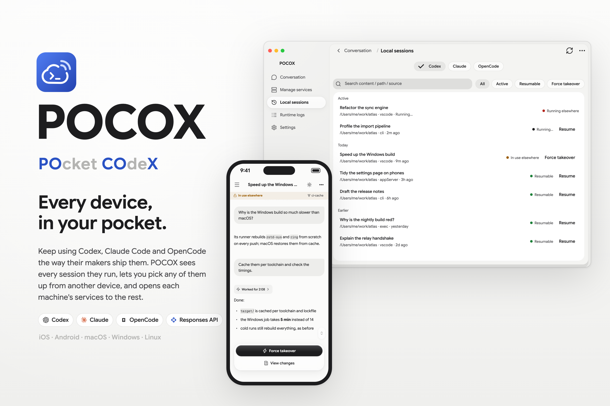

<p align="center">
  
</p>

<h1 align="center">POCOX</h1>

<p align="center">
  <strong>PO</strong>cket&nbsp;<strong>CO</strong>de<strong>X</strong>
</p>

<p align="center">
  <em>把你的每一台设备，都装进口袋。</em>
</p>

<p align="center">
  <a href="#状态"></a>
  <a href="https://www.rust-lang.org"></a>
  <a href="https://flutter.dev"></a>
  <a href="LICENSE"></a>
</p>

<p align="center">
  <a href="README.md">English</a> · <strong>中文</strong>
</p>

> [!WARNING]
> **POCOX 正在积极开发中。** 这里的一切都还不稳定——API、磁盘布局、
> 协议映射，乃至 crate 的边界，都可能在不另行通知的情况下变动。请**不要**将其
> 用于生产环境。在我们打地基的过程中，非常欢迎 PR、设计反馈与缺陷报告。

## 这是什么？

POCOX（取自 **PO**cket **CO**de**X**）把你拥有的每一台设备都装进口袋。
它是媒介，而不是又一个智能体 harness：Codex、Claude Code 和 OpenCode 照原厂的方式
继续用，我们也推荐这样做。POCOX 在每台电脑上陪在它们旁边：看到它们运行的每一个
会话，让你在手机、平板或另一台机器上实时跟进、随时接手，并把这台电脑的服务开放给
你的其它所有设备。

现在已经能做到：

- **这台机器上的每一个会话。** POCOX 列出 Codex、Claude Code 与 OpenCode 在一台电脑
  上运行的会话，包括在它们自己的 App 和 CLI 里开启的，并实时跟进。空闲的 Codex 会话
  可以从任意设备接管；Claude Code 与 OpenCode 的会话在其原生客户端释放后，可在
  POCOX 托管上继续。
- **任意桌面都能托管智能体。** macOS、Windows 与 Linux 可以托管 Codex（通过它的
  [`app-server`](https://github.com/openai/codex) 协议）、原生 OpenCode，以及经
  ACP 接入的 Claude Code 或其它智能体，多个可以同时运行。
- **随处触及。** iOS、Android 与桌面的原生 App 以及 CLI，可以跟进并引导每一轮对话、
  处理审批、浏览历史、查看改动，覆盖你所有设备上的每一个托管。
- **共享的是订阅，不只是会话。** 一台电脑的 Codex 登录可以发布成 OpenAI 兼容的
  Responses API（HTTP 与 WebSocket），没有安装 Codex 的设备和工具也能用同一个模型。
- **管理你的其它电脑。** 在手机或 CLI 上为另一台桌面添加、配置、重启和停止服务。

接下来的方向：一个内建工具，让一台设备上的智能体能够操作你的其它设备，一次对话
就能触及口袋里的一切。目前仍在规划中，尚未提供。

### 工作原理

POCOX 把上游 [`codex app-server`](https://github.com/openai/codex) 协议变成一种
可移植、多设备的体验；同时把宿主机的 Codex 登录态，暴露成一个经由中转（relay）
可达、任意设备都能访问的 Responses API 端点：

- 一个纯 Rust 的 CLI，在装有 Codex 的机器上管理本地的
  `codex app-server` 进程。
- 同一个 CLI 还内置了一个进程内的 **Responses API 代理**，复用宿主机的
  `codex login`（ChatGPT 账号或 `CODEX_ACCESS_TOKEN`），提供 OpenAI 兼容的
  `/v1/responses` HTTP + WebSocket 流量，于是**没有**安装 Codex 的设备也能
  通过中转驱动同一个模型。
- CLI 使用 [`pb-mapper`](https://github.com/acking-you/pb-mapper) 把上述任一
  服务以 `pcx:<device>:<kind>:<name>` 的键注册出去，或订阅远端的服务，并在
  本地物化成 TCP 端点。
- 一个 Flutter 前端（通过 `flutter_rust_bridge` 驱动）直接消费 app-server 的
  JSON-RPC 协议，让每个平台都拥有原生的 Codex 界面，而无需重新实现模型逻辑。
- **两种连接方式。** *自建中转*——让每台设备指向你自己的 `pb-mapper` 中转，
  并共享一把 32 字节密钥（最初的方式）。*托管账号*——在你的服务器上运行一次
  可选的 `pocket-codex-backend`，之后每台设备只需用 **GitHub** 登录
  （`pocket-codex login`，或在 App 里点「Sign in with GitHub」）；后端会以
  按用户隔离的 `pcxu:<user>:…` 键，替每个账号经中转代理其服务，因此中转的主
  密钥永远不会下发给客户端，账号之间也彼此不可见。

改名只换了名字：命令、crate、包名与应用标识仍是 `pocket-codex`，已有安装、脚本和设置照常沿用。

一句话：**每台电脑保留自己的智能体与登录；其它每台设备——POCOX App、远端的
`codex` CLI，或任意 OpenAI 兼容工具——都通过中转访问它们**，要么用共享的中转密钥
（自建），要么用按账号的 GitHub 登录（托管）。

## 状态

| 模块                           | 状态                                    |
| ------------------------------ | -------------------------------------- |
| 工作区 / lints / CI            | 已搭好                                  |
| `pocket-codex` CLI             | `login`、`logout`、`account`、`init`、`serve`、`connect`、`api {serve,connect}`、`services {list,default set}`、顶层 `status`/`stop`、`codex {start,stop,status}`、`pb {register,subscribe,status}`、`remote-hint`、`version` |
| `pb-mapper` 注册/订阅          | Git SDK 来自 `pocket-codex` 分支，由 `Cargo.lock` 固定版本 |
| `codex app-server` 进程管理    | 通过 PID + state.toml 启动/停止/查状态 |
| 外置 Codex 托管                | 所有桌面端均启动已安装的外置 `codex`，只直接依赖上游协议 crate；「内置引擎」暂未实现，按钮置灰。旧内嵌托管配置恢复为外置模式，需安装 Codex 或指定其路径。 |
| 对话历史分页 | 会话内有界缓存、明确的分页终点；跳转时间线后在真实缺口加载中间记录，复用已读页；失败手动重试、前插消息保持阅读位置，时间线分组改为线性计算。对话以中心行为锚点排布，上方补入的分页和缺口不会移动屏幕上的内容，跳转在第一帧即准确落位并预读上一轮；已读完的轮次不再重复请求。Codex Desktop 自动化任务显示为可展开指令的紧凑胶囊，空回复不占行；临时文件已被清理的粘贴附件改由 rollout 内联副本提供 |
| 审阅 | 1100 px 起在对话右侧显示审阅侧栏（更窄时为浮层面板，手机上为可右滑返回的独立页面）：按文件查看本对话的修改，可看全部修改或从修改卡片打开某一步，也可查看工作区相对上游的差异；差异按需渲染、可展开未改动行，并能查看标出改动的完整文件（经会话文件接口读取）；工作区尚未读取时显示原因和重试 |
| relay 不可达 | 连不上 relay 时，桌面端仍会恢复本机托管并直接打开本机服务，服务管理页保留本机的服务；若 relay 域名被解析成代理或 VPN 的虚拟地址（198.18.0.0/15）而没有路由，会直接说明原因 |
| 长对话导航 | 窄屏和触屏上，对话导航收为不遮挡阅读的淡色把手，触碰展开，5 秒无操作或滚动后自动收起；宽屏桌面保留时间线 |
| 历史加载与监看 | 历史先展示，配置与模型列表后台补齐；应用内托管走本机直连；其他进程的会话通过小体积版本通知触发有界刷新，缓存日志状态扫描结果 |
| 传输压缩 | 主机 HTTP 协商 Zstd/Gzip；app-server WebSocket 请求 permessage-deflate，需要外置服务端支持；兼容未压缩连接，SSE 保持流式传输 |
| 直连 Responses API 代理        | 经 pb-mapper 注册的本地 HTTP/WS 代理   |
| 托管账号（GitHub）             | 可选的 `pocket-codex-backend`：GitHub 设备流登录，按用户隔离的 `pcxu:<user>:…` 经中转打洞（主密钥不离开服务器）；`--relay` 仍保留自建模式。见 [`deploy/`](deploy/README.md) |
| Flutter 界面（`apps/flutter`） | 聊天优先主屏（打开即进入最近会话，从连接页淡入；侧栏可选所有会话，主机首次列出前显示骨架屏；自动连接上次使用/本机托管/首个可达的主机，桌面端自动恢复托管）；账号引导（「Sign in with GitHub」）+ 自建引导（中转+密钥、`pcx1:` 导入/导出）；管理页含服务发现、app-server 会话、API 服务订阅、托管；设置；托管的启动、保存、重启和停止在各自按钮上显示进度，结果固定在操作栏上方，启动或停止完成后有提示；统一的低饱和中性色与单一蓝色信号色（无紫色）、分层半透明（液态玻璃）界面、桌面端锚定式弹出面板、固定辅助导航，适配桌面、平板和手机（明/暗）；用户与助手消息均渲染 Markdown；输入框默认更紧凑，支持拖动调节并记住高度，展开编辑时可实时预览 Markdown，图标与介绍图同步配色 |

两种模式下，多设备 CLI 流程均已可用：

- `pocket-codex login` / `logout` / `account` 驱动**托管账号**模式：一次 GitHub
  设备流会话（令牌以 0600 存于 `config.toml`）即可让 `serve` / `connect` / `api`
  / `services` **无需中转地址或密钥**工作——后端以按用户隔离的 `pcxu:<user>:…`
  键替你代理。下文的 `--relay` 示例则是**自建**模式，显式传入 `--relay` 总会
  选择它（兜底逃生通道）。
- `pocket-codex init [--relay <host:port>] [--key <32B>]` 把默认中转地址和共享的
  `MSG_HEADER_KEY` 持久化到 `~/.config/pocket-codex/config.toml`（Unix 下 0600）。
  之后所有命令默认读取该配置（优先级：`--relay` 参数 > 配置 > `$PB_MAPPER_SERVER`）；
  `--relay` 仍可在单次调用中覆盖。
- `pocket-codex serve --relay <host:port>` 启动或复用本地 `codex app-server`，
  以 `pcx:<device>:app:<name>` 注册它，并打印对应的客户端命令。
- `pocket-codex connect --relay <host:port>` 订阅由 `--device` / 本地默认 /
  中转发现选出的远端 app-server，将其暴露到本地，并打印用于连接它的、确切的
  `codex --remote ...` 命令。
- `pocket-codex api serve --relay <host:port>` 把宿主机的 Codex 登录暴露成一个
  本地回环的 Responses API 代理，并注册 `pcx:<device>:api:<name>`。
- `pocket-codex api connect --relay <host:port>` 订阅该 API 代理，并打印一段
  本地 `model_providers` 配置片段供 Codex 使用。
- `pocket-codex services list --relay <host:port>` 发现可用的 `pcx:*` 服务；
  `pocket-codex services default set ...` 在命令未指定时记录本地默认设备。

详细路线图与贡献约定见 [`AGENTS.md`](AGENTS.md)。

## 仓库结构

```
pocket-codex/
├── apps/
│   └── flutter/                 # Flutter 界面（FRB 驱动，FVM 锁定）
├── assets/
│   └── logo/                    # 项目美术资源（海报、logo）
├── crates/
│   ├── pocket-codex-core        # 共享类型、配置、状态、路径
│   ├── pocket-codex-codex       # codex app-server 进程管理器
│   ├── pocket-codex-pb          # pb-mapper 注册/订阅胶水层
│   ├── pocket-codex-cli         # `pocket-codex` 二进制
│   └── pocket-codex-bridge      # 供 flutter_rust_bridge 消费的 cdylib
├── deps/
│   ├── codex/                   # 上游 codex（git 子模块）
│   ├── pb-mapper/               # 上游 pb-mapper（git 子模块）
│   ├── kanal/                   # pb-mapper 间接使用的固定 fork
│   └── uni-stream/              # pb-mapper 间接使用的固定 fork
├── docs/                        # 设计笔记与协议参考
└── skills/                      # 贡献者 / agent 技能包
```

## 快速开始

> 提醒：当前为打地基阶段。CLI 参数、磁盘状态、协议覆盖面与 UI 范围都可能变化。

### 一键安装 CLI

从最新 release 下载 `pocket-codex` 二进制，无需任何工具链。安装脚本会按你的
系统 + CPU 选择对应构建（Linux 用静态 musl、macOS/Windows 用原生），并放到
`PATH` 上。

```bash
# Linux / macOS
curl -fsSL https://raw.githubusercontent.com/acking-you/POCOX/main/scripts/install.sh | sh
```

```powershell
# Windows（PowerShell）
irm https://raw.githubusercontent.com/acking-you/POCOX/main/scripts/install.ps1 | iex
```

可用环境变量覆盖：`POCKET_CODEX_VERSION` 固定某个 tag（如 `v0.1.3`）、
`POCKET_CODEX_BIN_DIR` 指定安装目录、`POCKET_CODEX_NO_MODIFY_PATH=1` 跳过
PATH 处理。想用包管理器或从源码构建？见下文。

### Rust 工作区

```bash
# 连同所有子模块一起 clone（deps/codex、pb-mapper、kanal、uni-stream）。
git clone --recurse-submodules git@github.com:acking-you/POCOX.git
cd POCOX

# 如果你没带 --recurse-submodules：
git submodule update --init --recursive

# 构建整个工作区。
cargo build --workspace

# 查看 CLI 的命令面。
cargo run -p pocket-codex-cli -- --help
```

`$PATH` 中需有可用的 `codex` 程序；POCOX **不**自带模型运行时。CLI 提供：

```text
pocket-codex login                          # 托管账号（GitHub）
pocket-codex logout
pocket-codex account
pocket-codex init                           # 自建（中转 + 密钥）
pocket-codex serve
pocket-codex connect
pocket-codex api      serve | connect
pocket-codex services list | default set
pocket-codex status
pocket-codex stop
pocket-codex codex   start | stop | status
pocket-codex pb      register | subscribe | status
pocket-codex remote-hint
pocket-codex version
```

#### 托管账号（推荐）

用 GitHub 登录一次，之后每条命令都**无需中转地址或共享密钥**即可工作。需要一个
可访问的 `pocket-codex-backend`——自己部署一个；见 [`deploy/`](deploy/README.md)。

> **完整分步指南（CLI + App）：** [`docs/usage.zh-CN.md`](docs/usage.zh-CN.md)
> （English: [`docs/usage.md`](docs/usage.md)）。

```bash
pocket-codex login                 # GitHub 设备流：打开网址、输入验证码
pocket-codex account               # 当前登录身份 + 传输模式

# 宿主机：以你的账号暴露本机的 codex app-server。
pocket-codex serve

# 另一台设备：登录同一个 GitHub 账号，然后列出并驱动服务。
pocket-codex services list
pocket-codex connect               # 选中你的默认 / 唯一 app-server
codex --remote ws://127.0.0.1:28080

# 或把你的 Codex 登录当作 OpenAI 兼容的 Responses API 来访问。
pocket-codex api serve
pocket-codex api connect

pocket-codex logout                # 吊销并清除本地会话
```

在 **App** 中，这一切只是首次启动时的「Sign in with GitHub」；随后同一账号的
app-server 就会出现在主界面，随时可驱动。

#### 自建中转（进阶）

传入 `--relay`（并通过 `init` 设置一把 32 字节共享密钥）即可绕过账号后端，
直接与你自己的 `pb-mapper` 中转通信。显式的 `--relay` **总会强制使用自建模式**，
即便你已登录——它是逃生通道。

```bash
pocket-codex init    --relay relay.example.com:7666   # 持久化中转 + 32B 密钥
pocket-codex serve   --relay relay.example.com:7666   # 宿主端
pocket-codex connect --relay relay.example.com:7666   # 客户端
codex --remote ws://127.0.0.1:28080
pocket-codex api serve   --relay relay.example.com:7666
pocket-codex api connect --device my-host --relay relay.example.com:7666
```

### Flutter 前端

`apps/flutter` 是一个通过 `flutter_rust_bridge` 与 Rust 通信的 Flutter App。
Flutter 在项目层面由 [FVM](https://fvm.app/)（`.fvmrc`）锁定，在语言层面由
`pubspec.yaml` 的 `environment.flutter` 字段锁定；CI 使用
`subosito/flutter-action@v2`，并指向同一固定版本。

```bash
# 一次性：安装 fvm 与固定的 Flutter 版本。
brew tap leoafarias/fvm && brew install fvm
fvm install 3.44.0 --setup

# 日常：
cd apps/flutter
fvm flutter pub get
fvm flutter analyze
fvm flutter test
```

如果你改动了 `crates/pocket-codex-bridge/src/api/` 下的任何内容，请重新生成绑定：

```bash
flutter_rust_bridge_codegen generate
```

## 许可证

POCOX 以 [Apache License 2.0](LICENSE) 授权。

`deps/` 下的上游项目各自保留其许可证；详情请查阅各子模块。
