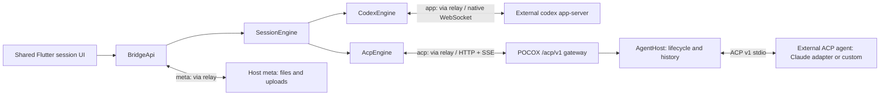

# ACP agents

POCOX can host any agent that speaks the
[Agent Client Protocol](https://agentclientprotocol.com) (ACP) v1 over stdio.
An agent is configured as a program plus an argument list; it is never run
through a shell. Grok Build's own CLI is a built-in preset
(`grok agent --no-leader stdio`, see [Grok Build](grok-build.md)), and so is
Claude, which runs the
[`@agentclientprotocol/claude-agent-acp`](https://www.npmjs.com/package/@agentclientprotocol/claude-agent-acp)
adapter (`claude-agent-acp`, no arguments), found on this computer or
prepared on request (see [Claude](#claude)). Codex
app-server stays the native, first-class engine. OpenCode is not an ACP
preset: it is hosted natively through its own HTTP server (`opencode serve`),
see [Native OpenCode](opencode-native.md). Its former `opencode acp` preset,
model-catalog plugin and custom provider routes are removed; their saved
records are dropped on load and never relaunched as a generic agent.

Decision record: [ADR-0003](adr/0003-generic-acp-agents.md).

## Architecture

The `/acp/v1` gateway is POCOX's controller transport. The host
contacts the spawned agent only through ACP stdio; adding an agent does not
add an agent-specific HTTP client or another `SessionEngine` implementation.

- **The host owns the ACP connection.** ACP is a single-client stdio
  protocol, so exactly one `AgentHost` speaks to the agent. Controllers never
  see ACP frames; they use the versioned `/acp/v1` HTTP + SSE gateway, which
  survives controller reconnects and lets several controllers watch one
  agent.
- **Protocol identity comes from the service key kind** (`app`, `acp`),
  never from the provider's display name. The bridge picks the engine
  with `engine(&key)` and every `app_*` entry point dispatches through the
  `SessionEngine` trait; unsupported operations return a stable
  "unsupported" error instead of being sent to the wrong protocol.
- **Capabilities are negotiated and conservative.** Until the agent has
  initialized, the UI receives `Capabilities::acp_unnegotiated()` (nothing
  optional enabled). Flutter gates every control on capabilities, including
  voice/dictation warm-up, shortcuts, steer, image attach, git diff, compact,
  rename and the model chip.

## Host lifecycle

- `AgentHost` has a single lifecycle lock. `start`, `stop`, `restart` and
  crash recovery all go through it, and each launch starts a new
  **generation**. Events, snapshots, permission handles and turn outcomes are
  tagged with their generation; anything from an older generation is ignored.
- The agent runs in its own process group (`process_group(0)`). Shutdown
  closes stdin, waits briefly for output to drain, then sends `SIGTERM` to
  the group, waits 300 ms and sends `SIGKILL` *before* reaping the child, so
  a recycled PID is never signalled. Grandchildren are killed with the group.
- An exit is detected when the agent's stdout closes **or** when the leader
  process exits, whichever comes first. The leader is polled with
  `waitid(WEXITED | WNOHANG | WNOWAIT)`, which observes the exit without
  reaping it, so a descendant that inherited stdout cannot hide a dead agent
  and the group is still signalled before the PID is released.
- An unexpected exit is handled by one supervisor task per host. Each
  generation's watcher only reports "closed"; the supervisor takes the
  lifecycle lock, tears the generation down (unless a stop or restart already
  did) and relaunches after 2 s. Relaunches, including failed ones, are
  limited to 3 per 10 minutes; a stop or manual restart during the delay
  wins. Every turn running when the agent exits completes once with
  `agentExited`.
- Stopping a host is final and bounded: a launch still in its handshake is
  cut short (it does not wait out the 20 s handshake timeout), the process
  group is cleaned up as above, and pending session-record writes get 2 s.
- **Quitting the app.** One ownership table holds every owned agent until
  its cleanup has finished: an agent enters it before it is launched and
  leaves it only after it was stopped — also while an ordinary "stop
  hosting" is still retiring it. Quit closes the table's barrier (no start
  begins afterwards, a start in flight can no longer enter the host table)
  and stops every agent still in it — starting, hosted or retiring — all at
  once. Stopping an agent joins a stop already in progress, so quit (and a
  second, overlapping quit) returns only once every owned process was
  cleaned up. Agent processes are stopped first; relay keys of the hosts the
  quit drained are withdrawn afterwards within 2 s, so a slow relay never
  delays process cleanup. The desktop tray waits for this (capped at 20 s)
  before destroying the window; closing the window to the tray keeps hosting
  as before. This is exercised against the production table with agents
  that are created but never launched (a quit overlapping a paused
  retirement, two overlapping quits, a start racing the barrier) and by a
  mock-agent test of a stop during the handshake — not by quitting a real
  app.
- **Re-publishing** (`reregister`) waits for the relay without holding the
  host table. Its result is installed only into the same host incarnation,
  in the same transport context, and only if that service's registration was
  not changed meanwhile (a deregistration or another publication); a late
  result is withdrawn instead and never replaces a newer host's registration
  under the same name.
- stderr is drained and discarded (it may contain secrets).
- Tool lookup uses a child-only PATH (`pocket_codex_codex::external_tool_path()`,
  the macOS login-shell PATH); the controller's environment is not changed.
  An explicit program path is never replaced; a bare name is searched on
  PATH and then in the preset's fallback directories.
- **Windows is gated.** `acp_hosting_supported()` returns false and the
  dialog explains why; a correct job-object implementation is future work.

## Protocol surface

The host is an ACP **client**. It sends `initialize` with `protocolVersion: 1`
and advertises no file-system, terminal or other optional client
capabilities, so agent requests for `fs/*` or `terminal/*` are answered with
`-32601` (method not found). Any other protocol version is refused with a
clear "unsupported version" phase.

JSON-RPC envelopes are strict: request ids may be `null`, int64 or strings and
are echoed verbatim; outbound ids are numeric in their own namespace. Frames
are limited to 8 MiB; the writer queue is bounded (32 MiB / 512 frames) and at
most 64 outbound requests may be pending. A frame sent with a deadline counts
as sent only once the writer has written and flushed all of it; one deadline
covers waiting for queue room and that write. A frame whose deadline passes
before it was queued was never sent, and the connection stays open; one whose
deadline passes after it was queued may be half-written, so the connection is
closed at once (nothing more is written) and the generation ends. Budgets:

- a prompt has 30 s from its admission — for the dispatch lane, queue room
  and the complete write. Only a prompt the agent received in full then waits
  without limit for its answer. A prompt that was never queued fails with a
  message and touches nothing else.
- a cancel or a permission answer has 10 s, covering the dispatch lane (for a
  cancel) and every reply it writes, including the `cancelled` answers to the
  turn's withdrawn permission requests. Such an exchange has already consumed
  what it answers, so when it cannot complete the generation is closed rather
  than leaving the agent waiting on a live connection: the supervisor ends
  its turns (`agentExited`) and restarts within the restart budget. The first
  answer to a permission still wins; a retry then reports that the request or
  turn is gone instead of a silent success.

Closing the connection releases every waiter at once, and a closed
connection is not "ready" even before its generation was torn down.

Supported optional features, each used only when negotiated:

| Feature | Negotiation | Use |
| --- | --- | --- |
| `session/load` | `agentCapabilities.loadSession: true` | reopen with replayed history |
| `session/resume` | `sessionCapabilities.resume` is an object | reopen without replay (retained history only) |
| `session/list` | `sessionCapabilities.list` is an object | agent-owned session list, cursor-paged |
| `session/close` | `sessionCapabilities.close` is an object | release idle sessions evicted from the host |
| config options | `configOptions` in session responses | select-type options as chips (`session/set_config_option`) |
| modes | `modes` in session responses | mode chip (`session/set_mode`), only while no `mode` config option exists |
| images | `promptCapabilities.image: true` | image attachments |

Without `session/list` the host lists sessions it created itself
(`sessionList: "host"`); without load or resume those sessions cannot be
reopened after an agent restart.

`auth_required` (`-32000`) is surfaced as an `authRequired` host state with
the agent's auth methods, whether it comes from `session/new`, a reopen or
`session/prompt`; a prompt rejected this way ends its turn once as *failed*
with a sign-in message. Hosts do not run an agent's sign-in. Sign in with
the agent's own CLI on the host and restart hosting; for Grok, the hosting
editor's Official account signs in in place through a private `grok`
([Grok Build](grok-build.md#sign-in)).

Queued frames retain their delivery deadline in a bounded table owned by the
peer, with one watchdog for the connection. Automatic permission replies have
the same control budget even when the writer is blocked by an earlier prompt.
Dropping a caller after consuming a cancel or permission closes that peer;
it cannot leave a consumed request unresolved on a live generation.

### Turns and permissions

- An agent that advertises top-level `_meta.steering.supported: true` in
  its `initialize` answer (the Claude adapter 0.89.1 does) accepts
  supplements: `POST /acp/v1/sessions/steer {sessionId, turnId?, text,
  images}` sends `_session/steering {sessionId, prompt, _meta: {steering:
  {idleBehavior: "promptRequired"}}}` for exactly the running turn (and
  `turnId` only, when given). It runs in the dispatch lane under the control
  budget, after the same size, image-capability and identity checks as a
  prompt, and re-checks under the lane that the turn is still the one meant
  and was dispatched (`409 turn_changed` otherwise; nothing was sent). The
  answer is `{"outcome": "injected", "turnId": …}` (the host folds the input
  into that turn as a user message, `<turn>:s<n>`, and streams a
  `supplement` event so every controller folds the same item) or
  `{"outcome": "promptRequired"}` (no turn ran; nothing was consumed). Any
  other answer — an `injected` without the expected turn id, one arriving
  after the bridge's connection or host view changed, a lost connection or
  no answer in time — leaves the outcome unknown: it is reported and never
  retried or turned into a prompt. The UI offers **Supplement** only for
  such agents; for others it shows **Queue only**, with a clickable explanation
  of the connected agent's missing capability. Messages queue for the next
  turn. Before changing anything the screen
  checks that the answer still owns its input: the same service, host connection and
  generation, conversation view, draft and request (leaving the
  conversation drops the request, so returning to the same session does
  not revive it). The host connection is the screen's link epoch, which
  moves when the event stream closes or the host is lost, replaced or
  reports a new generation — not when a reload re-reads the agent's
  options. An answer that no longer owns its input leaves the draft, its
  attachments, the queue and any newer request's state (mode, notice,
  Retry, composer lock) untouched and sends nothing. Only when the same
  conversation shows the same draft and nothing newer owns it does a
  notice appear; after an `injected` one a display-only refresh shows what
  arrived, keeping the notice, settling no admission and draining nothing.
  An owned `injected` answer takes exactly the sent snapshot out
  of the draft (edits and attachments added since stay); an owned
  `promptRequired` answer turns the exactly unchanged input (same text,
  same attachments) into the head of the queue, sent once that turn's end
  is confirmed, while changed input stays in the composer. If the history
  was reloaded since the request, the reloaded host history shows the input
  rather than a local copy. Cancelling and re-prompting is not steering and
  is never used for it.
- The queue sends a message only once the host admits it: it stays first
  in line, with its text and attachments, while it is being sent and after
  any failure, and the queue pauses. Only a failure before `turn/start` was
  sent or one of the host's own pre-admission refusals (not running, host
  changed, unknown session, busy, loading, capacity, limit, invalid
  request) is definite: Retry sends it again. Any other failure is
  uncertain: the entry is marked and nothing resolves it by itself. The
  prompt carries no request identity, and history is bounded and shared
  with other writers, so neither a matching nor a missing history entry
  proves what happened; it is sent again only by the user's explicit
  Retry (after a notice that it may already have arrived), and it can be
  edited or removed; a reload, reconnect or reopening that clears its
  notice offers the Retry again. Delivery is therefore at most once
  without user action, not exactly once. A send belongs to the service and
  connection it began on through every step (model list, session start,
  dispatch, answer): nothing is dispatched once the connection moved, and
  an answer arriving after that adopts nothing — an ordinary message goes
  back to its draft with the reason (not sent, or unknown whether it
  arrived), a queued one stays queued as refused or uncertain. A session
  started for a draft is still adopted by it after the user moved on.
  After an admitted prompt the queue waits for its `turn_started`; if none
  arrives within 20 s the conversation is reloaded, and only an
  authoritative history — read after the admission, for the same
  conversation, from the current connection, not overtaken by live turn
  events — settles the admission (running: the turn is shown; idle: it
  ended unseen and the queue continues). A failed, cached, display-only or
  obsolete reload, or one answered after its connection was lost or
  replaced, settles nothing; the reconciliation is retried and a
  reconnect's own reload answers. An older turn's end arriving after a
  newer start leaves the newer turn running.
- When a turn ends the host re-announces the session state, and the bridge
  also clears a cached `runningTurnId` that still names the ended turn, so
  controls gated on a running turn (agent options) are
  usable again in the same session.
- `session/prompt` is acknowledged immediately with a host-assigned turn id;
  the agent's final response is awaited in the background and ends the turn
  exactly once. `end_turn` maps to *completed*, `cancelled` to
  *interrupted*; refusals, token limits, unknown stop reasons and errors map
  to *failed* with a message.
- The bridge sends every mutation (`sessions/new`, `open`, `prompt`,
  `cancel`, `config`, `mode`) with the host incarnation (`hostId`) and
  generation its view shows. A replacement host behind the same relay key
  restarts its generations and may hand out the same session ids, so a
  request naming another incarnation or generation is refused with
  `409 stale_host` (a cancel answers `{"cancelled": false}`) before anything
  reaches the agent. The fields are optional on the wire and a request
  without them is not checked: this keeps a stale *bridge* view from
  mutating a newer host; it is not an authentication or authorization
  mechanism for arbitrary `/acp/v1` callers. The bridge applies an answer
  only to the connection that asked, and only while it still shows that host
  and generation.
- `session/cancel` names only a session, so every prompt dispatch and every
  cancel of a host is written under one dispatch lane, and each checks under
  it which turn is running. A cancel for turn A therefore never reaches a
  turn B admitted after A ended: either it is queued before B's prompt (the
  agent sees it while nothing runs) or it sees that A is gone and is not
  sent. Cancel names the turn it means; a stale cancel for an older turn
  returns `{"cancelled": false}` and touches nothing. A cancel that wins the
  race before the prompt is written ends the turn as *interrupted* without
  ever sending it. Only that turn's pending permission requests are answered
  with `cancelled`. Updates arriving after the cancel are still folded until
  the prompt response arrives.
- Permission requests get opaque host handles. The controller answers with
  the exact agent `optionId`; the first answer wins and later answers get
  `alreadyResolved`. Options are shown in the agent's order, and
  `allow_always` / `reject_always` ask for confirmation.

### History and limits

The host folds `session/update` notifications into a bounded transcript
(8 MiB, 4000 items, 500 turns). Every retained byte counts against the
budget: text, ids, titles, tool `rawInput`, locations and images, plus a
fixed per-item overhead. Per item, text is clipped at 512 KiB (the text then
ends with a visible marker and later text for that item is dropped),
`rawInput` above 64 KiB is replaced by a size note, and at most 8 images /
2 MiB are kept. Anything else dropped — images, diffs, tool input, locations,
content entries, plan steps — is named on the item, and the UI shows a
notice next to it ("Not kept because it was too large: images"). Dropping an
image never stops the text that follows it. Tool and plan updates replace
the collections they carry; the notice is state of its item, so each such
update re-states it, and when the replacement fits the notice is re-sent
empty and the session screen removes it — live, without a reconnect or a
history read. Notices and gaps have ids of their own (`#omitted:<item>`,
`#gap:<turn>`, …) that no agent-derived id can take, so a tool the agent
names `x:omitted` never collides with the notice of tool `x`.

Tool call and message ids are the agent's and are compared exactly. An id
longer than 256 bytes is kept as a 192-byte prefix plus its SHA-256, a form no
verbatim id can take, so distinct ids never merge and the chunks of one long
message id stay one message.

At most 32 sessions hold a transcript at a time. A running or reopening
session's transcript is never evicted for another; when all 32 belong to
running or reopening sessions, a new session, a reopen or a prompt of a
session without a transcript is refused (`429 capacity`, "too many sessions
are busy") instead of exceeding the pool. An idle transcript is evicted
least-recently-used, and one recreated later is marked incomplete.

The bounds hold inside a single turn: whole older turns are evicted first,
then older items of the oversized turn (never its prompt or newest item).
Item ids are per-turn ordinals that are never reused, so a later item can
never take an evicted item's id. Whatever was dropped is reported: history
reads start with a `historyGap` item when whole turns were dropped, and a
turn with evicted items carries an in-turn gap. The UI shows a notice instead
of pretending the history is complete. History is **retained only**: with
`session/resume`, or after the host evicts a transcript, earlier turns are not
recovered, and an evicted transcript that is recreated starts out marked
incomplete.

The event log keeps 4096 events / 16 MiB. A controller resumes the SSE stream
after its watermark; if that position was dropped, the generation changed or
a different host incarnation (`hostId`) answers, the gateway sends `reset`.
The bridge then reads the snapshot and recovers in a fixed order: turns that
ended meanwhile are completed first (with their final text and recorded
outcome), then turns it had not seen begin are announced, then each running
turn's folded history — which carries the log position it reflects — is
installed with the host's item ids, and only later events are applied. Every
item event names its turn, and the session screen ignores a terminal event
for a turn other than the one it shows running, so a late completion never
ends or regroups a newer turn.

A turn whose prompt carried images is begun in the controller's fold only
from the host's own fold: `turn_started` carries just the image count (image
data is never streamed in events), and a prompt folded without its images
would weigh less than the host's and evict — and number — later items
differently. The bridge reads that turn's fold right after announcing it.

Every history read — the newest window, an older page, one turn, a recovery
read — is accepted only from the host incarnation and generation the view
shows, and only while that connection is still the current one; otherwise it
is refused ("try again") without showing items or moving the paging cursor,
also when the answer is empty. This holds when a replacement host behind the
same endpoint reuses the generation number and session id before the event
stream has reported the replacement.

When a running turn's history cannot be read (the host is busy or the read
fails), the turn stays explicitly *unsynchronized*: its updates are not
folded (that would start it without its prefix and with wrong ids), and the
read is retried with backoff (250 ms up to 5 s) on the next event of that
turn or on a timer, without needing a reconnect. If the turn ends first, its
end says that its items could not be read rather than showing an empty reply.
Within these rules a controller that joins mid-turn or overflows the log
converges on the host's text and ids; this is tested against the host's own
fold and a scripted gateway, not against a real agent.

At most 16 event streams are open per host; a stream whose controller went
away releases its slot immediately, even while idle. A controller is healthy
only while its stream is open: a refused stream (the limit is reached) or a
failed one leaves it unhealthy with conservative capabilities even though a
snapshot is still readable, until a stream actually opens.

Session working directories are host-admitted:

- A new session's cwd must be an existing absolute directory and is
  canonicalized; the association is stored once and never changed by later
  reports.
- When an existing session is reopened, the stored cwd always wins. A cwd
  reported by `session/list` is accepted only for sessions with no stored
  entry, and is validated and canonicalized the same way.
- A reopen (`session/load` or `session/resume`) is provisional until the
  agent answers successfully. While it is pending the session grants no
  *new* authority: no prompts, no option changes, and a directory that is
  only listed by the agent is not readable. A failed reopen revokes the
  admission and discards any partial replay.
- Authority this agent source *already persisted* is kept: a session
  recorded earlier keeps its stored directory for conversation file links,
  also while a new reopen of it is pending or after one failed.

The per-host store lives at `<state>/acp/<hex(name)>/<source>.json` (format
version 2, mode 0600, at most 500 entries). `<source>` is a keyed SHA-256 of
the resolved program path and the exact argument list; the key is a random
per-device file `<state>/acp/source-key` (mode 0600), so the file name reveals
nothing about the arguments and the store never contains them. Reusing a host
name with a different program or arguments therefore starts with an empty
store; no session or directory carries over. The host never writes on its
event path: admissions and titles are queued under the state lock (so their
order matches the state's) and coalesced to one pending change per session —
a burst of titles is one write of the newest — with at most 500 pending
sessions. A title reported while a reopen is pending is persisted with the
confirmed admission — including an explicit clear (`title: null`), which
removes a stored title; a reopen with no title signal leaves the stored
title as it is. One worker applies each batch through a unique temporary
file and an atomic rename; an unreadable store is moved aside
(`*.corrupt-<time>`) rather than treated as empty-and-valid. Version 1
stores (`sessions.json`) are not read.

## Setting up an agent

1. Open **Host this device** (manage page title bar — whatever device is
   selected, and while discovery is loading or failing — the home screen, or
   **Manage hosts…** in the sidebar host switcher). Hosting is offered on
   desktops in self-host and account mode alike; phones and tablets only
   connect. Codex hosting runs on Windows, macOS and Linux; ACP agent hosting
   is Unix-only (on Windows, choosing an ACP tile explains that it is
   unavailable).
2. Click the agent's tile. **Built-in presets** hold **Codex**, native
   **OpenCode** (see [Native OpenCode](opencode-native.md)) and the ACP
   presets **Claude** and **Grok** ([Grok Build](grok-build.md)): launch templates with default settings, run from the
   agent's own installation. **Saved
   configurations** hold the launch settings you saved, then **Custom**,
   which creates a new one (with nothing saved yet, that section is
   **Custom configuration**). Each tile shows the agent's mark; a saved
   configuration that shares a preset's name is told apart by its section
   and its "Saved" subtitle.
3. The form suggests an instance name no running host uses (`default`,
   `default-2`, …; presets start from their id). Program and arguments of a
   preset or saved agent sit under **Advanced**; a custom agent shows them
   open: enter the program (name or full path) and one argument per row.
4. The dialog locates the program before starting. Start hosting.

A device hosts several instances side by side — Codex hosts, one native
OpenCode host, Claude and custom agents — each under its own name. A second
Codex host defaults to an automatic port (`0`); its port is under
**Advanced**. A name or port another
host owns is refused with guidance rather than taken over.

Started hosts are remembered by name for "restore hosting on launch": up to
16 Codex records (`autoHostCodex`) and 16 ACP records (`autoHostAcp`), plus
up to 50 saved custom agents. Stopping a host forgets only its own record.
When a list is full, a new host still starts but is not remembered, and a
notice says so; no other host's record is dropped. Stopping another host does
not remember the refused one afterwards: stop one, then start it again. A
custom agent refused by a full saved list is likewise reported and not shown
as saved. Changes made while the preferences file is still loading are
replayed onto it in order, so stopping one host or starting another during
startup never loses or resurrects a record, and whether a record was kept is
decided on the loaded file, never on the empty interim state. The
first Codex record is also written to the legacy single `autoHost` key, so an
older build still restores one host.

Agent marks are bundled vector glyphs (OpenAI and Claude from Simple Icons 15,
CC0-1.0; OpenCode from its v1.18.35 favicon, MIT — full notices in
`apps/flutter/lib/src/widgets/agent_icon.NOTICE.txt`). They are chosen by the
host's engine (`codex`, `opencode`) or reported ACP profile id (`claude`),
never by the instance name the user typed. Grok shows a plain "G" monogram
(profile `grok`; no openly licensed mark exists). Any other agent shows a letter tile. A remote host's mark is
known once connected (its profile is part of the host info).

### Claude

The Claude preset (`claude-agent-acp`, profile `claude`) runs the ACP
adapter, which needs Node.js 22 or newer and drives the native `claude` CLI
itself; the native CLI never speaks ACP on stdio and is never launched as
the agent. For the preset's own bare program the host looks, first match
wins, for:

1. **The adapter**: the child `PATH`, `~/.npm-global/bin`, `~/.local/bin`,
   `~/.bun/bin`, `~/.volta/bin`, pnpm and Yarn global directories,
   `/opt/homebrew/bin`, `/usr/local/bin`, Node.js version managers (nvm, fnm,
   asdf, mise, Volta; newest version first), then this app's prepared copy,
   used only with its current completion marker and a consistent
   installation (the same check a preparation passes).
2. **Node.js >= 22**: the one beside the adapter, the child `PATH`,
   Homebrew and `/usr/local` (including `node@22`), then version managers
   newest first, each confirmed with `node --version` (directories named for
   an older version are not run). The probe runs in its own process group
   with a bound on its whole lifetime and on its output; a silent leader or
   a descendant holding the output is killed with the group, and malformed
   or oversized output is not a version. A preparation needs npm beside a
   compatible Node.js; when the first compatible one has none, a later one
   with npm runs it. An adapter installed as the
   package's script runs as `node <script> <argv…>`, so the user's default
   Node.js is not changed; a wrapper or shim runs as found.
3. **The native CLI**: an inherited `CLAUDE_CODE_EXECUTABLE` is kept;
   otherwise `claude` on the child `PATH`, in `~/.local/bin`,
   `~/.claude/local`, `/opt/homebrew/bin` or `/usr/local/bin` is passed in
   the child's `CLAUDE_CODE_EXECUTABLE` only. Without one the adapter uses
   the CLI bundled with its SDK.

An explicit program path, changed arguments under another profile, or any
other program is launched exactly as configured. The session record stays
keyed by the adapter executable and the spec's arguments. Authentication
stays Claude's own (its login or environment, inherited by the child); the
hosting dialog shows only paths and versions.

When the adapter is missing and a Node.js 22+ with its npm was found, the
editor offers **Prepare ACP environment** to install
`@agentclientprotocol/claude-agent-acp@0.89.1` before hosting. It shows download bytes and a measured recent transfer rate, with separate
download/install and verification stages (no invented percentage or total),
allows cancellation or retry, and refreshes readiness while preserving the
form. Preparation alone never saves configuration, starts or restarts a host,
or enables automatic hosting; the same control is available in a running
host's editor. **Start** also retains its announced preparation fallback.
Picking the preset or restoring a host never downloads anything. Preparation
runs that Node.js's npm (`install --prefix <stage> --ignore-scripts`, npm's
own cache under the same directory, the Node.js directory first on the
child's `PATH` only) into a new staging directory under
`<state>/acp-runtime/claude-agent-acp`, shows its progress, and can be
cancelled (which stops only that npm process group and removes the stage).
The result is accepted only when the lockfile records the package at the
pinned version with the expected registry integrity, the installed manifest
agrees and the script exists (a consistency check of what npm recorded, not
a re-hash of the files); it is then marked and renamed into place in one
step. The same check guards reuse of a prepared copy. Cancellation is
honoured before npm starts and again before publishing; a cancel after the
rename is too late and the copy stays prepared. Detection and preparation
run off the setup state's lock, so reading the state or cancelling never
waits for a probe. Start prepares only from an open dialog, and only after
it announced the download for the same agent and the environment found
now; a changed environment is announced again first.
Overlapping preparation requests join one preparation; an incomplete directory in the way
is moved aside, not deleted. A failure is shown; either Prepare ACP environment or Start can
retry. Nothing global, no npm or shell configuration and no default Node.js
is changed. Install scripts are skipped; the adapter's published package is
assumed not to need them.

On one Mac the Claude preset was run live with POCOX: with no
adapter present, its first Start prepared exactly
`@agentclientprotocol/claude-agent-acp@0.89.1` into a confined app cache
beside a detected Node.js 22.11.0 and the native CLI, with no global
install. The real adapter answered prompts, negotiated steering, took a
supplement as `injected` into the running turn, and, when idle, answered
`promptRequired` with exactly one queued user turn. The full Rust and Flutter
suites, including the tests for the 2026-10-12 corrections, pass. Other
platforms and an interactive OAuth sign-in were not exercised.

The argv is stored in plain text in the App's preferences and is visible in
the dialog (the host's session store keeps only the keyed digest). **Do not
put secrets in arguments**; configure credentials with the agent's own
configuration. Each saved custom agent gets a random profile id, so two
agents whose names slug the same way (for example non-Latin names) are kept
separately.

Saved agents and "restore hosting on launch" are additive preference keys
(`acpAgents`, `autoHostAcp`); older versions ignore them.

Attachments follow the agent's capabilities everywhere they can enter the
composer — the image menu, the file picker, drag-and-drop and clipboard
paste: an agent that did not advertise image prompts gets no image (a short
notice says so; documents and text paste still work). Read-only views
(Guardian reviewers, a session another writer holds, child sessions) take no
attachment. A result that arrives later — a picker, a clipboard read, a file
read before its upload — is admitted again when it arrives, against the
draft chosen when the user acted: nothing enters (or is uploaded) once that
view turned read-only, its agent host was lost or replaced, or image support
went away. A document still being read when its conversation is left stays
in its original draft as a retryable attachment; no upload starts from a
view whose ownership subscriptions have ended. Uploads already dispatched
can finish in their original draft. Before uploading, the bridge checks the
account/relay context captured before the file read, and refuses a changed
context without transmitting the bytes.

### Model, effort and mode

Session config options are shown in category order — `model`, then
`thought_level` (effort), then `mode`, then the rest — each as a chip whose
tooltip and accessible name carry the option name and the full value label.
Values with up to eight entries open a menu; longer catalogs open a
searchable list grouped by the agent's value groups, matching label, group
and raw id. Value ids are opaque and sent back verbatim: model values may be
`provider/model`, and a model id may itself contain `/`
(`openrouter/openai/gpt-5`). A chip shows progress while its change is in
flight; a refused change leaves the agent's previous value and reports the
error.

The agent's answer to every change is its complete option set and replaces
the previous one. When an agent ties effort to models, choosing a model
recomputes it: the `effort` option appears when the model has variants, falls back to
`default` when the previous effort is not one of them, and disappears for a
model without variants. A `mode` config option takes precedence over legacy
`modes`, as ACP asks of clients that read config options.

The catalog is per session (an agent may resolve it for the session's
directory), so it exists only once a session does. A new conversation
prepares its agent session automatically when it has a project. Model,
effort and mode share one control group with opening, ready and retry states;
there is no extra setup click. The first send waits for the same preparation
attempt and keeps the draft and attachments. Late answers cannot adopt a
session into another host, project or draft. An unused prepared session is
hidden from this controller's sidebar until the first send; it may still
appear in another controller's inventory. With no projects, the folder
picker offers a typed host path and, on the host computer, native directory
selection. Choosing a directory never sends a message. Native Codex keeps
its own catalog and creates its thread on first send. Native OpenCode keeps
the draft's choices locally and applies them to the session its first send
creates ([Native OpenCode](opencode-native.md#draft-options)).

Existing Claude histories can instead open through the independent
[provider-native history reader](native-agent-history.md), without restoring
them through ACP. Browsing remains read-only. Opening a session on a connected
host resolves its access automatically: it opens for writing when the host
admits it, and is followed read-only, with the reason, while another client
holds it ([session access](native-agent-history.md#session-access)).

### Per-host model service

Claude hosts offer **Claude environment** groups for connection credentials,
exact model and alias IDs, reasoning/output and network settings. Every field
inherits by default; enabling one records an override for this host. macOS
GUI launches read missing allowlisted variables through the login shell,
including `~/.zshenv`; explicit app environment values win. An already supplied
connection group is kept together instead of mixing its endpoint with another
shell account. Nothing is written to shell files or the app's environment.

Saved credentials are masked and never read back; leave a stored secret field
blank to keep it, or turn its override off to inherit again. Overrides share
the host configuration's private-file transaction, revision checks and rollback.
Saving does not interrupt the host; explicit restart applies the revision.
Custom provider fields take priority for URL/key/default model; environment
connection overrides apply with inherited configuration. The inactive-overrides
control keeps those fields reachable for repair without clearing the draft.
Saving a switch to another runtime removes Claude-specific overrides. No Claude login flow
is added. Managed Claude policies and model support remain upstream decisions.

Keep provider model IDs exact. For a gateway whose Opus model differs from
Claude's built-in alias, set `ANTHROPIC_DEFAULT_OPUS_MODEL` to that gateway's ID;
POCOX never guesses or rewrites it. See the upstream
[environment reference](https://code.claude.com/docs/en/env-vars) and
[model configuration](https://code.claude.com/docs/en/model-config).

Validation on 2026-10-13 used a fresh isolated macOS home and the actual
Flutter bridge library. A cold preparation received 111,701,171 package bytes,
reported positive measured rates while downloading, and cleared the rate on
completion. The host process had no provider URL/token; only its login-shell
environment supplied them. An exact Opus alias configured through the host API
survived save/apply and restart, a real prompt returned the expected text, and
opening that fixture's existing conversation restored the reply without
sending another turn. No Claude login was performed. The original manual app
and its conversations were left running; its reported error was not retested
in place. A gateway may still need its own exact model alias, and no alias is
hardcoded by POCOX.

The updated UI passed 32 real-font combinations (320/390/800/1440, English and
Chinese, light and dark, 1×/2× text), keyboard/semantics checks, and the full
Flutter suite (1,404 passed, 5 existing skips). The first-party Rust checks and
macOS profile build also passed. These screenshots are Flutter-renderer
previews; they do not claim a new native interaction check of the running app.

A host may save a custom provider for the Claude preset (Anthropic Messages,
with a required key, as `ANTHROPIC_*` environment and session settings). Other
ACP agents launch with their own configuration only. The record's authority
generation (never the key) joins the session source key, so a changed
provider inherits no session history. A running agent's program and
arguments, including a generic agent without a preset, can be saved from
what it runs; they and the provider take effect only on an explicit,
confirmed restart, whose rollback relaunches the exact launch the agent ran.
See [hosting configuration](hosting-configuration.md), including its evidence
gaps.

## Accounts and older backends

ACP hosting works in self-host mode with a relay key and in hosted-account
mode with the normal POCOX account login. Agent authentication is
separate and uses the agent’s own CLI. Service names are claimed in one table
shared by Codex and ACP on a device, so two providers can never start under
the same name. A
name stays claimed until its host has fully stopped, including relay and
listener cleanup and "stop all"; the same provider can still restart under
its own name.

On the controller, ACP connections, their relay subscriptions and the
relay meta tunnels (host files, uploads, file links) belong to the transport
context they were resolved in (signed-in account and relay, or self-host
relay and key). One revision orders all of it: a resolution captures it
before reading the configuration and becomes current only if it is
unchanged when it is observed (checked under the same lock a configuration
change takes), so a resolution that read the previous configuration never
replaces the newer context, restarts its credential refresher or drops its
state — it resolves again. An account transport takes relay, credential and
namespace from one credential answer. Service keys namespaced to another
account are refused, also when resolving this device's own loopback ACP
services. Changing account, relay or key, or signing out, drops every ACP
connection and relay meta tunnel of the old context; a credential refresh
for the same account keeps them. A connection or tunnel being established
across the change is registered only while its revision is still current,
checked under the registry's lock; two callers creating the same tunnel at
once end with one registered tunnel and the other stopped. These rules are
tested for the ACP engine and the meta tunnels; the native Codex loopback
meta lookup is unchanged and keyed by service key as before.

Connection health comes from the event stream, not from a task being alive:
after the host stops answering, the bridge emits `acp/host/state`
`{"connected": false}`, withdraws pending permission cards and reports
unnegotiated capabilities, and the session screen runs its normal bounded
reconnect. A connect succeeds only once the event stream is open (a host at
its stream limit is reported as such). A replaced local host (new port or new
incarnation) ends the old stream rather than retrying the old port forever; a
replaced host incarnation also makes the session screen re-read the
transcript.

The bridge asks the backend for `include_acp=true`; an older backend ignores
the parameter and does not list `acp:` services, so remote discovery of ACP
hosts needs an updated backend, while relay-key mode and the local host work
regardless.

## Verification status

The tests use an in-repo mock agent
(`crates/pocket-codex-host-svc/examples/mock_acp_agent.rs`) with three
capability profiles (minimal; load + list + resume + options; list + resume
without load). The extra profiles
only show that the protocol layer is not tied to one agent; they are not
real agents. It is a Cargo example: `cargo test` (and
`cargo test --workspace`) builds it next to the test binaries, and it is
never installed or shipped. The integration tests in
`crates/pocket-codex-host-svc/tests/acp_host/` run it as a real
subprocess and fail with an explicit message, rather than skipping, when it
was not built (for example `cargo test --test acp_host` alone; add
`--examples`); so do the host unit tests that need it (the cancel/turn race
and the delivery budgets against an agent that stops reading, in
`src/acp/host/tests.rs`). Bridge recovery, refused-stream health and replacement
history are tested with a scripted gateway over real loopback HTTP; the
resolution race with a real resolver against fixture configurations; tunnel
ownership with real loopback listeners; quit and publication ownership with
the production tables and agents that are never launched. Flutter tests are
in `apps/flutter/test/acp_*_test.dart`, `composer_recovery_test.dart` and
`attachment_gate_test.dart`. The mock agent's `--steering MODE` flag
advertises steering (`on`) or answers it wrongly (`odd`) or never
(`silent`); the Claude adapter's detection and preparation are tested
against fixture directories and a stand-in `node`/npm script.

The automated tests of owned hosting and its process handling (process
groups, `waitid` exit detection) have been run on macOS; other Unix desktops
share the code, but their lifecycle and runtime paths have not all been
exercised. Windows hosting stays disabled.

### Earlier ACP acceptance (historical, former OpenCode preset)

On 2026-10-10 the ACP engine was exercised end to end through the since-removed
OpenCode ACP preset, hosted by the production POCOX host and driven by
a separate bridge controller process through a public pb-mapper relay (two
processes on one Mac, not a second physical device). It covered
initialization and capability negotiation, session inventory and
configuration, streamed output, reconnect with unchanged item IDs, exact
permission rejection/approval, cancellation, agent restart with history
replay, and relay-key withdrawal on stop. That preset is no longer offered and
the run has not been repeated with another agent: it is historical evidence
for the generic ACP engine paths only, not for the Claude preset and not for
native OpenCode hosting.

### Same-process hosting coexistence

The opt-in test `engine::hosting_live_tests::hosting_live_coexistence` hosts
two native Codex app-servers and two ACP hosts in one process
through the production start, stop, restart and session-engine paths. It
refuses to run unless `HOME`, `CODEX_HOME` and any `XDG_*` directory lie
inside its fixture. It checks:

- native hosts with the real `initialize` handshake only (no model prompt and
  no Codex login copied);
- disposable ACP sessions of the fixture's agent (`agent.json`), advertising
  exactly its expected models (`expected-models.json`), with isolated model
  selections (no prompt);
- that stopping, restarting or recreating any one host by name leaves every
  other host's process or incarnation, generation, listener, selections,
  sessions and relay keys unchanged;
- that each stop withdraws only that host's keys.

The agent is whatever the fixture names; the test assumes no particular
one. It runs on one Mac only, and no run with the generic fixture is recorded
here. It says nothing about other operating systems, second physical devices,
the Claude adapter or hosted-account transport.

### Repeating the remote-control test

To repeat the opt-in test in `engine/acp/live_tests.rs`, explicitly prepare a
private directory with `fixture/`, an `agent.json` containing the configured
`AgentSpec`, and `host-support/config.toml` plus
`controller-support/config.toml` containing the intended relay configuration.
Use an agent configuration with isolated storage, a working model provider,
write permissions set to ask, and external-directory access disabled. Keep
credentials out of the repository, arguments and logs. Use a fresh fixture
and a unique `PCX_ACP_LIVE_NAME`; the test refuses to overwrite its two fixture
files. Hosting creates only that name's ACP session record in the ordinary
host state directory; it never opens another host's records.

Build the bridge test executable once with
`cargo test -p pocket_codex_bridge --lib --locked --no-run`. Run that same
executable in two independent processes, both with `PCX_ACP_LIVE_ROOT` and
`PCX_ACP_LIVE_NAME`, and with the exact test filter
`engine::acp::live_tests::acp_live_remote_control --ignored --exact --nocapture`.
Start `PCX_ACP_LIVE_ROLE=host` first, wait for `ready.json`, then start
`PCX_ACP_LIVE_ROLE=controller`. The controller requests shutdown on completion
or panic; the host also has a ten-minute deadline. Preserve `acceptance.json`,
`cleanup.json` and private process exit logs as evidence. Normal CI does not
contact a paid model or real relay.
