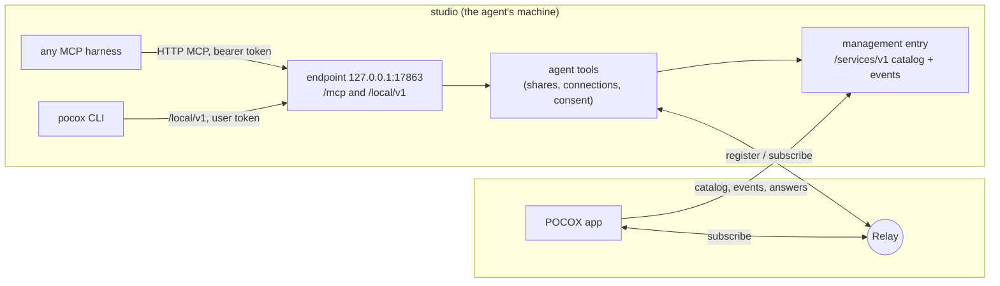

# Agent tools: devices and services

Status: implemented (2026-10-18). Verified on one Mac and an iOS simulator;
see [Verification](#verification) for what was and was not exercised.

POCOX lets a person reach every device's agents and services. Agent tools
give the same reach to the agents themselves, through one MCP server, `pocox`,
that any MCP-capable harness can use:

- every harness POCOX hosts gets it by default: Codex, Claude through ACP,
  native OpenCode, and any other ACP agent that accepts HTTP MCP servers;
- any other harness (Claude Code or Codex run in a terminal, OpenCode run by
  the user, IDE agents, anything that speaks MCP) gets it from a copied
  configuration entry with a token issued to it.

With it an agent sees the user's devices and the services on them, shares a
local port with the user's other devices, and connects to a service that runs
elsewhere. POCOX finishes the work on the devices the agent cannot touch: one
tool call ends in a link that opens on the phone in the user's hand.

The same catalog drives the galaxy, a page of its own where every visible
service can be seen and managed.

## User journeys

### See the page the agent just built

The user drives an agent on `studio` (a Mac) from a phone and asks to see the
web page it built. Nothing below depends on which harness the agent runs in.

```mermaid
sequenceDiagram
    participant U as User (phone app)
    participant A as Agent on studio
    participant H as POCOX on studio
    participant R as Relay
    A->>A: start the dev server (localhost:5173)
    A->>H: connect action=share ports=[5173]
    H->>H: 5173 answers on 127.0.0.1 or ::1
    H-->>U: consent request (first share of this conversation)
    U->>H: Allow (the call is still waiting)
    H->>R: register pcx:studio:port:5173
    H-->>A: shared; pocox://open link
    H-->>U: catalog event: new share, by this agent
    U->>R: subscribe pcx:studio:port:5173 → phone localhost:5173
    U->>U: Open → in-app browser
```

- The agent asks for the outcome ("share 5173"), never registers anything.
- The phone hears about the share from studio's catalog event stream, whatever
  harness made it, connects it right away (at the same port number when free,
  so a page that calls `localhost:8000` for its API works if both ports were
  shared), and shows it: as a notice above any page, under **Shared with you**,
  and as a card at the agent's tool call where POCOX shows the conversation.
  Desktops show it the same way but connect only when it is opened, so a
  share never takes a port the user's own servers need; a connection made
  for a share ends when the share does.
- Phones open the page in an in-app browser, which keeps the tunnel alive;
  desktops use the system browser. The in-app browser loads only pages on
  the phone's loopback (where shares are connected) and stays on the page's
  origin; other web links open in the system browser. **Send to agent** adds
  the page's address and its recent console errors to the conversation's
  draft and opens that conversation; nothing is sent by itself. Opening a
  share makes its tunnel the user's, so it lasts while the page is open.
  A page that does not load (nothing answering on the port, or on iOS a
  certificate the phone does not trust; Android's declined certificates are
  not yet reported) shows why, with Retry and Open in browser, and Send to
  agent then says it did not load; a failing frame or resource inside a
  page leaves the page alone. The header follows the page's title, also when
  a script sets or changes it after the page loaded.

### Use a service on another device

The agent on `studio` needs `devbox`'s API: `services` finds it, `connect
action=connect` makes it reachable on `studio` at a local address.

### Share and open a localhost link

A `localhost` link in a remote conversation explains that it points at the
host. On a newer host it also offers **Share and open**: the host shares that
port for the user (no consent prompt: the user asked) and it opens here.

## Concepts

| Term | Meaning |
| --- | --- |
| Device | A computer signed in to the same account or relay key (phones only connect). |
| Service | Something on the relay: agent hosts (`app`, `acp`, `opencode`), Responses APIs (`api`), shared ports (`port`), management (`host`, hidden). |
| Share | Loopback ports of a device published as `port` services, with a title and an owner. Each port is its own key, `pcx:<device>:port:<port>`. |
| Connection | Another device's service reachable on this device at a local address. |
| Owner | Who keeps a share or connection alive: a token, and the conversation when known. |

## Architecture



- **Who serves it.** The process that owns the machine's relay registrations:
  the desktop app, or the CLI host (`pocox serve --allow-remote-management`).
  A second desktop app started on the same hosting state serves nothing and
  cannot change the tools' switch or tokens
  ([one desktop app per hosting state](remote-device-management.md#one-desktop-app-per-hosting-state)).
  Code: `crates/pocox-bridge/src/engine/agent_tools/`.
- **Endpoint.** Streamable HTTP on 127.0.0.1, built on the official Rust MCP
  SDK (`rmcp`), stateless (a harness keeps working across POCOX restarts). Its
  port is 17863 for the app and 17864 for the CLI host, or the next free one,
  saved with the switch so copied entries stay valid. The endpoint announces
  itself to the local CLI in its private store (`endpoint.json`, `user-token`).
  It is desktop-only; phones do not link the SDK.
- **Catalog.** Each device's management entry gains `/services/v1`: shares
  with owners and expiry, consent requests, hosted services, and the switch;
  `/services/v1/events` streams the whole catalog on every change with what is
  new; the user's devices answer requests and stop, keep or create shares
  there. A device whose management is switched off, or that runs an older
  POCOX, is listed from the relay only (no titles or owners).
- **Watching.** The app follows every device's event stream (re-listing the
  relay every 20 s) and merges them with its own state into one overview.

## Tools

Server `pocox`; harnesses prefix tools with it (`mcp__pocox__services` in
Codex and Claude Code, `pocox_services` in OpenCode). Schemas are flat objects
(no top-level `oneOf`), which every model provider accepts.

### `services` (read-only)

Optional `device`, `kind` (`agent`, `api`, `port`, `all`), `status`
(`online`, `offline`, `all`), `mine`. Returns a compact listing for the model
and the same overview as structured content: devices with platform and
online state, their services with status, titles and owners, and this
device's connections. Text written by other devices is bounded and quoted.

### `connect` (act)

One `action` with its fields:

| Action | Fields | Result |
| --- | --- | --- |
| `share` | `ports` (1–4, the page's first), `title`, `path`, `scheme` (`https` for a TLS page), `wait_ready_seconds` (≤ 20) | `shared` with the share, a `pocox://open` link and the local URL; or `waiting_for_user` / `waiting_for_port`, to repeat |
| `stop_sharing` | `service` (share id, port or key) | `stopped`; only what the caller's conversation shared |
| `connect` | `service` (key, `device:kind:name` or `device/port`), `local_port` | `connected` with the local address; shared ports and APIs only; or `waiting_for_user` for another device's Responses API, to repeat |
| `disconnect` | `service` | `disconnected`; only what the caller's conversation connected |

- A share is published only after its first port answers on 127.0.0.1 or
  ::1 (a server listening on 0.0.0.0 is fine). Sharing ports the caller
  already shares returns that share; more ports extend it. At most eight
  ports per device are shared. A call that cannot publish all its ports
  shares none of them.
- POCOX's own ports (its tool endpoints, its hosts' listeners, its
  management entry and its tunnels to other devices) cannot be shared: they
  are reachable as services already.
- A port the relay refused shows as refused and is tried again every minute;
  an unreachable relay is retried every 15 seconds.
- Agent hosts cannot be connected to through the tools: they are for the
  user's controllers, not for other agents.
- Every failure says what to do next (`tools_off`, `not_hosting`,
  `declined`, `name_conflict`, `relay_unavailable`, …).

## Consent

An agent needs the user's answer before its first share, and before it
connects another device's Responses API (which spends that device's model
account), per owner: a conversation, or a token when the harness names none.
Connecting a shared port needs none, since it was shared with the user's
devices; nor do listing, stopping its own shares and disconnecting. It is
asked on every POCOX device of the user, the agent's own included, above
whatever page is open, or with `pocox tools requests|allow|deny` in a
terminal. A request names its ports or the API, and an answer covers what
the user was shown:

- **Allow once** admits that request, once; a call for other ports, or for
  some of them, is a request of its own.
- **Allow in this conversation** lets the owner share, or connect APIs,
  without asking again; sharing does not cover connecting, nor the reverse.
- **Deny** refuses the owner's sharing, or connecting, for ten minutes.

The last two settle the owner's other waiting requests of the same kind too.
The tool call waits for the answer (110 s for hosted harnesses, whose tool
timeout POCOX sets to 180 s, 18 s for others) and otherwise returns
`waiting_for_user`; an answer given later applies to the next call asking
the same. A waiting
call fails as soon as the switch goes off or its token ends, and nothing is
published after that. At most 16 requests wait at once, 4 per token.

Harness prompts (MCP elicitation, multi round-trip requests) are deliberately
not used: a harness may answer them itself — Codex accepts a plain
confirmation by itself under full access and declines under its `never`
policy — so they cannot carry the user's consent. POCOX enforces it for every
harness and approval policy. **Ask before agents share or connect an API**
can be switched off.

### Built-in tools in the composer

The user can hand an agent POCOX's built-in tools with a message: **+ ›
Built-in tools** in the composer offers what the conversation's host lists in
its catalog (`builtin`: Devices and services, Share a port, Connect a service
today; a newer host's tools appear by its own title), several at once. The
picked tools show as chips above the field and go with the next message, like
attachments:

- the message ends with a block naming them for the agent
  (`<pocox_tools ids="share,services">…</pocox_tools>`; a tool this app does
  not know is described in the host's own words); transcripts and list
  previews, truncated ones included, show chips instead;
- before the turn starts, a tool that needs consent (Share a port, and
  Connect a service for a Responses API) is granted to that conversation, as
  if the user had answered **Allow in this conversation** in advance, on the
  host itself or through its management entry (`POST /services/v1/grants`,
  bound to the account or relay like every answer). A request already waiting
  there goes ahead.

The tools go wherever the message goes: to the project chosen for a new
conversation's first message, into a supplement to a running turn (granted
before it is sent, and queued with it when the turn ended first), and into a
retry, which grants again the tools its text names.

A grant names the hosted instance and the conversation its harness reports,
exactly as its calls carry it (native OpenCode names none, so there it covers
the instance, as its consent does). It ends with the instance or the session
(a launch that adopts the running instance keeps it), when the switch or
**Ask before agents share or connect an API** goes off, and when the account
or relay changes. While asking is off nothing is recorded, so switching it on
again asks as before. A host that cannot be reached keeps its consent prompt.

## Ownership and lifetimes

Every call carries a bearer token, so it is attributed without trusting the
client: one per hosted Codex and OpenCode instance, one per ACP session (sent
only to agents that advertise `mcpCapabilities.http`), one per copied entry,
and one for the local CLI. Codex's `threadId` in each call's `_meta` names the
conversation; an ACP session token is bound to its session. Tokens are kept
as digests; the secret reaches its holder once, never through a command line.

An agent's share or connection ends when the first of these happens: the agent
stops it; its hosted instance stops or restarts (its tokens are revoked); its
token is revoked in Settings; 24 hours pass; the switch goes off; the account
or relay changes; POCOX quits. **Keep sharing** makes it the user's, with no
expiry, and so does the user sharing the same port. The user's own shares
(from the CLI or Share and open) survive restarts until stopped, and follow
an account or relay change as hosts do.

A token is committed only when its harness has started: a launch that fails
revokes it. A reopened ACP session gets a new token; once the agent accepts
it, the session's earlier tokens end and what they made is the new one's, so
the session can still stop its shares. A revocation from Settings is saved
before it takes effect, so a restart cannot bring the token back. A share
the user makes, keeps or stops, which outlives restarts, is reported only
once it is saved; otherwise nothing changes and the call fails.

## The switch

On by default, per installation, in a private file beside the management
preference (`agent-tools.json` in the hosting store; not `config.toml`, which
older builds would refuse to read). Settings › Agent tools (desktops) and
`pocox tools enable|disable|ask` change it; a running POCOX applies a change
within seconds. Off means: the MCP server refuses every call, hosted harnesses
start without the entry, and everything agents shared or connected ends,
with their waiting requests and the user's earlier answers. The user's own
surface (`pocox services share|connect`, Share and open) keeps working. A file
that cannot be read keeps the tools off until the switch is saved again.

## Getting the tools into each harness

| Harness | How | Tools without the harness asking |
| --- | --- | --- |
| Codex app-server | launch overrides `mcp_servers.pocox.{url, bearer_token_env_var}`, token in the child's environment, `tool_timeout_sec = 180` | `tools.<name>.approval_mode = "approve"` for every tool |
| Claude (ACP adapter) | an HTTP entry in `mcpServers` of every `session/new`/`session/load`, with a token for that session | every `mcp__pocox__<name>` in `_meta.claudeCode.options.allowedTools` |
| Other ACP agents | the same entry when they advertise `mcpCapabilities.http` | the agent's own prompt |
| Native OpenCode | a `mcp.pocox` remote entry (headers, `oauth: false`, `timeout`) merged into its inline configuration at launch | OpenCode does not prompt for MCP tools |
| Anything else | Settings › Agent tools › Add to another agent, or `pocox tools config --harness codex|claude|opencode|generic`: a ready entry with a new token for the harness's configuration file (`~/.codex/config.toml`, an `mcpServers` entry for `~/.claude.json`, `opencode.json`) | the harness's own |

Nothing writes another program's files, and no entry is a shell command: the
token never reaches a command line.

Hosted harnesses run every POCOX tool without their own prompt. Codex would
otherwise ask before any tool that is not read-only (`connect` reaches other
devices), by its own prompt or its auto-reviewer, which can refuse a share
before POCOX asks the user; POCOX's consent is the one gate, for what reaches
beyond what the user already exposed: shares, and connections to another
device's Responses API (see Consent). The tools are listed once
(`builtin.rs`), so a new tool is approved the same way.

## The CLI

- `pocox services share 5173 --title "Landing page"`, `services unshare`,
  `services connect devbox/8000`, `services disconnect`,
  `services list --json` (titles and owners when POCOX runs here).
- `pocox open <pocox-link>` connects a share and opens the browser.
- `pocox tools status|enable|disable|ask on|off|requests|allow|deny|config`.

They talk to the POCOX running on this computer (the CLI host first, then the
app) through its loopback endpoint and the token only this user can read. The
token is sent only after the endpoint proves it is the process that announced
itself (`/local/v1/hello`, answered with a secret from the private
`endpoint.json`), so a program listening on a stale port never receives it.
Deleting `user-token` and restarting POCOX issues a new one.

## The galaxy

`/galaxy`, a destination of its own beside Services (⌘2). Every device is a
star system on a tilted disk seen in true perspective, turning once every six
minutes; its services orbit it on slightly inclined rings — agents innermost,
APIs next, shared ports outermost — inner ones faster. This device's star is
the signal blue. Stable placement: devices take golden-angle spiral slots in
the order of their names' hashes. Planets glow in their status colour; an
agent's share carries a dashed orbit, a moon in its harness's colour and an arc
that runs down with its lease. Connections rise as arcs of light with
particles flowing from the service to the device using it. New services spiral
out of their star, a status change sends a ripple, a removed one fades.
Offline devices are dim embers, drifting slightly outward.

Depth: painter's order, distant bodies fainter; orbit rings split at their
star so the front half covers it; one key light from the upper left. The sky
is rendered once per size and theme — a neutral nebula from a fragment shader
(`shaders/nebula.frag`), white wisps at night and graphite ink by day, never a
hue — plus three parallax layers of twinkling stars.

Drag to orbit (with momentum), pinch or scroll to zoom; after four idle
seconds the camera glides back. Tap a body: the camera eases to it, the rest
dims, and a glass panel shows it (a share as its card; an agent host with
Open conversations; an API with Connect). Search and a kind filter sit on top;
**List** shows Shared with you and every service as a list, and is the default
with a screen reader. Arrow keys move focus between bodies, Enter opens one,
Escape returns. Reduced motion shows a still scene. Portrait screens view the
disk from higher above so it fills their height.

## Security

- Only loopback ports of the agent's own machine can be shared, and only to the
  user's own devices (the account namespace or the relay key).
- The endpoint listens on loopback only, refuses any request with an `Origin`
  or a `Host` that is not its own loopback address (DNS rebinding), and
  requires a bearer token; `/local/v1` accepts only the CLI's own token. The
  management entry's loopback listener refuses the same browser requests.
- Consent is enforced by POCOX for every harness and approval policy. Agents
  never see consent requests or conversation ids, and every action is checked
  again right before it publishes or connects.
- Owners, conversations and times come from POCOX, never from the agent;
  titles and labels from other devices are bounded, stripped of invisible
  and bidirectional formatting, and treated as data.
- Flutter's framework deep linking is off on iOS and Android, so no outside
  link opens an app route (sign-in callbacks use their own handler).

### Trust boundary

Consent and ownership hold for an agent that reaches POCOX only through its
tools, including one whose shell is sandboxed without network access (Codex's
default sandbox blocks loopback too). A program that runs as the same user
with network access to this machine — an unsandboxed shell, a full-access
agent mode — can do whatever the user can: read POCOX's private files, run
`pocox`, or call the management entry on loopback. No local program can tell
it from the user, so POCOX does not claim to; the harness's sandbox is that
boundary.

On a computer shared with other users, a copied harness entry names a fixed
loopback port: while POCOX is not running, another user could listen there
and receive that entry's token. Revoke entries that stop working; the CLI's
own token is protected by the proof above.

## Compatibility

- `port` is a new service kind; older apps skip unknown kinds, and the
  account backend's legacy listing omits it.
- `/services/v1` is versioned; a device without it shows its relay services
  only. Existing `pb register|subscribe`, keys and `config.toml` are unchanged.
- The page shortcuts after Services moved one key: Galaxy ⌘2, Local sessions
  ⌘3, Runtime logs ⌘4.
- A catalog's `builtin` list and `/services/v1/grants` are additions: an
  older host lists no built-in tools, so its conversations offer none.
- A consent request for an agent's connection to a Responses API carries the
  API's key (`service`); an older app shows it by its name as if it were a
  share, and its answer still settles it.

## Verification

- A local relay with two isolated CLI hosts on one Mac: a dev server shared
  from the CLI on one host was listed with its title and owner on the other and
  fetched through `pocox open`; an agent share over MCP waited for consent,
  answered from the other host (`pocox tools allow`), and was then shared
  with its conversation recorded; "allow in this conversation" let the agent
  extend the share without asking; an agent on the other host connected to it
  and fetched it; switching the tools off ended the agent's share, kept the
  user's, and refused MCP calls while the CLI kept sharing; a hosted Codex
  app-server listed both tools with its bearer token
  (`mcpServerStatus/list`).
- Rust unit and endpoint tests (MCP over HTTP: token, Origin, initialize,
  tools/list, tool errors, the user-only local surface and its proof);
  Flutter widget tests for the share card, the consent prompt, Settings and
  the galaxy, with offscreen renders of the galaxy in both themes and on a
  phone.
- The review rounds of PR #119 added tests for what they fixed: answers
  covering only the ports shown, owner answers settling waiting requests,
  calls ending with their token, unreadable settings staying off, POCOX's own
  ports refused, the user taking over an agent's share, browser requests
  refused by the management entry, consent prompts raised on the agent's own
  device, durable stops and revocations, and shared tunnels.
- Live run (2026-10-19): the macOS app and an iPhone 15 simulator (iOS 27),
  debug builds of the PR, a local pb-mapper 0.6.0 relay in self-host mode and
  an isolated CLI host as a second computer. Agents were driven over MCP with
  each hosted Codex instance's own token; no model turn was run.
  - Consent: a share asked for by the desktop's hosted Codex raised the card on
    the desktop itself and on the phone at once, and an answer on either
    cleared both. Of two requests waiting in one conversation, Allow once
    released only its own call; the other returned `waiting_for_user` after
    110 s, and the answer given later let the repeated call share at once.
    Deny ended the waiting call and refused the owner's next one; Allow in this
    conversation let it share another port without asking; `pocox tools
    requests|allow|deny` answered from a terminal.
  - Phone: a share showed a notice above any page (also over the in-app
    browser), was connected at once (on another port: the simulator shares the
    Mac's loopback), and was listed under Shared with you on its device's page
    and in the galaxy; the connection ended with the share. The in-app browser
    loaded shared pages through the tunnel, over http and, for a share made with
    `scheme: https`, at an `https://localhost` address (copied links carry
    `scheme=https`); it kept same-origin links inside and handed an off-origin
    link to Safari. Send to agent put the page and its console error into the
    owning conversation's draft without sending and opened that conversation;
    for the user's own share it copied the note.
  - Desktop: another computer's share showed a notice without connecting; Open
    connected it, or took over the tunnel an agent here held (the agent's
    disconnect then left it up), and opened the system browser; stopping the
    share released the local port within two seconds. Two conversations
    connecting to one service shared one tunnel.
  - Settings › Agent tools followed `pocox tools disable` and `enable` within
    seconds. Off refused MCP calls (403 `tools_off`), ended the agent's share
    and cleared earlier answers. A token issued by `pocox tools config` was
    listed in Settings, revoked there, refused afterwards (401) and gone from
    the saved file.
  - Galaxy, on macOS and the phone in light and dark: real devices and shares,
    the nebula shader, list mode, and the phone's home star with an arc to its
    connection. With the platform's disable-animations flag (delivered through
    the engine's accessibility entry point: the iOS 27 simulator ignored a
    written Reduce Motion preference) the scene stood still and drew no frames,
    in list mode too; clearing the flag resumed it.
- Built-in tools in the composer, live (2026-10-19): the same relay, an
  isolated CLI host with a hosted Codex 0.161.0 and the iPhone simulator.
  The Codex host read back `tools.services` and `tools.connect` with
  `approval_mode = "approve"` (`config/read`) and served both tools with
  its token. On the phone, **+ › Built-in tools** listed the host's three
  tools; the two picked showed as chips above the field and on the sent
  message, never as the block, and the composer emptied. The grant reached
  the host through its management entry before the turn: an MCP share from
  that conversation was shared at once, with no consent request, under the
  agent's name; the same call from another conversation raised the card on
  the phone, returned `waiting_for_user` after 110 s, and after a Deny from
  the terminal its repeat was refused at once. The turn itself failed (the
  isolated host had no sign-in), so no model read the block.
- Consent for an agent's connection to a Responses API (2026-10-19), by
  unit and widget tests only: an answer covers sharing or connecting, not
  both; Allow once covers only the exact request; a composer pick settles
  only what was picked; the card for it shows and answers on a phone.
- Not verified: a share card at a real model's tool call in the transcript,
  a model reading the picked tools' block, an agent's Responses API
  connection waiting for a live answer, Claude and OpenCode hosts
  calling the tools (their pre-approval by unit tests only), a physical
  phone, Android
  (including its loopback cleartext allowance), Windows and Linux, account
  mode across machines, connecting at the shared port's own number on a phone,
  and the operating systems' Reduce Motion settings themselves.
