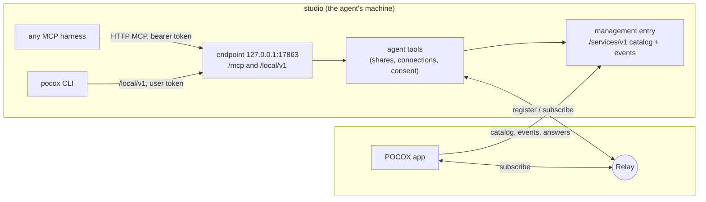

# Agent tools: devices and services

Status: implemented (2026-10-18). Verified on one Mac; see
[Verification](#verification) for what was and was not exercised.

POCOX lets a person reach every device's agents and services. Agent tools
give the same reach to the agents themselves, through one MCP server, `pocox`,
that any MCP-capable harness can use:

- every harness POCOX hosts gets it by default: Codex, Claude through ACP,
  native OpenCode, and any other ACP agent that accepts HTTP MCP servers;
- any other harness (Claude Code or Codex run in a terminal, OpenCode run by
  the user, IDE agents, anything that speaks MCP) gets it from a copied
  configuration entry with a token issued to it.

With it an agent sees the user's devices and the services on them, shares a
local port with the user's other devices, and connects to a service that runs
elsewhere. POCOX finishes the work on the devices the agent cannot touch: one
tool call ends in a link that opens on the phone in the user's hand.

The same catalog drives the galaxy, a page of its own where every visible
service can be seen and managed.

## User journeys

### See the page the agent just built

The user drives an agent on `studio` (a Mac) from a phone and asks to see the
web page it built. Nothing below depends on which harness the agent runs in.

```mermaid
sequenceDiagram
    participant U as User (phone app)
    participant A as Agent on studio
    participant H as POCOX on studio
    participant R as Relay
    A->>A: start the dev server (localhost:5173)
    A->>H: connect action=share ports=[5173]
    H->>H: 5173 answers on 127.0.0.1 or ::1
    H-->>U: consent request (first share of this conversation)
    U->>H: Allow (the call is still waiting)
    H->>R: register pcx:studio:port:5173
    H-->>A: shared; pocox://open link
    H-->>U: catalog event: new share, by this agent
    U->>R: subscribe pcx:studio:port:5173 → phone localhost:5173
    U->>U: Open → in-app browser
```

- The agent asks for the outcome ("share 5173"), never registers anything.
- The phone hears about the share from studio's catalog event stream, whatever
  harness made it, connects it right away (at the same port number when free,
  so a page that calls `localhost:8000` for its API works if both ports were
  shared), and shows it: as a notice above any page, under **Shared with you**,
  and as a card at the agent's tool call where POCOX shows the conversation.
- Phones open the page in an in-app browser, which keeps the tunnel alive;
  desktops use the system browser. **Send to agent** adds the page's address
  and its recent console errors to the conversation's draft; nothing is sent
  by itself.

### Use a service on another device

The agent on `studio` needs `devbox`'s API: `services` finds it, `connect
action=connect` makes it reachable on `studio` at a local address.

### Share and open a localhost link

A `localhost` link in a remote conversation explains that it points at the
host. On a newer host it also offers **Share and open**: the host shares that
port for the user (no consent prompt: the user asked) and it opens here.

## Concepts

| Term | Meaning |
| --- | --- |
| Device | A computer signed in to the same account or relay key (phones only connect). |
| Service | Something on the relay: agent hosts (`app`, `acp`, `opencode`), Responses APIs (`api`), shared ports (`port`), management (`host`, hidden). |
| Share | Loopback ports of a device published as `port` services, with a title and an owner. Each port is its own key, `pcx:<device>:port:<port>`. |
| Connection | Another device's service reachable on this device at a local address. |
| Owner | Who keeps a share or connection alive: a token, and the conversation when known. |

## Architecture



- **Who serves it.** The process that owns the machine's relay registrations:
  the desktop app, or the CLI host (`pocox serve --allow-remote-management`).
  Code: `crates/pocket-codex-bridge/src/engine/agent_tools/`.
- **Endpoint.** Streamable HTTP on 127.0.0.1, built on the official Rust MCP
  SDK (`rmcp`), stateless (a harness keeps working across POCOX restarts). Its
  port is 17863 for the app and 17864 for the CLI host, or the next free one,
  saved with the switch so copied entries stay valid. The endpoint announces
  itself to the local CLI in its private store (`endpoint.json`, `user-token`).
  It is desktop-only; phones do not link the SDK.
- **Catalog.** Each device's management entry gains `/services/v1`: shares
  with owners and expiry, consent requests, hosted services, and the switch;
  `/services/v1/events` streams the whole catalog on every change with what is
  new; the user's devices answer requests and stop, keep or create shares
  there. A device whose management is switched off, or that runs an older
  POCOX, is listed from the relay only (no titles or owners).
- **Watching.** The app follows every device's event stream (re-listing the
  relay every 20 s) and merges them with its own state into one overview.

## Tools

Server `pocox`; harnesses prefix tools with it (`mcp__pocox__services` in
Codex and Claude Code, `pocox_services` in OpenCode). Schemas are flat objects
(no top-level `oneOf`), which every model provider accepts.

### `services` (read-only)

Optional `device`, `kind` (`agent`, `api`, `port`, `all`), `status`
(`online`, `offline`, `all`), `mine`. Returns a compact listing for the model
and the same overview as structured content: devices with platform and
online state, their services with status, titles and owners, and this
device's connections. Text written by other devices is bounded and quoted.

### `connect` (act)

One `action` with its fields:

| Action | Fields | Result |
| --- | --- | --- |
| `share` | `ports` (1–4, the page's first), `title`, `path`, `wait_ready_seconds` (≤ 20) | `shared` with the share, a `pocox://open` link and the local URL; or `waiting_for_user` / `waiting_for_port`, to repeat |
| `stop_sharing` | `service` (share id, port or key) | `stopped`; only the caller's own |
| `connect` | `service` (key, `device:kind:name` or `device/port`), `local_port` | `connected` with the local address; shared ports and APIs only |
| `disconnect` | `service` | `disconnected`; only the caller's own |

- A share is published only after its first port answers on 127.0.0.1 or
  ::1 (a server listening on 0.0.0.0 is fine). Sharing ports the caller
  already shares returns that share; more ports extend it. At most eight
  ports per device are shared.
- Agent hosts cannot be connected to through the tools: they are for the
  user's controllers, not for other agents.
- Every failure says what to do next (`tools_off`, `not_hosting`,
  `declined`, `name_conflict`, `relay_unavailable`, …).

## Consent

The first share of each owner (a conversation, or a token when the harness
names none) needs the user's answer: **Allow once**, **Allow in this
conversation** or **Deny**. It is asked on the user's own POCOX devices,
above whatever page is open, or with `pocox tools requests|allow|deny` in a
terminal. The tool call waits for the answer (110 s for hosted harnesses,
whose tool timeout POCOX sets to 180 s, 18 s for others) and otherwise
returns `waiting_for_user`; an answer given later applies to the next call. A
denied owner is not asked again for ten minutes.

Harness prompts (MCP elicitation, multi round-trip requests) are deliberately
not used: a harness may answer them itself — Codex accepts a plain
confirmation by itself under full access and declines under its `never`
policy — so they cannot carry the user's consent. POCOX enforces it for every
harness and approval policy. **Ask before an agent shares** can be switched
off.

## Ownership and lifetimes

Every call carries a bearer token, so it is attributed without trusting the
client: one per hosted Codex and OpenCode instance, one per ACP session (sent
only to agents that advertise `mcpCapabilities.http`), one per copied entry,
and one for the local CLI. Codex's `threadId` in each call's `_meta` names the
conversation; an ACP session token is bound to its session. Tokens are kept
as digests; the secret reaches its holder once, never through a command line.

An agent's share or connection ends when the first of these happens: the agent
stops it; its hosted instance stops or restarts (its tokens are revoked); its
token is revoked in Settings; 24 hours pass; the switch goes off; POCOX quits.
**Keep sharing** makes it the user's, with no expiry. The user's own shares
(from the CLI or Share and open) survive restarts until stopped.

## The switch

On by default, per installation, in a private file beside the management
preference (`agent-tools.json` in the hosting store; not `config.toml`, which
older builds would refuse to read). Settings › Agent tools (desktops) and
`pocox tools enable|disable|ask` change it; a running POCOX applies a change
within seconds. Off means: the MCP server refuses every call, hosted harnesses
start without the entry, and everything agents shared or connected ends. The
user's own surface (`pocox services share|connect`, Share and open) keeps
working.

## Getting the tools into each harness

| Harness | How | Read tool without asking |
| --- | --- | --- |
| Codex app-server | launch overrides `mcp_servers.pocox.{url, bearer_token_env_var}`, token in the child's environment, `tool_timeout_sec = 180` | `tools.services.approval_mode = "approve"` |
| Claude (ACP adapter) | an HTTP entry in `mcpServers` of every `session/new`/`session/load`, with a token for that session | `_meta.claudeCode.options.allowedTools` |
| Other ACP agents | the same entry when they advertise `mcpCapabilities.http` | the agent's own prompt |
| Native OpenCode | a `mcp.pocox` remote entry (headers, `oauth: false`, `timeout`) merged into its inline configuration at launch | OpenCode does not prompt for MCP tools |
| Anything else | Settings › Agent tools › Add to another agent, or `pocox tools config --harness codex|claude|opencode|generic`: a ready entry with a new token | the harness's own |

Nothing writes another program's files.

## The CLI

- `pocox services share 5173 --title "Landing page"`, `services unshare`,
  `services connect devbox/8000`, `services disconnect`,
  `services list --json` (titles and owners when POCOX runs here).
- `pocox open <pocox-link>` connects a share and opens the browser.
- `pocox tools status|enable|disable|ask on|off|requests|allow|deny|config`.

They talk to the POCOX running on this computer (the CLI host first, then the
app) through its loopback endpoint and the token only this user can read.

## The galaxy

`/galaxy`, a destination of its own beside Services (⌘2). Every device is a
star system on a tilted disk seen in true perspective, turning once every six
minutes; its services orbit it on slightly inclined rings — agents innermost,
APIs next, shared ports outermost — inner ones faster. This device's star is
the signal blue. Stable placement: devices take golden-angle spiral slots in
the order of their names' hashes. Planets glow in their status colour; an
agent's share carries a dashed orbit, a moon in its harness's colour and an arc
that runs down with its lease. Connections rise as arcs of light with
particles flowing from the service to the device using it. New services spiral
out of their star, a status change sends a ripple, a removed one fades.
Offline devices are dim embers, drifting slightly outward.

Depth: painter's order, distant bodies fainter; orbit rings split at their
star so the front half covers it; one key light from the upper left. The sky
is rendered once per size and theme — a neutral nebula from a fragment shader
(`shaders/nebula.frag`), white wisps at night and graphite ink by day, never a
hue — plus three parallax layers of twinkling stars.

Drag to orbit (with momentum), pinch or scroll to zoom; after four idle
seconds the camera glides back. Tap a body: the camera eases to it, the rest
dims, and a glass panel shows it (a share as its card; an agent host with
Open conversations; an API with Connect). Search and a kind filter sit on top;
**List** shows Shared with you and every service as a list, and is the default
with a screen reader. Arrow keys move focus between bodies, Enter opens one,
Escape returns. Reduced motion shows a still scene. Portrait screens view the
disk from higher above so it fills their height.

## Security

- Only loopback ports of the agent's own machine can be shared, and only to the
  user's own devices (the account namespace or the relay key).
- The endpoint listens on loopback only, refuses any request with an `Origin`
  or a `Host` that is not its own loopback address (DNS rebinding), and
  requires a bearer token; `/local/v1` accepts only the CLI's own token.
- Consent is enforced by POCOX, also for agents with full access.
- Owners, conversations and times come from POCOX, never from the agent;
  titles and labels from other devices are bounded and treated as data.

## Compatibility

- `port` is a new service kind; older apps skip unknown kinds, and the
  account backend's legacy listing omits it.
- `/services/v1` is versioned; a device without it shows its relay services
  only. Existing `pb register|subscribe`, keys and `config.toml` are unchanged.
- The page shortcuts after Services moved one key: Galaxy ⌘2, Local sessions
  ⌘3, Runtime logs ⌘4.

## Verification

- A local relay with two isolated CLI hosts on one Mac: a dev server shared
  from the CLI on one host was listed with its title and owner on the other and
  fetched through `pocox open`; an agent share over MCP waited for consent,
  answered from the other host (`pocox tools allow`), and was then shared
  with its conversation recorded; "allow in this conversation" let the agent
  extend the share without asking; an agent on the other host connected to it
  and fetched it; switching the tools off ended the agent's share, kept the
  user's, and refused MCP calls while the CLI kept sharing; a hosted Codex
  app-server listed both tools with its bearer token
  (`mcpServerStatus/list`).
- Rust unit and endpoint tests (MCP over HTTP: token, Origin, initialize,
  tools/list, tool errors); Flutter widget tests for the share card, the
  consent prompt, Settings and the galaxy, with offscreen renders of the galaxy
  in both themes and on a phone.
- Not verified: a phone or the iOS/Android in-app browser against a real
  share, Claude and OpenCode hosts calling the tools, Windows and Linux,
  account mode across machines, and the nebula on device (the headless renderer
  has no shader).
