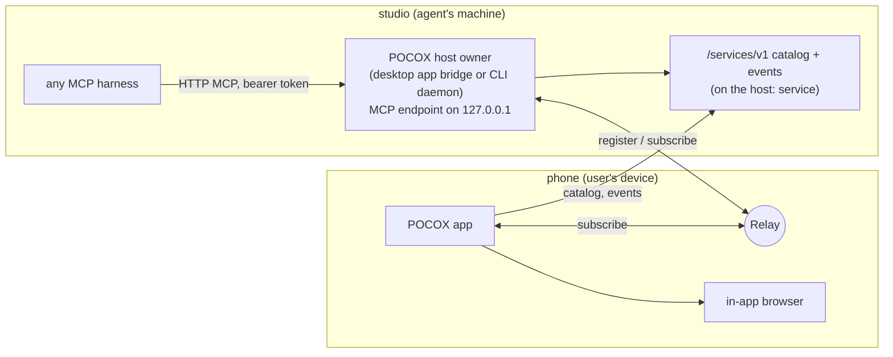

# Agent tools: devices and services

Status: proposed design (2026-10-18). Nothing here is implemented yet.

POCOX already lets a person reach every device's agents and services. This
design gives the same reach to the agents themselves, through one MCP server
that any MCP-capable harness can use:

- every harness POCOX hosts gets it by default: Codex, Claude through ACP,
  native OpenCode, and any other ACP agent that accepts HTTP MCP servers;
- any other harness (the Codex app, Claude Code, OpenCode run by the user, IDE
  agents, anything that speaks MCP) gets it through an explicit install or a
  copied configuration entry.

With it an agent can see the user's devices and the services on them, share a
local port with the user's other devices, and connect to a service that runs
elsewhere. The work an agent starts is finished by POCOX on the devices the
agent cannot touch, so one tool call ends in a link that opens on the phone in
the user's hand.

The same catalog drives the galaxy, a page of its own where every visible
service can be seen and managed.

## Goals and non-goals

Goals:

- One MCP server, `pocox`, with two tools: `services` (read) and `connect`
  (act), served by the POCOX process that already runs on each computer. No
  extra executable.
- Harness-neutral at the core: consent, delivery to the user's devices and
  ownership work with nothing but MCP. Harness-specific features only make
  things smoother where they exist.
- Flows designed from the user's side: "show me the page you just built" ends
  in a working link on the device the user holds, without the user or the agent
  registering or subscribing anything by hand.
- Hosted harnesses have the tools by default; one switch, on by default, in the
  app and the CLI.
- Every share and connection has a visible owner and ends on its own.

Non-goals for now:

- Operating other devices (shell, files). Roadmap item 39; it can reuse this
  server later.
- Sharing anything but a loopback port of the agent's own machine. No LAN
  addresses, no public internet links.
- Replacing the vendors' harnesses. POCOX stays the medium beside them.

## User journeys

### 1. See the page the agent just built (the motivating flow)

The user drives an agent on `studio` (a Mac) from a phone and asks to see the
web page it built. The agent can be Codex, Claude, OpenCode or any other
harness with the tools; nothing below depends on which.

```mermaid
sequenceDiagram
    participant U as User (phone app)
    participant A as Agent on studio
    participant H as POCOX on studio (MCP endpoint)
    participant R as Relay
    A->>A: start the dev server (127.0.0.1:5173)
    A->>H: connect action=share ports=[5173]
    H-->>U: consent request (first share for this owner)
    H-->>A: pending: the user is asked in POCOX
    U->>H: Allow
    A->>H: same call again
    H->>H: check that 127.0.0.1:5173 answers
    H->>R: register pcx:studio:port:landing
    H-->>U: share event: landing on studio, by this agent
    H-->>A: shared; pocox:// link; "the user can open it in POCOX"
    U->>R: subscribe pcx:studio:port:landing → phone 127.0.0.1:5173
    U->>U: Open → in-app browser at http://localhost:5173
```

What makes it end to end:

- The agent asks for the outcome ("share 5173 with the user"), not the
  mechanism. Registering is done by POCOX on the agent's machine.
- Connecting is done by the POCOX app on each of the user's devices, which
  hears about the share from its own host's event stream. It does not depend on
  the harness: a share made by Claude Code run in a terminal reaches the phone
  the same way as one made by a hosted Codex.
- Where POCOX shows the conversation, the share appears as a card at the tool
  call; elsewhere it appears under **Shared with you**. Either way the user only
  taps **Open**.
- The phone listens on the same port number when it is free, so a page that
  calls `http://localhost:8000` for its API keeps working if the agent shares
  both ports in one call. WebSocket traffic (hot reload) passes through, as the
  relay forwards TCP.
- To take part in debugging, the in-app browser offers **Send to agent**: the
  page URL, recent console errors and, where the platform allows, a screenshot
  are attached to the conversation's draft. Nothing is sent automatically.

When the harness supports MCP's in-call confirmation (below), the consent step
happens inside the first call and the retry disappears.

### 2. Use a service on another device from this machine

The agent on `studio` needs the API running on `devbox`, or another machine's
Responses API. `services` finds it; `connect action=connect` makes it reachable
on `studio` at a local address, for as long as its owner lives.

### 3. Ask what runs where

"Is OpenCode on devbox up?", "what have you shared?": `services` answers from
the catalog, filtered by device, kind or status.

### 4. Stop sharing

The agent calls `stop_sharing`, the user taps **Stop sharing** on the card, in
**Shared with you** or in the galaxy, or the share ends with its owner (see
Lifetimes).

## Concepts

| Term | Meaning |
| --- | --- |
| Device | A computer or phone signed in to the same account or relay key. |
| Service | Something reachable through the relay: an agent host (`app`, `acp`, `opencode`), a Responses API (`api`), a shared port (`port`, new), management (`host`, `meta`; hidden by default). |
| Share | One or more loopback ports of a device published as a `port` service, with a title and an owner. |
| Connection | A service of another device materialized as a loopback address on this device. |
| Owner | Who keeps a share or connection alive (see Ownership). |
| Lease | The rule that ends a share or connection (see Lifetimes). |

## Harness neutrality

| Layer | Works with any MCP harness | Used where available |
| --- | --- | --- |
| Transport | Streamable HTTP on loopback | stdio through `pocket-codex mcp`, only where the CLI is installed and a harness accepts nothing else |
| Discovery | server instructions, tool names and descriptions written for text search | lazy tool search (Codex `tool_search`, Claude Code tool search), an Agent Skill |
| Harness identity | the bearer token each harness or session is given | MCP client info |
| Conversation | none needed | Codex's `threadId` in each call's `_meta`; a token minted per ACP session; sessions POCOX observes on its hosted engines |
| Consent | a request on the user's POCOX devices, with a pending result the agent retries | multi round-trip requests (2026-07-28), elicitation (2025-06-18) |
| Delivery to the user | the share event on the user's POCOX devices (**Shared with you**) | a card at the tool call where POCOX shows the conversation |
| Auto-running the read tool | the harness's normal approval | a pre-allowed `services` tool in configurations POCOX writes |
| Long work | calls stay short; waits return a pending result the agent can repeat | the MCP tasks extension |

A harness that offers nothing beyond basic MCP tools over HTTP gets every
capability; the right column only removes a step or places the result better.

## Architecture



- **Host owner.** The process that already owns a machine's relay
  registrations owns shares and connections too: the desktop app's bridge
  engine when the app hosts, the CLI daemon (`pocket-codex serve`, the managed
  host) otherwise. A new `agent_tools` module holds the catalog, shares,
  connections, consent policy, leases and the MCP endpoint.
- **MCP endpoint.** The host owner serves the `pocox` MCP server itself over
  Streamable HTTP on `127.0.0.1`, at a port chosen once per installation and
  kept in `config.toml`, so installed harness entries stay valid across
  restarts. It is built on the official Rust SDK (`rmcp`, which Codex also
  uses) and supports MCP 2026-07-28 (`server/discover`, stateless requests,
  multi round-trip requests) and 2025-06-18 (Codex speaks 2026-07-28 only
  behind its own setting). The tools exist while POCOX runs on that computer;
  otherwise a harness reports the server as unavailable.
- **No extra executable.** Codex, the Claude ACP adapter (it advertises
  `mcpCapabilities.http`) and OpenCode all accept HTTP MCP servers, so nothing
  is bundled. `pocket-codex mcp`, a stdio-to-HTTP bridge, remains for a harness
  that accepts only stdio, where the CLI is already installed.
- **Catalog.** Relay keys carry only names. Each device's `host:` management
  service gains `/services/v1`: services with title, ports, owner, created and
  expiry times and status, plus an SSE event stream for changes, new shares and
  consent requests. A service's status combines its relay registration, the
  host's check that the local listener answers, and this device's connection
  state.
- **Controllers.** The POCOX app on every device subscribes to the catalog
  events of the user's devices, shows new shares under **Shared with you**, and
  places a card at the tool call in conversations it shows, recognizing:
  - Codex `mcpToolCall` items from server `pocox`, whose result arrives as
    structured JSON;
  - ACP tool calls and OpenCode tool parts whose output carries a
    `pocox://open?service=<key>&path=<path>` link;
  - the same link repeated in any message.

  Automatic connection applies only to shares announced by a host's event
  stream; a link in ordinary text needs a tap.

## Ownership

Every share and connection records who made it, from the strongest source
available:

1. **The token.** Each hosted harness instance, each ACP session and each
   installed harness gets its own bearer token, so every call is attributed
   without trusting what the client says about itself. Tokens are listed in
   Settings and can be revoked.
2. **The harness.** The hosted instance POCOX launched, or the installed
   harness the token was issued to; MCP client info fills in the version.
3. **The conversation, when known.** Codex sends `threadId` in every call's
   `_meta` (hosted or not). An ACP session's token is bound to the session id
   `session/new` returns. On every engine it hosts, POCOX also sees the tool
   call in the session's event stream and binds the share to that session.

Owner fields are written by POCOX, never by the agent, and are shown in the
catalog, on cards and in the galaxy.

## Tool surface

Server name `pocox`. Harnesses prefix tools with the server (Codex and Claude
Code: `mcp__pocox__services`; OpenCode: `pocox_services`), so tool names do not
repeat it.

Server instructions, shown by harnesses that list tool sources (for example in
Codex's `tool_search`):

> The user's devices and the services on them. Share a dev server or other
> local port with the user's phone and other devices, or connect to a service
> running on another of their devices.

Names, descriptions and parameter descriptions use the words people and models
search with (device, service, port, share, preview, dev server, connect,
relay).

Every call returns within about 20 seconds, below common MCP tool timeouts.
Waiting for a dev server or for the user returns a pending result, and
repeating the same call continues it (calls are idempotent).

### `services` (read)

Annotations: `readOnlyHint: true`, `idempotentHint: true`,
`openWorldHint: false`.

Input, all fields optional:

```json
{
  "device": "studio",
  "kind": "agent | api | port | all",
  "status": "online | offline | all",
  "mine": false
}
```

`mine` limits the answer to shares and connections owned by the caller.

Output: a short table for the model, and the same data as `structuredContent`:

```json
{
  "this_device": "studio",
  "devices": [
    {
      "name": "devbox",
      "platform": "linux",
      "online": true,
      "services": [
        { "key": "pcx:devbox:opencode:opencode", "kind": "agent",
          "agent": "opencode", "status": "online" },
        { "key": "pcx:devbox:port:api", "kind": "port", "title": "Orders API",
          "ports": [8000], "status": "online", "owner": "Claude on devbox" }
      ]
    }
  ],
  "connections": [{ "service": "pcx:devbox:port:api", "local": "127.0.0.1:8000" }]
}
```

Titles and descriptions written by other devices are untrusted data: bounded
in length, never instructions.

### `connect` (act)

Annotations: `readOnlyHint: false`, `destructiveHint: false`,
`openWorldHint: true`. The harness's normal approval applies; POCOX also asks
for consent itself (below), whatever the harness's approval policy.

Input, one shape per `action` (JSON Schema `oneOf`):

```json
{ "action": "share", "ports": [5173, 8000], "title": "Landing page",
  "path": "/", "wait_ready_seconds": 15 }
{ "action": "stop_sharing", "service": "pcx:studio:port:landing" }
{ "action": "connect", "service": "devbox/api", "local_port": 8000 }
{ "action": "disconnect", "service": "devbox/api" }
```

`share`:

- Accepts only ports of this machine and connects to them on `127.0.0.1` and
  `::1`. A server that listens on `0.0.0.0` is fine; nothing else is reachable.
- Waits up to `wait_ready_seconds` (at most 20) for the first port to answer;
  if it still does not, returns a pending result to repeat.
- Is idempotent: sharing ports the caller already shares returns that share.
- Names the service from the title or the project folder, adding a suffix on
  collision.
- Returns:

```json
{
  "status": "shared",
  "service": "pcx:studio:port:landing",
  "ports": [5173, 8000],
  "on_this_machine": "http://localhost:5173/",
  "open": "pocox://open?service=pcx:studio:port:landing&path=/",
  "ends": "when this conversation ends, or in 24 h"
}
```

with text the agent can relay: the page is shared, and the user can open it in
POCOX on any of their devices. A pending result has `"status":
"waiting_for_user"` or `"waiting_for_port"` and says to repeat the call.

`connect` prefers the same local port number as the service and returns the
local address. `disconnect` and `stop_sharing` end what the caller owns;
ending another owner's share needs the user, in the app.

Errors say what to do next: the port is not listening, the tools are switched
off on this device, the relay is offline, the user declined, the device needs
a newer POCOX.

### Consent

Sharing exposes a port to the user's other devices, so the first share for an
owner needs the user's consent (setting: **Ask before an agent shares a port**,
on by default).

- **Baseline, any harness.** POCOX posts a consent request through the catalog
  event stream to every POCOX device of the user, shown in the conversation
  when POCOX knows it and as a notification otherwise. The call returns
  `waiting_for_user`; the agent repeats it and gets the share once the user
  allows.
- **In-call, where supported.** A 2026-07-28 client gets an `input_required`
  result (multi round-trip request); a 2025-06-18 client that declares
  elicitation gets `elicitation/create`. The harness shows the question itself
  and the call completes in one step. Codex forwards both to POCOX as
  `mcpServer/elicitation/request`, which the app needs a card for (it renders
  `item/tool/requestUserInput` today, not MCP elicitations).
- **Allow for this conversation** (or, without a known conversation, for this
  token) is remembered with the owner.

`connect` asks no extra consent: it only reaches the user's own devices, and
the harness's approval still applies.

## Lifetimes

A share or connection made by an agent ends when the first of these happens:

- the agent calls `stop_sharing` or `disconnect`;
- its conversation is archived or deleted, when POCOX knows the conversation;
- its hosted harness instance or ACP session stops (POCOX stopped it, so it
  knows);
- its token is revoked;
- 24 hours pass;
- the tools are switched off on that device.

The user can **Keep sharing** from the card, **Shared with you** or the galaxy,
which pins it to the user (no expiry, ended only by the user). A controller's
own connection lives while its preview is open or its card is on screen, plus a
grace period, and is re-established when the app returns to the foreground.

## The device in the user's hand

- **Shared with you.** New shares from any of the user's devices, whatever
  harness made them, with title, device, owner and status.
- **Preview card.** Where POCOX shows the conversation, the share also renders
  at its tool call: title, device, ports, status, **Open**, **Copy link**,
  **Stop sharing**.
- **Connect early, open on tap.** A share announced while its conversation is
  on screen connects right away (setting, on by default), so **Open** is
  instant. Nothing opens by itself.
- **Port preservation.** The same port number when free; otherwise another one,
  with a note that absolute `localhost` URLs in the page may not work.
- **In-app browser.** On iOS and Android the page opens in an in-app web view
  (the official `webview_flutter` package): it keeps the app in the foreground,
  which keeps the tunnel alive, and it can collect console messages for **Send
  to agent**. Desktop controllers open the system browser; the app keeps the
  tunnel.
- **Localhost links.** A `localhost` link in a remote conversation, which today
  only explains that it points at the host, gains **Share and open**: it asks
  that host to share the port (with consent) and opens it.
- **CLI.** `pocket-codex open <pocox-link>` connects and opens the browser;
  `pocket-codex services connect <service>` prints the local address.

## The switch

- One setting per installation, on by default: `[agent_tools] enabled = true`,
  `ask_before_sharing = true` and the endpoint's port, in `config.toml`.
- App: Settings, **Agent tools**: the switch, the consent setting, current
  shares and connections, issued tokens, and the harness install buttons.
- CLI: `pocket-codex tools status | enable | disable`.
- Off means: the endpoint stops, hosted harnesses start without the entry,
  shares and connections made by agents end; ones the user made or pinned stay.

## Getting the tools into each harness

### Harnesses POCOX hosts: on by default

POCOX adds the server when it launches the harness, without touching the
user's files. Codex, Claude and OpenCode get exactly the same tools; the token
never appears in a command line.

| Harness | Injection | Read tool runs without asking |
| --- | --- | --- |
| Codex app-server | `-c` launch overrides: `mcp_servers.pocox.url` and `bearer_token_env_var`, with the token in that variable of the app-server's environment | `tools.services.approval_mode = "approve"` in the same overrides |
| Claude (ACP adapter) | an HTTP entry in `mcpServers` of `session/new` and `session/load` (sent empty today), with a token minted for that session in its `Authorization` header | `allowedTools: ["mcp__pocox__services"]` in the session's `_meta.claudeCode.options`, which the adapter passes to Claude Code |
| Other ACP agents | the same HTTP entry when the agent advertises `mcpCapabilities.http`; otherwise none (the hosting editor says so) | the agent's own permission prompt |
| Native OpenCode | a `mcp.pocox` remote server, with the token in its headers, merged into the `OPENCODE_CONFIG_CONTENT` the host already passes | a permission rule for `pocox_services` in the same configuration, if OpenCode accepts per-tool rules for MCP tools |

The Codex entry uses the same name as a manual install, so the hosted process
loads only POCOX's entry.

### Every other harness: explicit install

- **Known harnesses** (the Codex app and CLI, Claude Code, OpenCode run by the
  user): **Install** in Settings, or `pocket-codex tools install --harness
  codex|claude|opencode` from the CLI, writes one `pocox` entry (URL and a token
  issued to that harness) into its MCP configuration; **Remove** deletes exactly
  that entry and revokes the token. Never automatic, since it edits another
  program's files.
- **Any MCP harness:** **Copy configuration** in Settings (or `pocket-codex tools
  config` from the CLI) gives a ready-to-paste entry with the URL and a new
  token.
- A share made there reaches the user's devices like any other, under **Shared
  with you**, and as a card where POCOX shows that conversation (for example a
  followed session).

An optional Agent Skill (`SKILL.md`, read by Codex, Claude Code, OpenCode and
other harnesses that follow the standard) can teach when to share, for example
after starting a dev server the user wants to see. The server's own
instructions should usually be enough.

## The galaxy

A page of its own (`/galaxy`), reached from the main navigation, from **Shared
with you** and from the host switcher. It shows every device and service the
user can see as a living galaxy: one look tells what runs where, what is
healthy, what agents shared, and which devices are talking to each other. The
services list stays for scanning.

### Scene

- **A tilted disk.** The galaxy lies on a disk seen from about 30° above its
  plane, drawn in true perspective. It turns slowly on its own, about once every
  six minutes.
- **Devices are stars.** Each device is a glowing core placed along a golden-
  angle spiral by a stable hash of its id, so it keeps its place between visits.
  This device sits at the centre, slightly raised, its core in the signal blue.
- **Services are planets.** They orbit their device on slightly inclined rings:
  agent hosts innermost, Responses APIs next, shared ports outermost. Inner
  planets move faster, as in a real system; the slowest completes an orbit in
  about ninety seconds.
- **Connections are light.** When one device is connected to a service on
  another, a luminous arc rises above the disk between them, with particles
  flowing from the service to the device that uses it.
- **Agent shares carry a moon.** A shared port made by an agent has a small moon
  with that agent's mark, a dashed ring, and a thin arc that runs down as its
  expiry approaches.
- **Status is colour and light.** Bodies use the app's status colours (online,
  starting or degraded, offline) as their glow. An offline device dims,
  desaturates and drifts slightly outward; a status change sends a ripple across
  its ring; a new service spirals out of its core; a removed one fades.

### Depth and light

- Painter's order by depth; far bodies are smaller, softer and fainter, near ones
  crisp with a specular highlight.
- One key light from the upper left, matching the app's white-lit backdrop:
  planets are shaded spheres (highlight, terminator, rim light); cores bloom
  through layered glows.
- Orbit rings are projected ellipses, brighter in front of their core than
  behind it.
- Three parallax layers of stars move against the camera, with a slow twinkle;
  behind them a faint nebula, drawn by a fragment shader (a still image where
  shaders are unavailable).

### Light and dark

The scene is the same in both themes; its palette is a theme extension built
from `theme.dart`, and switching themes cross-fades like the rest of the app.

- **Dark: night sky.** Graphite space with a soft vignette, white stars, glowing
  cores and planets that emit their status colour, faint white rings.
- **Light: daylight orrery.** Paper-white space lit from the centre, stars as
  fine graphite specks, planets as glossy ceramic spheres casting soft shadows
  on the disk, ink-thin rings, status shown as an inner glow and rim rather than
  bloom.

### Interaction

- Drag to orbit the camera, with momentum; pinch or scroll to zoom. After a few
  idle seconds the camera glides back into its slow turn.
- Tap or click a body: the camera eases to frame it, everything else dims, and a
  glass panel opens (anchored on desktop, a sheet on phones) with details
  (device, ports, owner, conversation, created, expiry, last check) and actions:
  open, connect or disconnect, copy, keep sharing, stop sharing, open the agent
  host's conversation or settings, manage the device. Tap empty space or press
  Escape to return.
- Labels are billboards (service name; device and owner), shown for bodies near
  the front, hovered or focused, placed to avoid each other.
- A glass bar holds search and filters (device, kind, status) and a legend.

### Motion, performance and accessibility

- Everything moves continuously: the disk's turn, orbits, a slow breathing of
  cores, a slight bob of planets, flowing connection particles.
- One ticker drives one painter; the scene update is linear in the number of
  bodies, and the starfield and nebula are cached per size, theme and pixel
  ratio. It stays at 60 fps on phones past a hundred bodies and pauses when the
  page is hidden or the app is in the background.
- Reduced motion shows a still, composed scene; live changes appear as gentle
  opacity changes.
- Every body has a semantic label, grouped by device. The keyboard moves focus
  between systems and planets, Enter opens the panel, and **List** opens the
  services list.
- Built with `CustomPainter` and a fragment shader, both part of Flutter on every
  platform; Flutter's experimental 3D renderer is not used, since it is not yet
  available on every platform POCOX supports.
- Reviewed with the offscreen render pipeline the README poster uses, in both
  themes.

## Security

- Only loopback ports of the agent's own machine can be shared.
- The MCP endpoint listens only on loopback, rejects requests that carry a
  browser `Origin` (against DNS rebinding), and requires a bearer token,
  compared in constant time and never logged.
- POCOX enforces consent itself, also for agents running with full access and
  for harnesses that do not ask.
- Shares are visible only to the user's devices (same account namespace or
  relay key), like every other service.
- Owner, conversation and times come from POCOX, never from the agent; titles
  are bounded and treated as data.
- Every share and connection is recorded with its owner in the catalog and the
  exportable logs.

## Compatibility

- `port` is a new service kind; older clients skip unknown kinds already.
- `/services/v1` is versioned. A device without it is listed with its relay
  services only, and the tools report that it needs a newer POCOX.
- Existing `pb register` / `pb subscribe` and service keys are unchanged.

## Phases

1. **Catalog and CLI.** Host owner module, `port` kind, `/services/v1` with
   events, `pocket-codex services share | connect | list --json`, `pocket-codex
   tools` switch. Accepted when a dev server shared from the CLI on a Mac opens
   on a phone through the services list.
2. **Agent tools.** The MCP endpoint, tokens, injection into Codex, Claude, other
   ACP agents and OpenCode, ownership, consent (baseline, multi round-trip
   requests, elicitation, the new elicitation card), **Shared with you**,
   transcript cards, connect on appear, port preservation, the in-app browser.
   Accepted when journey 1 works end to end from a phone with a Codex host, a
   Claude host and an OpenCode host, and with Claude Code run in a terminal on
   the Mac.
3. **The galaxy and other harnesses.** The galaxy page, **Send to agent**,
   harness install and removal, copied configurations, **Share and open** for
   localhost links.
4. **Later.** Operating other devices (roadmap item 39) on the same server.

## Risks and open points

- Claude Code's and OpenCode's support for multi round-trip requests and
  elicitation is not verified; the baseline consent path covers them.
- Whether OpenCode accepts a per-tool permission rule for an MCP tool is not
  verified; without it the read tool asks once.
- A port taken by another program when POCOX starts moves the endpoint, which
  breaks installed entries until they are installed again; the app says so.
- Harnesses that run in a container or on another machine cannot reach the
  loopback endpoint.
- Dev servers that reject unknown `Host` headers or call non-`localhost`
  absolute URLs may need the agent to adjust their configuration; the tool's
  result says so when the first request fails.
