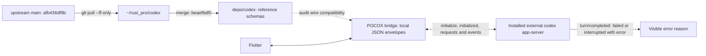
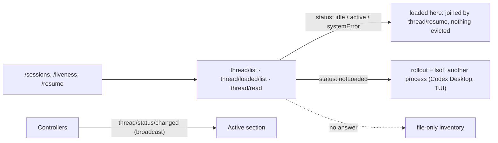

# App-server protocol sync: 2026-10-04 (updated 2026-10-18)

The reference is upstream `openai/codex` main, pulled on 2026-10-04 with
`git -C ~/rust_pro/codex pull --ff-only origin main`:
`afb436df8b70bb5bc57b86d9a3e829968988cd21`. Local `HEAD` and `origin/main`
matched after the pull. The fork merges that exact commit at
`beaefbdf0ed3788762f7a30f3a83ad982d717fd4`; its `app-server-protocol` and
`protocol` directories have no differences from the pulled upstream revision.

This corrects 0.2.6, which used the stale local revision `17a9df60e` despite
the request to pull latest. The new reference includes 225 further commits.
It does not assert that an external Codex executable installed by a user was
built from this commit.

POCOX still launches the installed external executable. The submodule is
the wire-schema reference, not a bundled runtime or a linked protocol library.



## Consumed surface

| Upstream change since `c08819510` | POCOX behavior |
| --- | --- |
| `Turn.error` can accompany an interrupted turn; `tooManyDenials` and `flexUnavailable` error information added | Show explicit terminal errors on failed or interrupted live turns. Ordinary interruption without an error stays quiet. Preserve the raw error JSON. |
| `thread/items/list.cursor` additionally accepts an item anchor object | Existing opaque string cursors remain supported and are passed back unchanged. No extra reads or translation are needed; POCOX does not expose item-anchor navigation. |
| MCP discovery adds optional `serverName` and `threadId` | Existing full-inventory calls remain valid. Unknown response fields are retained in wire values. |
| Enterprise MCP OAuth adds `loginId` and completion metadata | No enterprise login flow is added in this release; POCOX's existing account login behavior is unchanged. |
| Plugin summary drops obsolete extension metadata; account plan/error variants expand | POCOX does not deserialize these into closed upstream enums. No runtime dependency or compatibility shim is added. |
| Tool-call execution metadata changes within upstream model messages | The app-server item/event surface remains the integration boundary. POCOX does not interpret model-provider message internals. |
| Command rollouts now persist only `aggregated_output`; app-server still sends `aggregatedOutput` | Both existing readers already accept these fields. Regression coverage checks current rollouts without legacy stdout/stderr/formatted output, plus live and restored app-server items. Older rollout fallback fields remain readable. |
| Persisted paginated command output is capped at 64 KiB with a middle truncation marker | Keep the server's text and marker visible. POCOX does not claim the stored output is complete or reread files to reconstruct omitted bytes. |
| Unknown `CodexErrorInfo` string/object variants are accepted upstream | Local JSON envelopes retain them; the UI shows the supplied error message without requiring a known error enum. Tests cover both future wire shapes. |
| Resume reuses unchanged stored snapshots after validating writer ownership | This is internal to the external server. Existing `excludeTurns: true` resume and bounded history requests remain valid; no extra controller request or snapshot copy is added. |
| Rollouts can contain `additional_tools` model metadata | Read-only history ignores it as metadata while retaining command output; it is not a user or assistant transcript row. |
| Optional goal mutation `origin`, attachment owner lookup, prediction and Bedrock advisory methods are added; `namespaceTools` capability is removed | POCOX does not call these new methods, mutate goals, or depend on the removed capability. Existing consumed requests require no new fields. |

Initialization still waits for the initialize response before sending
`initialized`. Bounded history windows, model/service-tier discovery, async
questions, approvals and image references retain their existing contracts.
The upstream WebSocket fork revisions and Rust 1.95 compiler floor are unchanged.

## Local host identity

```text
systemd pocox-host
  +-- POCOX host supervisor
  +-- npm / Node launcher
  |     +-- native codex app-server PID  <-- record this process
  |           +-- runtime worker TIDs   <-- never record these as the host PID
  +-- pb register worker

worker identity on Linux = boot ID + /proc/PID/stat start ticks
wall-clock synchronization changes neither part of that identity
```

An executable replaced by npm can remain alive as `codex (deleted)`. Status
recognizes it until a deliberate restart loads the replacement. Listener
matching uses an exact `--listen` argument, not a URL substring.

## Follow-up sync: 2026-10-08

`deps/codex` now points at `b360f3350bf0b6ee5b11e94b09122b570e84f0d3`, a clean
merge of upstream `openai/codex` main `b38942ce7ce73a5cee7981f1f1b6f1a3d2c5a5c0`
(139 commits after `afb436df8b`) into the `pocox` branch, keeping its
Windows console-suppression fixes. The branch was fast-forwarded on the fork so
CI can fetch the pointer.

No app-server method or notification was added, removed or renamed, and
`thread/realtime/*` is byte-identical. New optional request fields
(`parentTurnId`, `rootTurnId`, `excludedThreadIds`) are not sent; new response
fields are ignored by local parsing. `subAgentActivity` gained `model` and
`reasoningEffort`, which the step card shows live and from rollouts. The
resolved workspace graph still contains no Codex runtime crate.

## Follow-up sync: 2026-10-18

`deps/codex` now points at `35eabb7013`, a clean merge of upstream
`openai/codex` main `8d9f6466f` (356 commits after `b38942ce7`) into the
`pocox` branch. The resolved workspace graph is unchanged: no Codex
runtime or protocol crate is linked.

| Upstream change since `b38942ce7` | POCOX behavior |
| --- | --- |
| `imageGeneration` items carry either `result` or a file-backed `fileId` (attachment store), plus optional `inputImages` | The saved path still renders; a `fileId` with no saved path shows the existing unavailable state. POCOX never reads the attachment store. |
| Experimental `thread/readState/update`, `thread/readState/changed`, `readState(s)` on `thread/read` / `thread/list`, and `thread/items/read` | Not called; unknown response fields are ignored. |
| Rollouts left idle for a week are compressed to `….jsonl.zst` (since `a8a6071279`); `thread/list` keeps naming the plain path | Every rollout reader accepts both forms (the plain file wins when both exist). A compressed rollout's last turn is `unknown`: it is never decoded for listing, and Codex decompresses it before writing again. History review offsets address decoded bytes. |
| Optional request fields (`responsesapiClientMetadataPatch`, `experimentalPredictionMode`, `voiceSessionId`, `websocketRequestId`) and response fields (`McpServerStatus.toolListMeta`, `TurnToolOutput.retain`) | Not sent; ignored by local parsing. |

### Standard session state

The host's Codex routes now ask the colocated app-server before reading files
(`crates/pocox-host-svc/src/codex_inventory.rs`, over one shared
read-only connection):



- `/sessions` lists through `thread/list` with every model provider and the
  conversation list's source kinds, so renamed titles (`name`) and
  compressed sessions appear. Each row carries the app-server's
  `Thread.status` type (`status`); older hosts omit both fields.
- `/sessions?running_only=true` reports the app-server's active threads
  (`thread/loaded/list`, then `thread/read` for each) plus rollouts another
  process holds with an unfinished turn.
- A thread the app-server has loaded is joined by `thread/resume`, running or
  idle: liveness lists no holders and force-resume evicts nothing.
- An unfinished last turn that nobody holds is reported `aborted` (the
  app-server reads it as interrupted), so no view shows it as running; its
  safety tag keeps the "last turn interrupted" label.
- The API cannot see another process's writer: those threads report
  `notLoaded`, and only for them do the rollout and `lsof` probes decide.
- Controllers follow `thread/status/changed`, which the app-server broadcasts
  to every connection for every loaded thread, and re-list on
  `thread/started`, `thread/archived` and `thread/unarchived`.
- This device's own Local sessions view has no app-server and stays
  file-only.

## Verification

Run the full first-party gates in `AGENTS.md`, including Flutter lifecycle
regressions for interrupted errors and ordinary interruptions, current
aggregated-output rollout/live/history shapes and future error variants.
Audit the resolved bridge dependency graph on all targets/features: it must contain no
Codex runtime/protocol crate. The Responses proxy's HTTP and WebSocket transport
tests exercise host authentication, streaming and error forwarding. Build the
desktop application and require the native macOS host CI result.

After local installation, verify the loaded native executable and SDK version,
app-server initialization, model/history requests and a relay round trip. A
submodule update alone does not upgrade an already-running external process.
