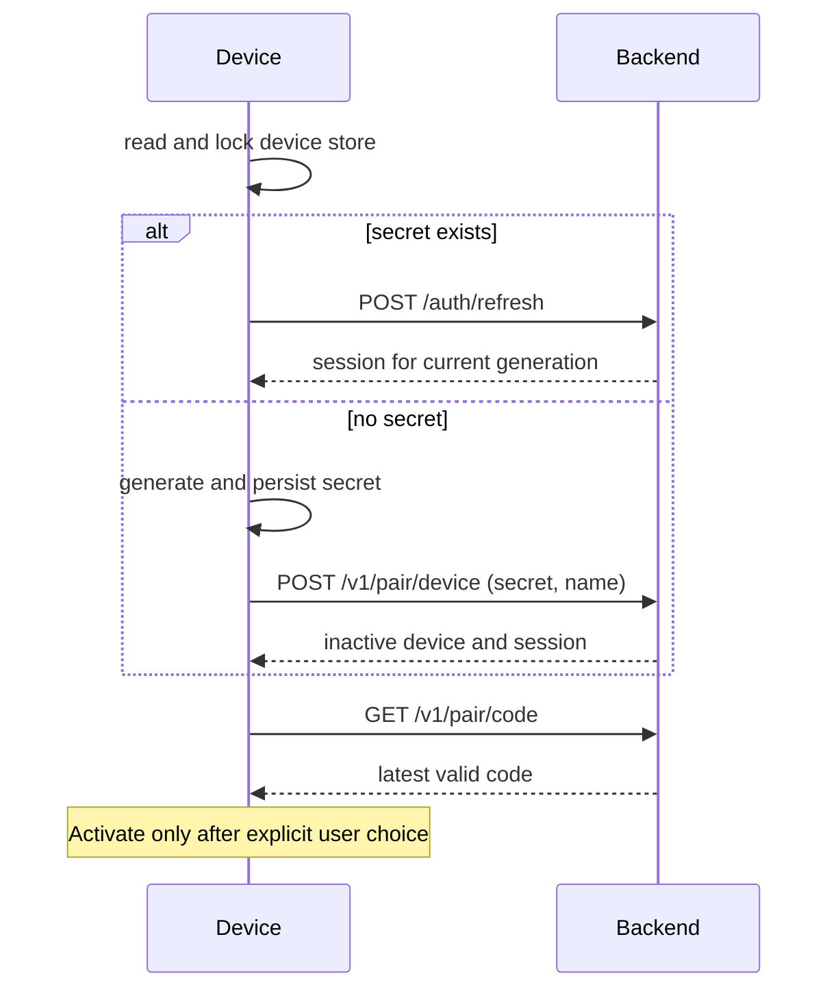
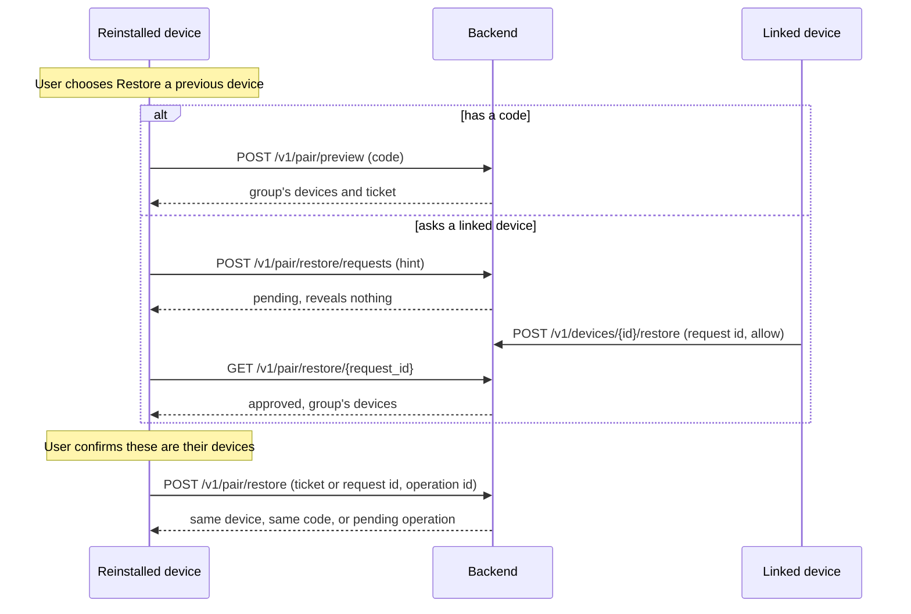

# Pairing-code login

**Status: relay support (stage 1), the backend (stage 2), the core, bridge and CLI
(stage 3) and the app (stage 4) have shipped; the app's Android side is built in CI
but has not yet been run on a device. Usage and deployment docs remain.** This
page specifies the design for
[issue #174](https://github.com/acking-you/POCOX/issues/174). Once a stage ships, its
section becomes the rules a change must keep.

Pairing makes a device usable without GitHub or another third-party account.
The backend gives each device its own code, and devices linked by those codes
count as one user. GitHub sign-in and self-hosted relays keep their existing flows.

## Decisions

| Question | Decision |
| --- | --- |
| Who issues a code? | The backend, one long-lived code per device; not a one-time invitation. |
| How does a device find its code? | Opening sign-in prepares its latest code without changing the active account or hosting. |
| What does linking do? | B enters A's code, previews A's device names, confirms that group and moves into it. Either device can invite another. |
| What is a user? | The set of linked devices. No profile, email or password. |
| Rotation | At least 24 hours after issue. The old code dies at once; existing membership is unchanged. |
| A leaked code during the wait | Pause that code immediately. Removing an intruder alone does not prevent re-entry with a still-valid leaked code. |
| Reinstalling | Keeps the code if the device secret survives, or through recovery with any current code from its group or a member's approval. A hardware identifier alone never authorizes recovery. |
| A device with no secret | Starts as new and sends no hardware hint. Recovery is the user's explicit choice, and the requester sees the target group's devices before anything changes. |
| Replacing a device secret | Old JWTs and old relay credentials have a fixed **10-minute** overlap, restricted as described under [Sessions](#sessions). |
| Removal or leaving | No overlap for new authorization. Revoke every relay key of the departing device and change its membership; peers retain their keys. |
| Existing connections | May continue until their endpoints close them. Revocation prevents new setups; it is not a promise to terminate an established P2P session. |
| Already linked to others | Moving only this device requires explicit confirmation. Two groups never merge. |
| Everything lost | A remembered valid, unpaused code restores its device or joins its surviving group. Without a secret, a valid code or an authorized member, recovery is impossible. |

## Terms

```text
user          device_users row      linked set; owns relay namespace and pcxu:<id>
└ device      devices row           one OS-account identity and one pairing code
  ├ session generation             secret + JWT generation + relay credential
  └ installation (existing hostId)  hosting identity, unchanged
```

One device may contain the desktop app and several CLI hosting installations.
They retain their own service keys but share a pairing identity within the same
OS account, environment, backend and explicit device scope. Moving that identity
therefore affects all those installations; confirmation must say so. Hosting
state and `owner.lock` remain installation-owned.

## Device identity

The **device secret** proves authority. The optional **hardware hint** only finds
a candidate row when the secret is lost and the user asks to recover. Neither a
hostname, a hardware hash nor a client-supplied platform/scope is proof that the
caller owns that device.

### The device secret and store

Use a cryptographically random 256-bit `pcxd1_…` value; store only its SHA-256 on
the backend. It does not rotate on ordinary refresh.

The client creates and durably saves the secret **before** its first request. A
retry presents that same secret, and creation is idempotent by its hash. Thus a
lost response cannot leave a server-generated secret that the client never
received. The first request creates an **inactive** device: a session and a code,
but no relay authority until [activation](#activation). A confirmed
[recovery](#recovery) moves this same secret onto the recovered device, so the
store always holds one secret.

The device store lives outside application uninstall directories where the
platform permits. It is keyed by canonical backend origin/base path, OS
environment and `POCOX_DEVICE_SCOPE`; the OS account supplies the private parent
directory. Scope must affect both the store and hardware derivation, so test
devices do not share a secret. Canonicalization must not equate different backend
paths or send credentials across redirects to another origin.

Canonical means the URL parser's lowercase host and elided default port, with only
a trailing slash removed: path case and every other path stay distinct. A backend
address must be `https://`, or `http://` to a loopback address, and carries no
credentials, query or fragment. Pairing requests follow no redirect at all, since a
307 would carry a JSON body holding the secret to wherever it points.

| Platform | Device store | App reinstall |
| --- | --- | --- |
| iOS | Keychain, `kSecAttrAccessibleAfterFirstUnlockThisDeviceOnly`, synchronization disabled | Usually retained; [Apple does not guarantee this](https://developer.apple.com/forums/thread/36442?page=2) |
| Android | App-private `no_backup` directory, plus Block Store where available | `no_backup` is wiped with the app; Block Store can survive. Otherwise recovery requires a valid code or a member's approval |
| macOS, Linux, WSL | Private user data directory outside the app's folder; directory `0700`, files `0600`. On macOS, excluded from Time Machine when created | Retained if that directory survives |
| Windows | Local (not roaming) user profile data directory outside the app's folder; owner-restricted ACL when created, keeping the profile's own ACL if that fails | Retained if that directory survives |

Reuse the locking and atomic-write approach in
`crates/pocox-core/src/device/identity.rs`, with Windows replacement semantics
handled explicitly. Serialize create, recovery and replacement across processes,
and re-read under the lock. No network call happens under it. An unreadable store is
an error, never a new device, and it is left in place for a repair. Sharing a home
directory or copying a VM can copy this bearer identity; a hardware hint cannot detect
or revoke such a clone.

The record also says whether the backend has acknowledged the secret, because that
decides the first request. Until then `POST /v1/pair/device` is the idempotent retry
after a lost response. Afterward only `POST /auth/refresh` applies, so a purged device
answers `device_unknown` instead of being recreated silently. Each installation also
writes the device and generation it last saw, so another installation can tell its own
JWT is out of date before using it. Neither authorizes anything.

A platform whose secure storage is not a file implements `StoreBackend` (read and
durably write opaque bytes under an opaque slot name). A desktop never needs one. A
mobile build with none installed refuses, rather than falling back to a directory the
platform backs up.

**Block Store on Android.** Also write the secret to
[Block Store](https://developer.android.com/identity/block-store), local only
(without `setShouldBackupToCloud`), together with this device's hardware key. It
survives an app reinstall only where Play services exists and the user has Google
Backup on, so it is a best-effort layer: absence or failure falls back to recovery.
Device-to-device restore can copy the record, so discard one whose hardware key
differs from this device's.

**The store holds the only durable copy of the secret.** `[account]` records
`provider = "device_code"`, the short-lived JWT and display fields; `refresh_token`
stays empty. Both clients read the secret under the store's lock through a
provider-aware accessor, replacing today's `account_refresh_token()` call sites, so
no copy can go stale. A copy in `config.toml` would defeat the Keychain's
`ThisDeviceOnly` and Android's exclusions, because that file lives in a backed-up
directory on both platforms, and excluding the whole file would change what GitHub
users get back from a restore. A restored `config.toml` without its store means
signed out: its JWT expires within the hour and cannot be refreshed, and it is cleared
before anything is created or sent, so no new secret ever stands behind it. A record no
session ever came from counts the same. On
`device_superseded` show recovery; never automatically reclaim a device in a loop.
The store retains pending and completed operation identity until local
configuration catches up with a successful server transition.

**Backups and transfer.** Exclude the store from backup and device transfer, and
keep relay credentials out of backed-up files. On Android this needs the `no_backup`
directory plus `fullBackupContent` (Android 11 and earlier) and
`dataExtractionRules` for cloud backup and device transfer on Android 12+; see
[Android's backup rules](https://developer.android.com/identity/data/autobackup).
A transferred device starts unauthenticated and pairs explicitly.

### The hardware hint

```text
hardware_key = HMAC-SHA256(
    key = raw_id,
    msg = encode("pocox.device.v1", source, os_account, environment,
                 canonical_backend, POCOX_DEVICE_SCOPE))
```

`encode` is an unambiguous length-prefixed UTF-8 tuple. The raw identifier never
leaves the device; the backend stores a separately domain-separated
`HMAC(pairing_secret, encode("hardware", hardware_key))`. Application-specific
derivation limits raw-identifier exposure; it does not add secrecy to a public
identifier. Backend binding prevents the same hint becoming a cross-backend
tracking identifier.

| Platform | Optional source | Limit |
| --- | --- | --- |
| Android 8+ | [`ANDROID_ID`](https://developer.android.com/reference/android/provider/Settings.Secure#ANDROID_ID) | Scoped to signing key, user and device; reset/signing changes and the documented Android 8 OTA case can change it. Not remote attestation. |
| macOS | `IOPlatformUUID` | Machine-wide, readable by other local accounts, may survive resale; not an authorization secret. |
| Windows | SMBIOS UUID, with `MachineGuid` fallback only when the firmware answered with a placeholder; a failed or slow read sends no hint | Firmware duplicates/placeholders exist; fallback and OS-account identity may change on reinstall. |
| iOS, Android 7 and older | None | Recover with a retained secret or a code from its group. A member's approval needs a hint to find the device. |
| Linux, WSL, containers | None | The store preserves identity across binary reinstalls; losing it requires a code from its group. |

Reject empty, all-zero, all-`F` values and known firmware placeholders such as
`03000200-0400-0500-0006-000700080009`. Do not promise recovery across an OS
reinstall: `os_account` can change even when a machine UUID survives. Renaming
the host only changes its display name.

Read the hint only at activation or for an explicit recovery request. Desktops read
it with the system's own tool, named by absolute path and bounded to a few seconds; a
mobile platform passes its identifier into the one call that needs it, and Rust derives
the key and drops the identifier. Do not use it for locality, routing or automatic
takeover. The stored source/scope is
informational; claiming `app` scope in a request must never bypass recovery
authorization. Linux's machine-id provides little recovery benefit and is often
copied in VM images, so this design omits it.

Activation binds the hint to that device and replaces any earlier binding, so the
most recently activated device holds it. A resold computer's new owner takes the
binding just by starting as new, and the old group stops receiving its requests.
A device nobody activated holds no hint, so reinstalling before activation never
offers recovery. Anyone who can compute a hint (another local account, a former
owner) can only move the binding: code recovery does not use it, and the
requester's confirmation stops a misdirected request from pulling them into a
stranger's group.

### Recovery

A device with no secret starts as new: `POST /v1/pair/device` takes only its secret
and name, looks nothing up, and the first screen shows that inactive device's new
code. Recovery begins only when the user chooses **Restore a previous device**, from
an inactive device with no peers. The client cannot learn whether the old device
has peers, so it always offers every path.

| Path | Result |
| --- | --- |
| Enter any current, unpaused code from the group | Preview lists the group's devices with their last-active days. The user picks **this is that device** or **add as a new device**. Needs no hint, so it works on every platform. |
| Ask a linked device, hint finds a row | Create a pending request. Reveal no code, device names or count. A member allows or denies; allowing changes nothing until the requester has seen the group's devices and confirmed. |
| Ask a linked device, no hint or unknown hint | Report that nothing was found; offer the code path or continuing as new. |
| Confirmed restore | Replace the target's secret with the requester's, delete the inactive requester row, preserve the target's code and apply the 10-minute overlap. |
| Explicit compromised-device recovery (`intent: retake`) | Same authorization and confirmation, then revoke old authorization immediately and rotate the code without the 24-hour wait. |
| Denied, expired or declined | Nothing changes; the device continues as new. |
| Retried secret | Return its existing status; only a current secret can refresh. Never recreate a retired identity or restart a grace deadline. |

A valid code already lets its holder join the group and remove peers, so restoring
through it adds no authority. It can, however, cut off a live device, so preview
shows each device's last-active day and picking one active today asks again.
Knowing the hint, an obsolete secret or a previous JWT authorizes nothing. A
superseded installation discards its dead secret under the store's lock, creates a
new inactive device and follows the same paths.

Requests have independent random ids. Approval/denial names the **request id**, not
just the device id, and binds the target's session generation, group and membership
revision. A replacement request cannot inherit an earlier approval. Show a
request-specific matching identifier on both devices; names and platform labels
cannot distinguish a legitimate request from an impostor. Keep at most three per
target: a new unauthenticated request cannot overwrite a pending one or revoke
current access, and a full set blocks only this path, not code entry. On completion,
invalidate competing requests; on denial or expiry, polling returns a terminal
status. Requests expire after seven days, and an approval waits at most 24 hours for
its requester. Activating or linking the requester cancels its own requests.

A device removed from a group keeps its own row/hint in a new single-device
user. Cancel its old pending requests in the same membership transition: an old
group's approval must not restore it into that group later, and returning takes a
new link.

Normal recovery is continuity, not theft remediation: anyone who already copied
the still-valid pairing code can join again. Use explicit retake/code rotation
for a suspected leak. Current installations display the replacement and the
fixed grace deadline; at expiry they stop retrying their old authorization.

### Activation

An inactive device has a session and a code and nothing else: no relay key, no hint
binding and a short [retention](#retention-and-recovery-limits). Get started,
Continue and confirming a link or restore activate it; opening or polling never
does. `POST /v1/pair/activate` records this idempotently, and link and restore
commit it with their own transition. Each carries the optional hint.

Another device may link into an inactive one: showing the code is how the first
screen invites it. Linking never activates the device it points at. That device's
screen shows who joined and still waits for Continue before hosting; until then its
peers see it as not set up. If nobody activates it, it is purged on schedule without
affecting the device that joined, which keeps the user and namespace.

## Flows





```mermaid
sequenceDiagram
    participant D as Device B
    participant S as Backend
    participant R as Relay
    D->>S: POST /v1/pair/preview (A's code)
    S-->>D: device names and short-lived preview ticket
    D->>S: POST /v1/pair/link (ticket, operation id, leave_current?)
    S->>S: validate confirmation; persist transition; block issuance
    S->>R: revoke all B's old-generation keys
    R-->>S: revoked; new setups refused
    S->>S: commit membership and new generation
    S-->>D: completed session, or pending operation to poll
    D->>D: persist; stop old owned tunnels; restart under new user
    D->>S: GET /v1/relay
    S-->>D: B's key in A's namespace
```

### Confirmation and retry boundaries

Preview returns a five-minute signed ticket bound to the caller device/session
generation and source membership revision, plus the target device, code
generation, user and membership revision. Link revalidates all of these and the
code's active/unpaused state in the committing transaction. If A moves to another
group after B previews it, return `preview_stale` and show a new preview; do not
silently follow A's code into a group B never confirmed. A restore through a code
uses the same ticket: it authorizes the ticket's group, and the chosen target must
still be in it.

Every membership mutation uses an idempotency operation id bound to its actor,
target, expected generations and confirmed destination. A duplicate reads its
result; it does not apply the mutation again. Authorize result lookup to the
actor's current secret. No bearer material is returned merely for knowing an
operation id. Historical results contain status, not reusable JWTs or relay
credentials; issuing a session always rechecks that the secret is still current.
Reusing an operation id with different input fails instead of applying the new
input.

A link to a different device already in the same current user is a no-op success,
including opposite-direction A/B links that race. Other stale previews fail.
Do not treat a retry of leave/remove as a request to create another new group.
Recheck actor membership when approving a restore or removing another device,
so a concurrent removal cannot authorize a later action on its former peers.

## Backend

### Persisted model

Migration `0004_pairing.sql` adds separate tables: `users.github_id` remains
`NOT NULL UNIQUE`, and existing GitHub rows/tokens are not migrated. The
implementation must persist the following ownership and state boundaries:

| Table | Required state and constraints |
| --- | --- |
| `device_users` | Unique id, fixed relay namespace that is UNIQUE per relay, membership revision and creation time. A conflict on that index means the relay repeated a number: allocate again and alert. Namespace is allocated once even under concurrent first-key requests. |
| `devices` | Id; user FK/index; label/platform; unique nullable hardware lookup, set at activation with the latest device winning; current session generation; code generation/unique lookup/issue time; pause flag; joined time; activation time and last-active day; last membership transition (kind, time); nullable pending transition id. |
| `device_sessions` | Device FK + generation as primary key; indexed secret hash; original user; state (`current`, `grace`, `revoked`); fixed nullable grace deadline. Partial unique indexes permit one current session per device and one current owner per secret hash. Membership moves preserve the hash in historical generations; a restore takes the inactive requester's hash and deletes that row in the same commit. Keep old hashes briefly to answer `device_superseded`. |
| `pair_restore_requests` | Request id; requesting device, unique while pending; target device/group/session generation/membership revision; state; expiry. Multiple requests never overwrite each other. |
| `pair_operations` | Operation id; actor (with its secret hash, which authorizes reading the result and survives every move) and subject; expected revisions; confirmed destination; kind; prepared/relay-applied/committed/failed state; result and retry metadata. Never store plaintext secrets or codes. No foreign keys: a result outlives the requester a restore deletes. |
| `device_relay_keys` | Grant id as key, named in the relay label `pcxd:<device>:<generation>:<grant>`; device/session generation, relay instance, full key id unique per relay instance, namespace, the relay's last stated expiry and the same moment in the backend's clock; a backend-clock hard cutoff and whether the relay has yet to confirm it; granting/active/revoked/expired/dead state. At most one open key per device generation. Include every key that may still authenticate, so no foreign key: a purge must not forget one. |
| `retired_codes` | Unique code lookup and retirement time; retain seven days for `code_retired`. |
| `pairing_metadata` | Non-secret key verification value/version, to detect an accidental pairing-secret change at startup. |
| `pairing_budgets` | Backend-wide admission windows, in the database so they survive a restart. |

**One process serves a pairing database**, enforced by an OS file lock beside it
(`<database>.owner.lock`) that the backend takes at startup when pairing is enabled. Relay work
is serialized by per-operation and per-device locks held in memory, and with two processes one
could undo the other's revocation, so a second process refuses to start. Replicas need those
locks moved first. With pairing disabled nothing is locked, as before.

Use STRICT tables, foreign keys, indexes on ownership/lookups and transactional
compare-and-set updates. Relay key ids/namespaces are `u64`: store canonical
decimal TEXT (or fixed eight-byte BLOB), not a signed SQLite INTEGER. A namespace
must not be reused for another user after all its keys expire. Device-user ids
must also be disjoint from `users.id`, which GitHub sessions use for `sub` and
credential ownership.

### Codes

12 Crockford Base32 characters (60 bits), displayed as `K7M2-F9QX-3RTB`.
Ignore case and dashes; fold `I`/`L` to `1` and `O` to `0`; reject other
characters and lengths before lookup. The QR contains
`pocox://pair?c=K7M2F9QX3RTB`.

```text
code        = crockford(HMAC(pairing_secret, encode("code", device_id, generation)))[..12]
code_lookup =           HMAC(pairing_secret, encode("lookup", normalized_code))
```

Derivation lets a device retrieve its code without plaintext storage. A lookup
collision with an active or retained retired code advances the generation in the
same transaction. Rotation retires the old lookup, increments the generation and
records server time atomically. Pause and rotation also invalidate preview tickets
for that code: a ticket binds the code's pause count, so resuming revives none of them.
Server time determines the 24-hour wait.

`POCOX_PAIRING_SECRET` follows the entropy/configuration checks on `jwt_secret`.
It is independent of the JWT key. With it unset, pairing routes are disabled and
device refresh fails closed; GitHub remains available. On a populated pairing
database, changing it is **not** a harmless environment update: derived codes
would disagree with stored lookups, and hardware indexes use the old key too.
Reject a mismatched key verification value at startup. A later documented rekey
migration must handle both indexes and active/retired codes before changing it.

### API

The JWT form below distinguishes a current device session from a grace session.
All pairing mutations require a **current** device session. A GitHub JWT is never
implicitly converted to a device principal.

| Route | Auth | Behaviour |
| --- | --- | --- |
| `POST /v1/pair/device` | New secret, creation limits | Idempotently create an inactive single-device user and device, or return the existing status. Takes no hint. |
| `POST /auth/refresh` | Current device secret, or existing GitHub refresh token | Issue the appropriate session; a device's also reports its last [membership change](#sessions). Superseded secrets cannot mint new JWTs. |
| `POST /v1/pair/activate` | Current device JWT, optional hint | Explicit Get started/Continue; marks activation idempotently and binds the hint. |
| `GET /v1/pair/code` | Current device JWT | Own current code, next rotation time and pause state. |
| `POST /v1/pair/code/rotate` | Current device JWT, operation id | Enforce 24 hours; 429 and `retry_after` before then. |
| `PATCH /v1/pair/code` | Current device JWT | Set pause state explicitly, not a retry-sensitive toggle. |
| `POST /v1/pair/preview` | Current device JWT, code limits | The group's devices (id, name, last-active day) plus preview ticket; `code_unknown`, `code_retired`, `linking_paused`, `own_code`. |
| `POST /v1/pair/link` | Current device JWT, preview ticket, operation id, optional hint | Move this device; 409 `already_linked` unless the preview's source group is explicitly left. |
| `POST /v1/pair/leave` | Current device JWT, operation id | Revoke old authorization and move this device into a single-device user. |
| `POST /v1/pair/restore/requests` | JWT of an inactive device with no peers, hint, limits | Locate by hint and create a pending request that reveals nothing; `not_found` when no row holds the hint. |
| `GET /v1/pair/restore/{request_id}` | That request's device JWT | Pending/denied/expired/stale; approved adds the group's devices and the matching identifier. |
| `POST /v1/pair/restore` | JWT of an inactive device with no peers, preview ticket and target or approved request id, operation id, optional hint and `intent` | Confirm recovery. Fails `preview_stale` if the group changed or `stale` if the caller has since gained peers. |
| `GET /v1/devices` | Current device JWT | Own group's devices, last-active day, joined time and bounded pending request summaries. Never another device's code/secret. |
| `PATCH /v1/devices/{id}` | Current device JWT | Rename only a device in the caller's current user. |
| `DELETE /v1/devices/{id}` | Current device JWT, operation id | Remove only from the caller's current user; revoke every old key before completing the move. |
| `POST /v1/devices/{id}/restore` | Current device JWT, request id, operation id | Allow/deny that exact pending request in the caller's current user. Allowing changes nothing until the requester confirms. |
| `GET /v1/pair/operations/{id}` | Actor's current secret | Read that operation's pending/completed result after a lost response or stale JWT. |
| `GET /v1/relay` | Activated current, or eligible grace, device JWT | Issue only for its validated session generation; grace never obtains the current generation's key. An inactive device gets no key. |

Return 202 with an operation id while relay work is incomplete. Do not show
"removed" or "restored" until it completes. Foreground controllers poll devices
every 60 seconds; pending operation screens can poll their own operation with
bounded backoff. Background/headless correctness must not depend on those UI polls.

**On the wire.** Every pairing request carries `X-Pocox-Pairing-Protocol: 1`. A refusal
is `{ "error": <code> }`, plus `retry_after` (also sent as `Retry-After`),
`operation_id` or `grace_deadline` where they apply. Pairing responses and a device's answers on
routes it shares with GitHub are `no-store`, and pairing bodies, device refresh included, are
limited to 8 KiB. Bodies and codes are in `crates/pocox-account-proto/src/pairing/`, whose
response enums parse a value they do not know as `unknown`, so a newer backend can add one.
Details a client depends on:

- `POST /auth/refresh` takes `{ "device_secret": … }` and answers with a
  `DeviceSession`; a body naming both a refresh token and a secret is a 400. GitHub's
  request and response are unchanged.
- `GET /v1/pair/operations/{id}` takes the device secret itself as the bearer value,
  because the JWT may already be dead by then.
- `DELETE /v1/devices/{id}` takes its operation id as `?operation_id=`.
- **Only the secret gets a session**: `POST /auth/refresh`, `POST /v1/pair/device` and
  `GET /v1/pair/operations/{id}`, because the presented secret is current right now. A response to a
  JWT never carries one, even when that request really moved the device, or a JWT could live forever
  by cycling link and leave and a restored `config.toml` would never expire. **After any completed
  mutation the client refreshes.** Sessions are issued for that one response, never stored.
- A link to a device already in this user is a no-op that still activates this device, binds
  its hint and cancels its requests, because the user confirmed that group.
- `GET /v1/relay` answers 429 `rate_limited` with `Retry-After: 1` while another request is working on
  this device, rather than queueing.
- Last-active days are days since the unix epoch. Operation ids are 16 to 64 URL-safe
  characters chosen by the client.

| Code | Status | Means |
| --- | --- | --- |
| `session_stale` | 401 | This JWT's generation no longer authorizes anything. Refresh with the secret. |
| `device_superseded` | 401 | This secret was replaced. Offer recovery or starting as new. |
| `device_unknown` | 401 | Nothing is known about this secret. |
| `grace_restricted` | 403 | A retiring session on a route it may not use. |
| `device_session_required` | 403 | A GitHub session on a device route. |
| `device_not_activated` | 403 | No relay key until Continue. |
| `transition_pending` | 409 | A membership change is under way on this device or group. Retry; an `operation_id` is included only when it is the caller's own. A refresh gets this too, so it does not mean the secret is dead. |
| `retiring_key_gone` | 410 | A retiring session's key no longer exists, and none is minted for it. |
| `relay_state_lost` | 503 | The relay does not know a stored namespace. Nothing moves until an operator restores it. |
| `relay_unavailable` | 503 | No authoritative answer from the relay. |

### Sessions

Add optional `did` and `dgen` claims and make `gh_id` optional, but validate
a closed set of principal forms: GitHub has `gh_id` without device claims;
pairing has both `did` and `dgen` without `gh_id`. Reject mixed or incomplete
forms. Legacy GitHub tokens keep their existing validation.

Each device-authenticated route checks the database row, user, generation,
session state and any pending transition, and refuses a token at its `exp`, without the minute of
leeway a GitHub token gets. `sub`/`ns` refer to the device's
current user; `account_id` is that user's opaque id; `login` is display only.
Apply this to existing `/v1/me`, service listing and service deregistration as
well as the new routes. Checking only `/v1/relay` leaves other old-user access.
Authenticate a refresh against the current session first; a matching historical
hash cannot override the current row after a membership move.

**A refresh reports membership changes.** A peer's removal changes nothing in the
shared store, so a device learns of it from the relay rejecting its old key or from
its next refresh. The response carries the device's current `account_id` and an
additive `membership_change` naming its last transition (`linked`, `left`,
`removed`). Each installation compares that user with its own before persisting;
today's bridge and CLI refreshes write whatever comes back. On a change it stops its
owned tunnels first. After `linked` or `left`, which the user confirmed, the hosting
owner restarts under the new user. After `removed` it shows that state and hosts
nothing until an explicit Continue, so a removed device never quietly republishes
into a new single-device namespace.

A refresh does not issue a JWT while a transition is moving the device, whichever
side it is on: it answers `transition_pending`, and the device learns the outcome once
the operation commits.

**Normal secret replacement allows a fixed 600-second overlap.** At preparation
time `t`, persist the retiring generation's deadline `t + 600` and shorten all its
relay keys to the remaining time before activating the replacement. If activation
takes longer, the remaining overlap is shorter; retries never restart the clock. The
deadline applies to the session from that moment, before the replacement exists: from
then on it is limited to the routes below.

During that overlap:

- An already-issued old JWT is accepted only before both its own expiry and that
  generation's deadline. Its old secret cannot refresh, and it cannot read codes,
  preview/link, approve recovery, rename/remove devices or deregister services.
- Allow `/v1/me`, `/v1/services` and access to the **same retiring generation's**
  relay key, if it still exists. Never mint another old-generation key or hand
  out a current-generation key. The backend's credential cache includes backend,
  user, device and generation; an account-only cache would leak the new key.
- The relay enforces the shortened expiry persistently: at that deadline it refuses
  new setups and closes the key's relayed connections. Renewal takes a relative TTL,
  so this needs no clock agreement;
  below the relay's 10-second minimum, revoke instead. Only the backend holds the
  administrator key and it never extends a retiring key: recovering a lost
  credential string renews with the remaining time. Reconciliation reads each key's
  expiry back and re-applies the deadline if a delayed earlier renewal moved it, so
  retries, restarts and repeated restores cannot extend it. Each retiring generation
  retains its own earlier deadline.
- Existing data connections follow [the connection boundary](#connection-boundary).
  This design adds no forced teardown beyond the SDK's existing lease handling.

Leave, removal and explicit compromised-device retake have **no grace** for new
authorization: revoke all current and grace generations, invalidate old JWTs and
cancel pending requests. A moved device's current secret may obtain a new-user
JWT after completion; a superseded secret never revives. Returning later to the
same user must not make any old JWT valid again.

A removal also clears the device's activation in the same commit, so the backend itself
refuses it a relay key until an explicit Continue, whatever its client does. A leave
keeps it, because the user confirmed that move. A link's old authorization also ends at
preparation, with no overlap.

### Relay credentials and durable transitions

Today one GitHub account shares a key whose id is its namespace
(`crates/pocox-backend/src/credentials.rs`). Pairing needs per-device-generation
keys in one stable user namespace. GitHub retains its current shared model.

**What pb-mapper provides on `master`, through `pocox_pb::admin`:**

- `allocate_namespace` and `issue_credential_in_namespace`, administrator-only. Each
  key persists its namespace; a key issued the old way, and state from an older
  relay, stay in the namespace their key id names. Issuing into a number the
  allocator did not hand out fails, including another key's own namespace.
- Allocated namespaces are `1` to `2^32 - 1`, the generation no key id uses, so they
  cannot collide with key-id namespaces. The relay hands a number out once, across
  restart, root rotation and auth-state reset, including a reset out of a damaged
  snapshot. A lost allocation response wastes a number; ask again. Only losing the
  relay's state directory, where both copies of its allocator live, can repeat one.
- `relay_instance_id` reads the relay's instance id. A reset out of a damaged snapshot
  changes it and starts key ids over, so a stored key id can come to name another
  tenant's key.
- `renew_credential` moves an active key's expiry in either direction, persists it
  and returns the same credential text, label and namespace. A shortened key ends at
  the new deadline, open relayed connections included, and the deadline survives a
  restart. `live_credentials` reports each key's label, namespace and expiry, which
  identifies a key after a lost issue response.
- `relay_supports_key_namespaces` reads the relay's capability. Pairing returns 503
  `relay_too_old` before side effects on an older relay.
- Per-key revocation is enforced at new register, subscribe and direct setups over
  both TCP and QUIC. Existing data paths have the documented boundary below.

**What the backend must not assume about those answers:**

- **Lost relay state.** `namespace_not_allocated` for a stored namespace means the
  relay lost its state. Keep the operation pending and return 503. Never silently
  allocate a replacement: the user's namespace is fixed, and moving it would split
  the group.
- **Instance change.** Before any call naming a stored key id, compare
  `relay_instance_id` with the instance stored for that key, and treat a change as the
  old key being dead. Renew, reveal and revoke act on whichever key holds an id now.
- **Credential identity.** Before exposing a credential, check that the returned
  namespace and label are the expected ones. Otherwise a recovery by stored id can
  return another tenant's credential.
- **Namespace drift.** Renewal and reconciliation compare the namespace returned by
  renew and listing with the stored one. On a mismatch, revoke and reissue.
- **Absence.** `live_credentials` pages by position, so a removal between pages can
  skip a row. A walk spanning more than one page is not proof that a key is absent:
  repeat it before minting another.

Issuance is serialized against session/membership transitions. Persist the grant
operation before calling the relay, label it with device/generation/operation,
and reconcile a lost issue response by finding that label and renewing to recover
the credential, as `adopt_from_relay` does today, instead of blindly minting another
key. Persist every returned key id before exposing it to a client. Recover or revoke
orphan grants after a crash, including ones the relay applied before a response
or database write. Do not adopt the longest-lived old key across generations.

A link, leave, removal or restore is a durable operation, not a database
transaction pretending to include a network call:

1. Under transactional generation/revision checks, persist the operation and mark
   the subject transitioning. Block competing changes and new key issue/renewal.
2. Apply its relay action: shorten retiring keys for normal recovery; revoke **all**
   previous-generation keys for leave, removal or retake. Treat an authoritative
   already-expired/revoked response as success, not a transport timeout.
3. Once confirmed, commit the destination membership/new session generation and
   result, clear the transition and allow destination issuance. Preserve the
   secret on a move; replace it only on recovery. Cancel stale recovery requests
   and bump both affected users' membership revisions.

If the relay is unavailable, retain the operation and report pending. A worker
reconciles it on restart. No destination credential is exposed while old
authorization is uncertain. Revalidate the confirmed destination before commit;
if it changed, require a new preview and leave the source membership intact.
Once any relay call may have been made, the subject gets a fresh generation there
rather than its old one back: a shortened or revoked key is not restored, and the old
generation keeps only the deadline it had. Whatever cutoff that operation put on a key stays
owed: the worker enforces it on every pass until the relay confirms, so an old key never runs on to
its full life. A failed retake therefore still ends the old key, and the secret stays current until
a retake succeeds. Before any relay call, the transition mark is simply undone. Keep empty source users until no operation or
potentially live old key refers to them. Client cache clearing is not server-side revocation.

Membership changes are **serialized per group**: while an operation is open on a user,
as source or destination, another link, leave, removal or restore touching it gets
`transition_pending`. A change that would only lose at commit is thus refused before it
revokes anything. Of several concurrent links into one group, one commits and the others
then find a changed revision and need a new preview. A relay outage therefore holds the
group still until the relay returns.

A worker resumes open operations at startup, ignoring their retry schedule, then every
15 seconds. Every 5 minutes it compares the relay's table with the database: it adopts
an orphaned grant whose generation still stands and revokes one whose generation does
not, revokes a labelled key with no grant on record, revokes a key reported in another
namespace, and reapplies a deadline a delayed renewal moved. Expiries are compared only
with the relay's own earlier answers, so this needs no clock agreement.

**Identity comes before any change.** Renew and revoke act on whichever key holds an id now, so
before either the backend reads the key's label and namespace with the relay's non-mutating
`KeyShow`. A stored id naming another tenant's key ends the row as dead with no write at the relay.
A key our label names in another namespace follows the namespace drift rule. A relay's answer to
the write is checked again, since the read can be raced.

**A key's life is never lengthened against its rule.** A retiring key's lifetime is computed from a
clock read right before the renewal, as the time left to the earlier of its deadline and its own
end, so no wait for a lock or the relay can push it past either. A current key is never shortened:
renewal takes the longer of the group's key lifetime and what the key has left, since another
installation may be asleep on the expiry it was given.

**Answers may be slow; requests may not.** The relay can accept connections and then say nothing,
and the SDK waits 30 seconds. Checking its capability reads a status refreshed under a 1-second
bound and goes on without one, so a removal still persists and ends the old session at once, and
answers 202. `GET /v1/relay` and a device's service routes are bounded by the 5-second foreground
wait and answer `relay_unavailable`. A status known to be too old still refuses.

`GET /v1/relay` does its work in a task of its own that the request waits on, so a client closing
between the relay's answer and the backend remembering it cannot throw away a relay write for the
next request to repeat. It never queues on its device's lock while holding a global slot.

**What a device can make the relay do is metered**, because the relay's replay window holds 65,536
administrator writes per 10 minutes for the whole backend, GitHub included, and every write takes a
slot before it is checked. Renewing an existing key stays free: the credential is cached until its
renewal margin, so a client cannot force it. A retiring session's credential is cached too, however
often it asks. A device with no key on record pays per device before the relay is asked anything,
status reads and label walks included, so once refused it costs the relay nothing per request.

**A shared budget must not stop anyone defending themselves.** Only a link owing the relay work
draws from the backend-wide move budget, inside the transaction that decides it is owed. A no-op,
a device with no keys, a leave, a removal and a recovery never do, each of the last three needing a
peer or a code some metered step already paid for. Replacing a key that merely ended, in the same
generation, is outside the key budgets too: a laptop that slept past its one-hour key, or every
device after a relay reset, cannot be starved by a fleet. `DELETE /v1/services/..` for a device reads a listing first, and a service that is not
there costs no write. `GET /v1/services` for a device reads one listing shared across all devices for
3 seconds, so a service can take that long to appear. The limits are in the
[table](#limits-and-transport).

A linked group's keys last 24 hours. A single-device group's last one hour, renewed
while the device runs, so an abandoned device returns its slot quickly. Grace keys
and revoked/expired tombstones also consume capacity until the relay reclaims them;
65,536 slots is not a promise of 65,536 simultaneous devices. GitHub accounts share
this table and pairing removes the cost of creating an account, so pairing keys get a
[bounded share](#limits-and-transport). Renewal needs no new slot, so issued keys and
GitHub accounts keep working when that share is full. Bound grant concurrency and
handle capacity errors without changing a device's namespace or falling back to an
administrator credential.

### Connection boundary

The pinned SDK explicitly lets established P2P data connections survive relay
loss and credential revocation; see
[direct connections](relay-worker-recovery.md#direct-connections).
This design accepts that behavior. The 10-minute overlap bounds **old JWT use
and new connection authorization**, not the lifetime of an established stream.

Removal prevents new relay/direct setups once its relay action completes. A
revoked key's relayed connections close, and a relayed stream closes when either
end's key dies. For a setup that raced revocation, the relay stops offering and
attaching setups for that key and cancels those its consumer had in flight. Direct
commit happens between the endpoints, so a grant they already hold stays good for
that one session until its setup deadline, at most 8 seconds, and authorizes nothing
after it. Previously committed direct connections may remain, and a session inside
one can still send commands, read files or open application-level channels.

UI says access for new connections was removed, rather than claiming every
session has been disconnected. To cut an established connection, stop its owning
subscription or host/service at an endpoint. Local account changes still stop
all tunnels owned by that installation, including direct ones; remote correctness
must not rely on the removed device voluntarily doing this. No new P2P restriction
or reconnection of unaffected peers is required.

### Limits and transport

| Limit | Initial value |
| --- | --- |
| Code checks per address (`preview`, `link`, `restore`) | 5 per 10 minutes, with growing backoff; a valid code refunds its charge |
| Code checks across the backend | 100 per second, charged only for attempts the per-address limit admits; an address whose charge this budget refused gets it back |
| Valid code checks per address | 60 per 10 minutes, unrefunded, or one address could spend the budget above for free. A device's own code proves nothing and is not refunded at all |
| `POST /v1/pair/device` per address | 20 new operations per hour; idempotent retries do not create rows |
| First relay key per address | 10 per hour, activated devices only |
| First relay keys across the backend | 1,000 per hour, charged once a namespace exists, so a failed allocation costs none |
| Keys after a move | 120 per hour per address and 3,600 across the backend. Renewing a key, or replacing one that merely ended, is outside this |
| Attempts at a key per device | 30 per hour, charged before the relay is asked anything; a failed allocation gets it back. Renewal is free |
| Namespace allocations across the backend | 1,000 per hour |
| Links, leaves, removals and restores | 20 per hour per device. Links and restores also 60 per address. Links owing the relay work also 1,000 across the backend. A refused or replayed one costs nothing; a no-op counts per device |
| Service deregistrations | 30 per 10 minutes per device, 60 per address; those reaching the relay, 600 per 10 minutes across the backend |
| Pairing keys' share of relay capacity | 50%; past it, 503 `relay_capacity` before side effects. Operators can raise `PB_MAPPER_AUTH_MAX_TEMP_KEYS`. |
| Pending recovery requests | At most 3 per target, plus 1,000 new requests per hour across the backend |
| New devices across the backend | 1,000 per hour |
| Group size | 64 devices |
| Concurrent device requests, pairing routes and a device's `/v1/relay` and `/v1/services*` | 256, past which 429. A body is read before taking a slot, under its own 5-second bound; relay grants in flight, 16 |
| Connections, with pairing on | 8,192 in total and 128 per address, trusted proxies exempt, so every proxy must be listed. A client has 18 seconds to send a request's headers, which also ends an idle connection. Refusals are logged at warn, at most once a minute. With pairing off none of this applies |
| Rotation | Once per 24 hours per device; an authorized retake may skip the wait, at most 3 times per device per 24 hours |

An address is one IPv4 address or one IPv6 /64, since a single host commonly controls
the whole prefix. Also bound request bytes, label lengths, group size, preview
responses, concurrent requests, new-device admission and in-memory limiter entries.
Failed-only counters updated after lookup allow concurrent guesses to outrun the
limit. Charge an attempt atomically before expensive work, the per-address limit
first so that an attempt it refuses cannot drain the backend-wide budget; do not put
raw codes into limiter keys. Return `Retry-After` and paginate device lists. The
backend-wide budget must be shared or partitioned across replicas, not multiplied
per process.

Use HTTPS for all remote pairing requests and redact request/response bodies.
Carry the socket peer address through `serve.rs` in both direct-TLS and plain
modes: the current accept loop discards it. Trust forwarding headers only from
an explicitly configured trusted proxy whose ingress is restricted and which
overwrites them. A global "trust any X-Forwarded-For" switch is insufficient.
Use keyed IP hashes in bounded counters and expire them within 24 hours.

QR scanning only parses an invitation for the configured backend; it never
executes a link. Reject unexpected schemes, hosts, extra redirect/backend
parameters and oversized input. Route `pocox://pair` separately from
`pocox://auth` so it cannot consume an OAuth callback, and always show preview
before linking. The existing Android callback activity catches the entire
`pocox` scheme and therefore needs explicit dispatch. Never log a full URI
containing a code; use no-store responses and keep codes out of status/errors.

### Retention and recovery limits

| Data | Kept until |
| --- | --- |
| Activated device, code and hardware index | 180 days without successful authenticated use/credential renewal. A removed device keeps this clock though its activation was cleared, so it can still say it was removed |
| Unactivated first-screen device | 30 days after creation; opening or polling the code does not activate it, and a peer linking into it does not extend it |
| Current session hash | Device deletion or authorized replacement |
| Superseded/revoked session hashes | At least their authorization cutoff; seven-day diagnostic retention |
| Pending requests and terminal results | Seven-day expiry/diagnostic window; never delete an unresolved relay transition |
| Completed operation retry results and retired-code indexes | Seven days. A no-op keeps one row per device and kind, replaced by the next |
| Relay grant/revocation records | Reconciled inactive at the relay and no longer needed by a transition |
| User id and namespace | Last device and outstanding operation/grant gone. The relay does not hand the number out again unless it loses its state directory, and the `device_users` unique index catches that |
| Failure counters | 24 hours or process restart |

Purge follows the same revocation/transition boundary, not a blind cascade that
forgets still-valid keys. It runs in small batches, each its own short transaction, since GitHub
login shares this database, and leaves alone any group with an open operation. A host's successful credential renewal counts as
activity even with no foreground UI. Pausing the last available code prevents
code-based recovery; retiring it invalidates remembered copies. Once retention
deletes the last device, its code cannot recover that group. Unknown/expired
identity is shown explicitly with a choice to start anew; never silently create
a replacement group on refresh failure.

The backend keeps no conversations, model keys, agent credentials, email, phone
number, raw hardware identifiers or plaintext codes/device secrets.

## Client

| Area | Change |
| --- | --- |
| `pocox-core` | Device store/hardware-hint modules; provider-aware session persistence and secret access replacing `account_refresh_token()` callers; redact `pcxd1_`, codes and pairing URIs; keep installation hosting identity separate. |
| `pocox-account-proto` | Pairing requests/results, principal/provider and operation states; preserve GitHub wire compatibility. |
| `pocox-store`, `pocox-auth` | Additive schema, transactional operations, code derivation and generation-aware device sessions; refresh dispatch must reject incomplete/mixed principals. |
| `pocox-backend` | Pair/device routes, common auth checks, per-generation grants, reconciliation, bounded admission, peer address propagation and pairing-key startup validation. |
| `pocox-pb` | SDK wrappers for namespace issuance and its capability check. |
| `pocox_bridge` | Pairing engine/API, foreground progress and lifecycle integration; compare the refreshed user before persisting, invalidate caches and stop old owned tunnels before restarting under the current generation/user. |
| `pocox-cli` | Pairing commands, shared-store coordination with the app and the same refreshed-user comparison; existing login/logout meanings preserved. |
| Native platforms | Hardware hint adapters and private storage; iOS Keychain; Android `no_backup`, Block Store and backup exclusions; pairing/OAuth URI dispatch. |
| Flutter | Pairing pages, onboarding, recovery and Account settings, explicit confirmations and deadline/pending/removed states; l10n; QR display/scan dependencies in both pubspecs. |

A backend commit is authoritative even if the local response/write is lost.
Reconcile using the saved secret or operation id on next start; do not switch
back to old hosting or replay a mutation against a different active account.
Shared-store changes are observed before issuing new authenticated work and by
long-running hosting owners, not only when a foreground page happens to poll.
Only the hosting-state lock owner may restart hosts.

**What may start a device.** Preparing, activating, previewing a code and asking to
recover may create the secret. Everything else (a code's pause or rotation, the group,
a removal, a leave) reads the store and fails with `no_device` if there is none: pausing
a leaked code on a machine that never paired, or with the wrong `--backend`, must not
report success on a new device while the real code stays live.

**A late answer.** The account is read before a request and compared again before and
during the write, so an answer that arrives after the user signed in elsewhere or out
changes nothing they did and stops nothing of theirs. A refresh requires the identity to
still be the active one, and an adoption requires the account it started from. The same
holds for a refusal saying the identity died. The account's explicit self-host mode means
the identity is not active; only an adoption ends that mode.

**Operations.** A link, leave, removal or restore is saved in the store, with the
installation that started it and that installation's active account, before it is sent.
It is sent once. After a lost answer its result is only ever read, and a device with one
pending starts no other. A clear refusal (a 4xx with a known code) means it did not
happen. Anything else, a server failure included, may still commit, so it stays pending
and its result is read. A completed link or restore moves the installation that started
it only if that installation is still on the account it started from; otherwise the
commit stands and that account is left alone. Any other installation may read the result
at once, and a result it has read blocks nothing, but adopting it stays with the
installation that started it for a day. A result the backend still does not know two
minutes on was never received; past the week the backend keeps finished ones, or once the
secret can no longer ask, how it ended is unknown, and the device's own state says where it
stands. An operation that did not happen stays a day, so whoever
started it can still learn why after another process read it. A completed one's absence
from the store never reads as success: the backend is asked. A commit whose local
catch-up failed says so and is tried again, including by the watcher of an installation
on GitHub. A decision on a recovery request has one identity per device, request and
answer, and after a lost answer a rotation reads the code route, since sending either
again could only be refused.

**A change of user.** A process running the engine stops what the old user owned before
the new one reaches `config.toml`: cached credentials and the renewer, every tunnel and
session through the transport's epoch, then its hosts without touching their restore
choices. What can fail locally is done first, and if the write still fails what was stopped
starts again. Token work fails fast meanwhile, before waiting as well as after, so a start
holding a host's lease cannot leave the stop waiting on it; a host still busy after ten
seconds is owed a stop and a start, retried on the next check. Then the hosts it stopped start
again if the session is activated, and otherwise it holds: nothing starts until Continue.
A hold is memory, and the backend is what survives a restart: every start asks whether
`/v1/relay` refuses this device, and being refused holds too, so when a hold ends
everything the restore ledger says should run starts. Signing out keeps that owed: the
hosts start under the next account that can publish them, in this process or any other. A superseded or unknown identity
holds the same way, only the user's choice moves it on, and this process stops asking the
backend about that secret and stops dropping connections over it. GitHub and self-hosted
setups skip all of this at the first check of the configuration, and a process given an
explicit relay does not depend on the account at all.

**Long-running processes.** A process that may host compares `config.toml` with the
account it hosts under on every check, once a minute, and on a move to or from pairing it
runs the same stop, then starts or holds: a `pocox pair join` in another terminal is the
only way to confirm a move on a headless host, and it writes first. The first check after
a start also learns whether this device may host. After that it asks `GET /v1/me`, which
refreshes a session whose generation moved on. While holding it refreshes instead, since
a Continue from another installation does not change this JWT. A plain `pocox serve` and
detached relay workers on an account's credential make the same comparison and ask the
same question, and exit when the account changes; one running under GitHub only ever
reads its configuration here. A worker, or `pocox serve`'s own meta registration, that the
relay refuses as expired after a sleep past its key's end fetches the replacement for the
same user and registers again. Only the backend refusing this device ends that; a busy or
unreachable relay is asked again for a while. A stop request reaches every phase of it.

**Switching.** `[account]` holds one session, so moving to pairing sets a GitHub session
aside in `parked-accounts.json` in the support directory, under the canonical backend it
really used, carrying that backend so a resume can put it back. A new GitHub sign-in on
that backend replaces it, and a resume never replaces a GitHub session already there, whose
token would be lost unrevoked. Going back to GitHub is a change of user like any other:
hosts stop first and start again under GitHub, whether it happens here or another process
wrote it, because left alone they would stay published to the group this installation left.
A file of its own, for the reason `[account]` gains no fields. A self-hosted relay and key
stay where they are in `config.toml`, and an explicit self-host mode wins while chosen, with
pairing asleep. `POCOX_DEVICE_SCOPE` names a separate identity and hardware key; since
`config.toml` holds one session, each scope in use also needs its own configuration
directory: a separate `HOME` on macOS and Linux, and a separate account on Windows, whose
configuration directory follows the account rather than any variable.

```bash
pocox pair                  # show this device's code, ask before activating, wait for a link
pocox pair join             # read code interactively or from stdin, never argv
pocox pair restore          # recover a previous device: a code from stdin, or ask a linked device
pocox pair start-over       # a superseded or unknown identity: sign out of it, start as a new device
pocox pair rotate           # error while the 24-hour wait runs
pocox pair pause            # resume explicitly with: pocox pair resume
pocox pair leave            # confirm; move this device out of its group
pocox devices               # list, with changes under way or failed; devices remove <id>
pocox devices allow <id> --request <request-id>
pocox devices deny <id> --request <request-id>
```

A change still under way when a command stops waiting exits 75: neither done nor failed,
never to be repeated, and `pocox devices` shows how it ended. A restore or retake runs on a
device not yet set up (the backend refuses any other), so a live device is told to pause its
code and remove what it does not recognise from a peer instead. Waits poll at the 60 seconds
foreground screens use and back off through transient failures; only a refusal ends one.

`pocox login` stays the GitHub flow, and `pocox login --resume` returns to a session set
aside for pairing. Off a terminal `--yes` is the only confirmation; without it a command
that would change membership changes nothing. `pocox logout` clears that installation's
active account and owned connections, just as before; it does not call
`/auth/logout`, silently leave a group or delete the persistent device store.
Resuming pairing from the retained store is an explicit choice: `pocox pair` asks. Server-side device
removal/retake is the action for revoking authorization, rather than assuming local
logout erased every copy.

## UI and compatibility

The PR's widget-rendered mockups are design references, not evidence of an
implemented feature.

| Screen | Behaviour |
| --- | --- |
| First open, computer | Logo and headline, prepared code with QR/copy, Get started, Enter another device's code, then Other ways to sign in: at most three actions on the page. If a device links meanwhile, show who joined; hosting still waits for Continue. |
| First open, phone | Logo and headline, code entry/scan, Next, This is my first device, then Other ways to sign in. |
| Other ways to sign in | A sheet on a phone, a dialog on a computer: Restore a previous device (only when the device has nothing to lose), GitHub's two sign-ins in the platform's preferred order, and Advanced, which reveals the backend field and the self-hosted relay. A GitHub user whose session expired sees GitHub's sign-ins on the page instead, with "Use a pairing code instead" and Advanced here. |
| Retained-secret reinstall | Same code and explicit Continue. |
| Restore a previous device | Enter a code or ask a linked device; continuing as new stays available. Waiting shows the matching identifier and no device names. No hardware-only "Restored" state. |
| Pick a device | After a code: the group's devices with last-active days. This is that device, or add as a new device; a device active today asks again. |
| Approved | The group's devices before anything changes. Restore, or these are not mine, which continues as new. |
| Confirm link | Target group's names and explicit notice of leaving current peers/all local installations sharing this identity. Re-preview if membership changes. |
| Pending operation | Show pending relay confirmation; survive restart and allow status retry without repeating the action. |
| Superseded | Explain the fixed overlap deadline; offer recovery or starting as new. |
| Removed | Say another device removed this one and new connections stopped; host nothing until Continue. |
| Settings › Account | My devices; Add device shows the own code; pause/change code; explicit leave/switch actions. |
| Peer view | Joined/recovery notice with the matching identifier; approve/deny the exact request. Removal explains the existing-connection boundary. |

The existing `accountUseDeviceCode` label becomes "GitHub device code / GitHub
设备码" to distinguish GitHub's flow from pairing.

**In the app.** Sign-in leads with pairing and keeps GitHub's two sign-ins and Advanced
under Other ways to sign in; Advanced's backend field applies to pairing too. The pages are `/pair/join`,
`/pair/restore`, `/pair/scan` and `/pair/pending`, plus `/pair` for an installation on
GitHub or a self-hosted relay, reached from Settings › Account. A code travels to them
in memory, never in a route; each page opened from sign-in carries its backend. While
this installation is a pairing device, the app reads its group every minute it is in
front: a device that joined or asks to be restored since the user was last told,
whether or not the app was running, is offered for review once, and the record starts
over silently under another account. A removal or a replaced identity returns to
sign-in, where the banner says what happened; a change still under way is offered for
review, and one that did not happen says why once. The config view names the account's
provider, so a pairing device never shows a GitHub avatar or "@" for an id that is not
GitHub's. A pairing route that a backend answers with 404 or 405 means that backend
cannot pair, which shows as unavailable rather than offline.

| Platform | Device store | Hint | Links and QR |
| --- | --- | --- | --- |
| iOS | A Keychain item per slot, `kSecAttrAccessibleAfterFirstUnlockThisDeviceOnly`, not synchronizable; lock files in Application Support, excluded from backup | None | `pocox://pair` through `app_links`; camera scanning with a usage string |
| Android | `no_backup/device-store/<slot>.json`, replaced atomically; a local-only Block Store copy where Play services exists, tagged with a hash of `ANDROID_ID` and ignored on any other device | `ANDROID_ID` on Android 8+, read only for the action the user just confirmed | `pocox://pair` opens the main activity; the OAuth callback activity takes only `pocox://auth`; camera scanning |
| Desktops | Rust's own files (above) | Rust reads its own | `pocox://pair` on macOS; QR shown, not scanned |

The store is installed at every engine start, before any other pairing call. Block Store
is best effort: it is written only after the file is durable, an entry over its 4 KB
limit is skipped, and its absence or failure only leaves recovery to a code or a member.
A platform keychain package was not used because its Linux plugin would add native
build dependencies to every desktop build for storage only phones need; the two channels
are small. Android's backup rules exclude any store copy outside `no_backup` from cloud
backup and device transfer as well.

Preparing a code on first open creates only an inactive device. It must not
call active-account setters, reset self-host settings, restart services or discard
an in-progress GitHub login. Cancel/Advanced/offline/backend errors leave those
choices usable. Use backend/account ownership checks before applying async results.

A device on GitHub/self-host enters pairing through a staged device principal,
then explicitly confirms activation. A GitHub JWT cannot call pairing mutations
as if it already had a device id. Switching to GitHub/self-host does not merge
users or revoke a GitHub account's shared relay key. Retain enough inactive
configuration to resume explicitly, and isolate it by backend.

Do not claim old clients transparently support pairing: current
`set_account_session` hard-codes `github`, refresh does not handle superseded
secrets, and old clients lack generation-aware lifecycle rules. They never hold a
pairing secret, because it stays out of `config.toml`; one reading a pairing
`[account]` sees a session it cannot refresh and asks for sign-in. New clients keep
GitHub response compatibility; pairing requests carry an explicit pairing protocol
version, and an unsupported one gets 426 `pairing_client_upgrade_required` before
side effects. Apply the same check to `GET /v1/relay` for a device JWT, not only to
`/v1/pair` routes: an old client can present the device JWT from `[account]` for up
to its hour, and a key from a namespace fails every direct session on an older SDK.
Keep new pairing lifecycle state in its own store rather than adding
unknown fields to old `deny_unknown_fields` config schemas.

## Security boundaries

| Threat | Control and remaining limit |
| --- | --- |
| Guessing | 60-bit codes plus atomic admission limits. At one million active codes and 100 independent guesses/second, expected time to any hit is about 365 years; this is an estimate, not a guarantee against leaks or an excuse to omit creation limits. |
| Leaked code | Pause/rotate the invitation and remove unauthorized members. A joined member has full group authority and can remove peers; a toast is detection, not prevention. |
| Hardware leak/shared or resold computer | A device with no secret sends no hint unless the user asks to recover. Hints only locate pending requests; a valid secret, code or authorized approval is required even for a single-device group, and the requester confirms the group's devices. A hint holder can move the binding or fill approval slots; code recovery is unaffected. |
| Anonymous key exhaustion | Keys only after activation, per-address and backend-wide first-key limits, one-hour keys for single-device groups and a bounded share of relay capacity. GitHub accounts and issued keys keep working; new pairing can still be refused during an attack. |
| Replaced secret | Old JWTs/new setups bounded by 600 seconds and original expiry; old credentials cannot obtain new-generation authority. Normal recovery preserves the code, so use retake for compromise. |
| Stolen/removed device | New authorizations revoked without grace. Established sessions and local cached data may remain; stopping the owning endpoint is needed for full disconnection. |
| Copied device store | A bearer-secret clone is indistinguishable until authorized replacement/revocation; the store stays out of backups and `config.toml` holds no secret. |
| Database disclosure | Hash device secrets and hardware indexes; derive codes with a separate server secret. Database plus pairing secret derives all codes. |
| Isolation | Relay namespace enforced independently of claimed service-key names; administrator credentials stay only in the backend. |

## Delivery and verification

Each stage is a separate PR. This documentation-only change does not ship the
feature, alter configuration, or warrant a release-note claim that pairing works.

| Stage | Scope | Acceptance |
| --- | --- | --- |
| 0 | Reviewed design and identity wording | Cross-check with current auth/relay/client code; document chosen 600-second overlap and surviving connections. |
| 1 (shipped in [pb-mapper#52](https://github.com/acking-you/pb-mapper/pull/52)) | pb-mapper namespace support; then update the lockfile | Per-key isolation, stable namespace, a shortened expiry holds across restart, crash/restart recovery, old keys unchanged; TCP and QUIC plus direct-setup boundaries. |
| 2 | Backend model, auth, routes and reconciliation | Real relay: multi-device groups, invalid principals, concurrent confirmed links, idempotent retries, lost responses, activation gating, key limits and every recovery rule; a relay that repeats a namespace, lost its state, changed instance or reports another namespace. |
| 3 (shipped) | Core, bridge and CLI | App/CLI shared-store races, two explicit device scopes, account switches and hosting owner rules; a peer's removal reaches every installation; copied/expired/superseded credentials cannot revive authority. |
| 4 (shipped; not yet verified: Android on a device, iOS backup exclusion on a real device, camera scanning, macOS `pocox://pair` routing) | Flutter and native platforms | Real-app state/theme media, large text and phone/desktop layouts; real reinstall/backup/transfer checks, Block Store with and without Play services, and OAuth/pair URI routing. |
| 5 | Usage, CLI, deployment docs and changelog | Upgrade order, supported client versions, recovery/retention limits and existing-connection behavior documented. |

The central acceptance scenarios are:

- A retired JWT works only on grace-eligible routes just before its deadline and
  fails at/after it; its relay key cannot start a new setup then. The replacement
  stays usable. Refresh, retry, restart and successive replacements do not extend
  any earlier deadline or leak a current-generation key.
- Leave/remove/retake racing renewal or lost issue responses revokes every old
  generation before reporting completion. A backend/relay outage reports pending
  and recovers without cross-group authority or namespace changes to peers.
- An already-established P2P session may survive removal; a fresh direct setup
  cannot. Show this distinction in the UI acceptance, not a misleading
  "all connections terminated" assertion.
- A forged hint/platform/scope never grants authority; two pending requests cannot
  approve each other, and an old-group approval fails after removal. Lost create
  or restore responses are recoverable with the saved secret.
- A first open with no secret sends no hint, and a new owner who starts as new sends
  the old group nothing. A member's approval changes nothing until the requester
  confirms; declining leaves a new device.
- A remembered code restores the same code on every platform, including one with no
  hint and a target whose approval slots are full.
- Inactive devices get no relay key, and pairing keys stop at their capacity share
  while GitHub sign-in and renewal of issued keys keep working.
- A peer's removal stops the removed device's hosting on every installation, and it
  republishes nothing until Continue. Linking into an inactive device leaves it
  inactive; its later purge does not affect the device that joined.
- Preview A, move A elsewhere, then confirm: require a new preview. Repeated leave
  is a no-op result; opposite-direction singleton links converge without merging
  existing multi-device groups.
- A repeated namespace from the relay allocates again and alerts; two users never
  share a namespace. `namespace_not_allocated` for a stored namespace leaves the
  operation pending with 503 and allocates no replacement.
- After the relay's instance id changes, a stored key id is treated as dead and is
  never renewed, revealed or revoked. A recovered credential whose namespace or label
  is unexpected is never exposed. A renewal or listing reporting a namespace other than
  the stored one revokes and reissues.
- Android backup/transfer cannot restore credentials through the store, and
  `config.toml` holds no secret. Missing retained secrets require authorization. No
  retained secret/code after the retention window means explicit new identity, not a
  promise of universal reinstall recovery.
