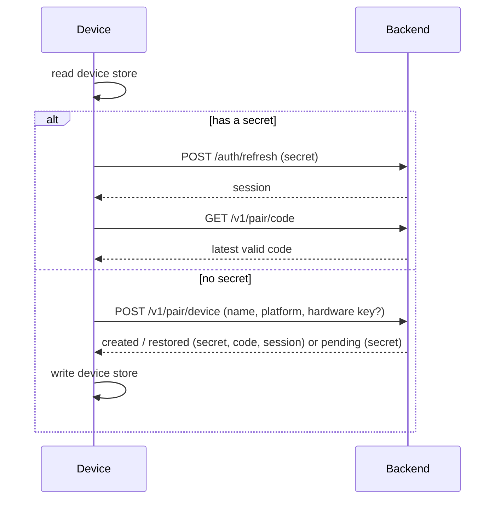
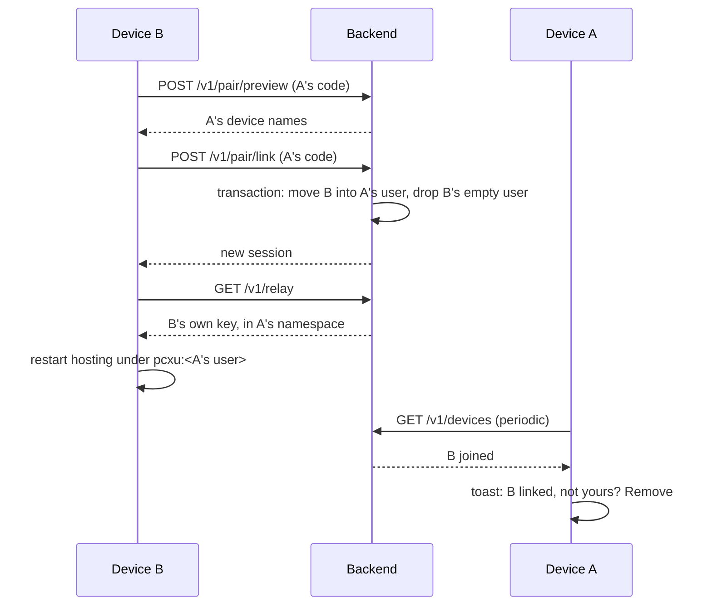

# Pairing-code login

**Status: planned, nothing here is implemented yet.** This page fixes the design
for [issue #174](https://github.com/acking-you/POCOX/issues/174) before any code
lands. Once a stage ships, its section becomes the rules a change must keep.

Pairing makes a device usable without GitHub or any other account. The backend
gives each device its own code, and devices linked by those codes count as one
user. The two GitHub sign-ins and self-hosted relays keep working as they are.

## Decisions

| Question | Decision |
| --- | --- |
| Who issues a code? | The backend, one code per device. It is long-lived, not a one-time invitation. |
| How does a device find its code? | Opening sign-in fetches its latest valid code. A device without one gets one automatically. |
| What does linking do? | Device B enters device A's code, sees A's device names, confirms and moves into A's user. Either code then links a further device. |
| What is a user? | The set of linked devices. There is no profile, email or password. |
| Rotation | Available, at least 24 hours after the code was last issued. The old code dies at once, and existing links are unaffected. |
| A leaked code during the wait | A pause switch stops linking with this code at once, with no waiting period. |
| Reinstalling | Keeps the same code. See [device identity](#device-identity). |
| Removal | Any member can remove any device. It returns to being a single-device user, keeps its code, and the others do not reconnect. |
| Already linked to others | Leaving is explicit. Two groups never merge. |
| Everything lost | Any remembered valid code brings a new device back to that user. There is no separate recovery code. |

## Terms

```text
user          device_users row     the linked set; owns one relay namespace and pcxu:<id>
└ device      devices row          owns one code, one secret, one relay key
  └ installation  (existing hostId)  a hosting identity, unchanged
```

A *device* is a machine (or phone) under one OS account. An *installation* is the
existing [hosting identity](remote-device-management.md#several-instances-on-one-computer):
one device may hold several, such as the desktop app and a CLI host, and they keep
their own service keys.

## Device identity

Two things identify a device. The **device secret** is what proves it on every
request. The **hardware key** only finds its row again after the secret is lost.

### The device secret

A random 256-bit `pcxd1_…` value issued with the device. The backend stores its
SHA-256. It does not rotate on refresh, so a lost response can never lock a device
out, which is the failure mode of rotating refresh tokens.

It lives in the **device store**, which is one per OS account and outside anything
an uninstall removes, then is copied to `[account].refresh_token`. That copy keeps
the refresh, redaction and session code in `engine/account.rs` as it is. When a
refresh answers 401, the client re-reads the store and retries once, which is how
the app and a CLI on one account follow each other.

| Platform | Device store | Survives an app reinstall |
| --- | --- | --- |
| iOS | Keychain, `kSecAttrAccessibleAfterFirstUnlockThisDeviceOnly` | In practice yes; [Apple does not promise it](https://developer.apple.com/forums/thread/36442?page=2) |
| Android | App-private file, excluded from Auto Backup | No, wiped with the app; the hardware key restores it |
| macOS, Windows, Linux, WSL | `0600` file under the user's data directory, not under the app's bundle-named folder | Yes |

`device/store.rs` in `pocox-core` reuses the private-file and atomic-write helpers
of `device/identity.rs`, keyed by OS environment and backend, because each backend
has its own devices. An unreadable store is an error, never a silent new device.

### The hardware key

```text
hardware_key = HMAC-SHA256(key = raw_id,
                           msg = "pocox.device.v1" | source | os_account | POCOX_DEVICE_SCOPE)
```

The raw identifier never leaves the device, following
[systemd's rule for machine IDs](https://www.freedesktop.org/software/systemd/man/latest/machine-id.html),
and the backend stores only `HMAC(pairing_secret, hardware_key)`. `os_account` keeps
two accounts on one machine apart. `POCOX_DEVICE_SCOPE`, normally empty, gives a
second identity on one computer, which local two-device tests need.

| Platform | Source | Scope | Lost when |
| --- | --- | --- | --- |
| Android 8+ | [`ANDROID_ID`](https://developer.android.com/reference/android/provider/Settings.Secure#ANDROID_ID) | `app`: signing key, user and device | Factory reset or a new signing key |
| macOS | `IOPlatformUUID`, from `ioreg` | `machine` | Never; it survives an OS reinstall and a resale |
| Windows | SMBIOS UUID, or `MachineGuid` where firmware reports a placeholder | `machine` | Board replacement, or OS reinstall on the fallback |
| iOS | None exists; `identifierForVendor` resets with the last app | none | Keychain loss makes a new device |
| Android 7 and older | None; the value is shared with other apps | none | Reinstall makes a new device |
| Linux, WSL, containers | None | none | Data directory loss makes a new device |

Rejected values: empty, all zeros, all `F`, and the common firmware placeholder
`03000200-0400-0500-0006-000700080009`. The key is read only while no secret exists,
never on an ordinary start, and adds no dependency.

**The hostname is not in the key.** It becomes the default device name and nothing
more: a rename or a DHCP-assigned macOS name would otherwise create a new device,
and a hostname adds no secrecy.

**Linux has no hardware key** because `/etc/machine-id` is world-readable, so
another account on a shared server could claim the device and reach the agents it
hosts. It also regenerates on an OS reinstall and is often cloned or empty in VMs
and containers, so it would only help after a deleted data directory. The hardware
UUID in `/sys/class/dmi/id/product_uuid` needs root. A reinstalled binary keeps the
code through the device store; a reinstalled Linux system gets a new one.

### Restore rules

A hardware key is not a secret: every local account can read `IOPlatformUUID`, and
it survives the sale of a Mac. So it restores the device and its code, but on a
machine-scoped key it does not by itself reach linked devices.

`POST /v1/pair/device` decides:

| Case | Result |
| --- | --- |
| No key, unknown key | New device and single-device user; an unknown key is bound to it. |
| Known `app` key, or `machine` key on a device with no peers | **Restored.** Same device, code and user. A new secret replaces the old one, and the old relay key is revoked. |
| Known `machine` key on a device with peers | **Pending.** Nothing changes yet. The response carries a pending secret and reveals no code, names or count. |
| `intent: retake` that restores directly | As restored, and the code rotates at once with no waiting period. |
| `intent: fresh` | New device with no key bound, so the old row keeps its binding. Cancels this client's pending request. |

A pending device becomes restored when a peer allows it or when it enters a peer's
current code; a peer's denial clears the request. The request expires after 7 days.
Removed devices stay bound to their own single-device row, so a reinstall never
brings one back into the group it left.

A replaced secret answers 401 `device_superseded`. That installation shows a choice
instead of restoring itself: take the device back, or start as a new device. This
is what stops two clones of one machine from taking turns, and it tells the real
owner if someone else did it. Taking back rotates the code, because whoever
restored the device saw it.

## Flows





Link is idempotent and safe under races: a repeat from the same user is a success,
and two devices entering each other's codes serialize into one user. A failed
`/v1/relay` after a link is retried and loses nothing, because the database, not the
relay, decides membership.

## Backend

### Tables

Migration `0004_pairing.sql`, in new tables, because `users.github_id` is
`NOT NULL UNIQUE` and GitHub accounts must not change.

```sql
CREATE TABLE device_users (
    id              TEXT PRIMARY KEY NOT NULL,  -- pcxu:<id>
    relay_namespace INTEGER,                    -- set with the first key, then fixed
    created_at      INTEGER NOT NULL
) STRICT;

CREATE TABLE devices (
    id                   TEXT PRIMARY KEY NOT NULL,
    user_id              TEXT NOT NULL REFERENCES device_users(id),  -- linking changes this
    label                TEXT NOT NULL,
    platform             TEXT NOT NULL,
    hardware_key         BLOB UNIQUE,            -- HMAC; NULL when there is none
    hardware_scope       TEXT,                   -- 'app' or 'machine'
    secret_hash          BLOB NOT NULL UNIQUE,   -- SHA-256 of the device secret
    previous_secret_hash BLOB,                   -- answers device_superseded
    pending_secret_hash  BLOB,                   -- awaits a peer's confirmation
    pending_at           INTEGER,
    code_generation      INTEGER NOT NULL,
    code_lookup          BLOB NOT NULL UNIQUE,   -- HMAC of the code
    code_issued_at       INTEGER NOT NULL,       -- starts the 24-hour wait
    linking_paused       INTEGER NOT NULL DEFAULT 0,
    relay_key_id         INTEGER,
    joined_at            INTEGER NOT NULL,       -- drives the "just joined" notice
    last_active_day      INTEGER NOT NULL        -- day precision on purpose
) STRICT;

CREATE TABLE retired_codes (                     -- answers "retired" for 7 days
    code_lookup BLOB PRIMARY KEY NOT NULL,
    retired_at  INTEGER NOT NULL
) STRICT;
```

### Codes

12 Crockford Base32 characters (60 bits), shown as `K7M2-F9QX-3RTB`. Input ignores
case and dashes and folds `I`, `L` to `1` and `O` to `0`. The QR payload is
`pocox://pair?c=K7M2F9QX3RTB`.

```text
code        = crockford(HMAC(pairing_secret, "code"   | device_id | generation))[..12]
code_lookup =           HMAC(pairing_secret, "lookup" | code)
```

A code is derived, so its plaintext is never stored and a generation always gives
the same one, which is how a device finds its latest code at any time. A collision
on `code_lookup` bumps the generation. `POCOX_PAIRING_SECRET` follows the checks on
`jwt_secret`; changing it invalidates every code. With it unset, the pairing routes
answer 404 and a deployment stays GitHub-only.

### API

Routes are additive. Device sessions reuse `/auth/refresh` and the JWT.

| Route | Auth | Behaviour |
| --- | --- | --- |
| `POST /v1/pair/device` | IP limit | Create or restore, per [the rules](#restore-rules). Returns `created`, `restored` or `pending`. |
| `POST /auth/refresh` | Device secret | A new JWT carrying the device's current user. 401 `device_superseded`; 403 `restore_pending`, `restore_denied`. |
| `GET /v1/pair/code` | JWT | The latest valid code, next rotation time and pause state. |
| `POST /v1/pair/code/rotate` | JWT | 429 with `retry_after` under 24 hours; else the old code moves to `retired_codes`. |
| `PATCH /v1/pair/code` | JWT | Pause or resume linking, at once. |
| `POST /v1/pair/preview` | JWT, code limit | The other user's device names, changing nothing. Errors: `code_unknown`, `code_retired`, `linking_paused`, `own_code`. |
| `POST /v1/pair/link` | JWT, code limit | Move this device, in a transaction. 409 `already_linked` with the current peers unless `leave_current` is true. |
| `POST /v1/pair/leave` | JWT | This device becomes a single-device user. |
| `POST /v1/pair/restore` | Pending secret, code limit | Confirm with a peer's current code. |
| `GET /v1/devices` | JWT | This user's devices, with last-active day, `joined_at` and `pending_restore`. |
| `PATCH /v1/devices/{id}` | JWT | Rename. |
| `DELETE /v1/devices/{id}` | JWT | Revoke its relay key and move it to a new single-device user. |
| `POST /v1/devices/{id}/restore` | JWT | Allow or deny a pending restore. |
| `GET /v1/relay` | JWT, database check | Issue by the device's current user. 401 when the token's user is stale. |

A controller polls `GET /v1/devices` every 60 seconds while in the foreground and
compares it with what it saw last. That drives the joined and restore toasts and
needs no push channel.

### Sessions

`Claims` gain an optional `did`, and `gh_id` becomes optional. A token with `did`
is checked against `devices` on each authenticated route, because a stateless JWT
would otherwise keep a moved or removed device in its old user until it expired.
`sub`, `login` and `account_id` carry the device user's id and the device's label,
so the transport layer and `pcxu:` keys need no change.

### Relay credentials

Today one account shares one key whose id is its namespace
(`crates/pocox-backend/src/credentials.rs`). Removing one device that way would
move the namespace and disconnect the others. Each paired device instead holds its
own key in its user's namespace, and only that key is revoked on removal, which the
relay enforces by closing its live connections. GitHub accounts stay on the shared
model.

**This needs a pb-mapper change first**, landed on its `master`:

- `AuthContext::namespace` reads a namespace stored with the key, defaulting to its
  id, so existing keys behave as before (`pb-mapper-auth/src/lib.rs`).
- The admin client gains `issue_key_in(namespace, ttl, label)`.
- A namespace outlives the key that named it. Key ids carry a slot generation, so a
  retired id is not reissued.

The relay must be upgraded before the backend turns pairing on. Against an older
relay, pairing routes answer 503 `relay_too_old`. Each active device uses one of the
relay's key slots (`max_temporary_keys`, 65,536 by default), and an idle device's
slot frees when its 24-hour key lapses.

### Limits

| Limit | Value |
| --- | --- |
| Failed codes per IP (`preview`, `link`, `restore`) | 5 per 10 minutes, with growing backoff |
| Failed codes, whole backend | 100 per second |
| `POST /v1/pair/device` per IP | 20 per hour |
| Rotation | Once per 24 hours per device |

Counters hold a keyed hash of the IP, in memory only. The IP comes from the
connection; `X-Forwarded-For` counts only with `POCOX_TRUST_FORWARDED_FOR`, for the
plain-TCP deployment behind a proxy.

### What the backend keeps

| Data | Why | Kept until |
| --- | --- | --- |
| Device id, name, platform, last-active day | The device list | 180 days inactive, or 30 days if never used past the first screen |
| Hashes of the secret and hardware key | Recognizing the device | The device row goes |
| Code index, generation, issue time, pause flag | Validating codes, the 24-hour wait | The device row goes |
| Index of retired codes | Saying "retired" | 7 days |
| User id, relay namespace | Treating linked devices as one user | The last device goes |
| Failure counters | Rate limits | 24 hours or a restart |

It keeps no conversation content, model keys, agent credentials, email, phone
number, raw hardware identifier or code plaintext.

## Client

| Area | Change |
| --- | --- |
| `pocox-core` | `device/hardware.rs`, `device/store.rs`; `set_account_session` takes the provider instead of hard-coding `github` (`config.rs:568`); `redact` learns `pcxd1_`. |
| `pocox-account-proto` | Wire types for the routes above. |
| `pocox-store`, `pocox-auth` | The migration and queries; a `pairing` module for codes and device sessions; `refresh` branches on the token's prefix. |
| `pocox-backend` | `api/pair.rs`, `api/devices.rs`, per-device keys, limits, `POCOX_PAIRING_SECRET`. |
| `pocox-pb` | `issue_credential_in`, wrapping the new SDK call. |
| `pocox_bridge` | `engine/pairing.rs`, `api/bridge/pairing.rs`. A link or removal follows the existing account-change path: persist, `forget_relay_credential`, restart hosting under the new key. iOS Keychain access through `security-framework`, already in the lockfile. |
| `pocox-cli` | The commands below, in [CLI](cli.md). |
| Android | A `MethodChannel` for `ANDROID_ID`, and `dataExtractionRules` that exclude the device store, so a backup never copies a device's secret to another phone. |
| Flutter | `screens/pairing/`, a reworked `account_onboarding_screen.dart`, the Account section in `settings_sections.dart`, `PocketIdentity`, l10n, `qr_flutter` and `mobile_scanner` in both pubspecs. |

```bash
pocox pair                  # show this device's code, wait for a device to link
pocox pair join             # enter another device's code (stdin for scripts, never argv)
pocox pair rotate           # error while the 24-hour wait runs
pocox pair pause            # stop linking with this code; `pair resume` undoes it
pocox pair leave            # become a single-device user
pocox devices               # list; `devices remove <id>`, `devices allow <id>`, `devices deny <id>`
```

`pocox login` stays the GitHub flow. `pocox logout` on a paired device explains
`pair leave` rather than discarding its identity.

## UI

Reference images render the real widgets and theme of the app, and are attached to
the pull request that introduced this page. Screens follow
[quiet forms](app-ui.md): explanations sit behind info marks, visible lines are state.

| Screen | Behaviour |
| --- | --- |
| First open, computer | Logo and greeting, this device's code with its QR and copy, Get started, Enter another device's code, then the two GitHub sign-ins and Advanced. |
| First open, phone | Another device's code with scan first, then This is my first device. A phone is rarely the first device. |
| Reinstalled | The same page with a Restored mark on the code and Continue. |
| Confirm | The other user's device names, then Link. Nothing changes before it. |
| Pending restore | Waiting for a peer, or enter a peer's code, or start as a new device. |
| Superseded | Take back and change code, or start as a new device. |
| Settings › Account | Identity, My devices with Add device, Pairing code (pause switch, change code with its wait), Linking (link elsewhere, switch to GitHub, leave). The code itself shows only in the Add device panel. |
| A peer's view | A toast with one action when a device joins or asks to return; Allow and Deny on a returning device's row. |

The existing `accountUseDeviceCode` label becomes "GitHub device code / GitHub 设备码",
so the word "code" on the first page always means a pairing code.

## Security

| Threat | Control | What remains |
| --- | --- | --- |
| Guessing | 60 bits and [the limits](#limits). Calculated, not measured: 1 million devices at a sustained 100 guesses per second is one hit per 365 years. | |
| A leaked code | Shown only to its own device; pause at once; rotation; the join toast; one-tap removal. | Until paused or rotated, whoever holds it can link and reach this user's devices. |
| A hardware identifier leaks, or another OS account reads it | Hashed, never sent raw; a peer must confirm on a `machine` key; no key on Linux. | On a Mac or Windows PC shared between accounts, another account can restore an **unlinked** device. It sees the code and cuts off the real owner, whose hosted services go offline with the revoked key, so it cannot reach them. The owner sees `device_superseded` and taking back retires that code. |
| A resold computer | A peer must confirm; the new owner starts as a new device; the old owner can deny and remove. | An unlinked Mac hands its code to the new owner. A previous owner who kept the code could then link to it, which raises the join toast. The row lapses after 180 days. |
| A stolen device | Any peer removes it; its key dies at once. | Its local data is out of scope. |
| A database leak | Secrets and hardware keys are hashed, codes are keyed. | The database with `POCOX_PAIRING_SECRET` derives every code. Keep them apart, like `jwt_secret`. |
| Isolation | One namespace per user, enforced by the relay; the administrator key stays in the backend. | |
| Secrets in the open | `pcxd1_` and codes never reach argv, logs or status. A code is a capability, so `pair join` reads stdin. | |

Keychain survival on iOS is observed behaviour. If Apple changes it, a reinstalled
iPhone becomes a new device and re-enters a code, with nothing lost.

## Compatibility

- Additive routes, an additive migration, and no new config field. An app that
  predates `provider = "device_code"` keeps refreshing with the copied secret.
- A GitHub session, its namespace and its services do not change, and nothing
  migrates by itself. Joining from a GitHub session or a self-hosted relay is an
  explicit confirmation, and either can be restored later.
- The first page asks the default backend for a code when it opens, before the user
  has chosen anything. A never-used row is deleted after 30 days, and the Advanced
  page can still point at another backend.

## Delivery

Each stage is its own pull request, and CI stays green between them.

| Stage | Scope | Acceptance |
| --- | --- | --- |
| 0 | This page and the identity wording | Reviewed and merged |
| 1 | pb-mapper namespace keys, then `cargo update -p pb-mapper` | Two keys in a namespace see each other; revoking one closes only its connections; old keys behave as before; a relay restart keeps it all |
| 2 | Backend tables, routes, limits | Against a real relay: distinct groups cannot list or connect across; concurrent and repeated link; restart; removal; rotation wait; every restore rule |
| 3 | Core, bridge and CLI | Two `HOME`s and `POCOX_DEVICE_SCOPE` link, host and connect; reinstall keeps the code; a moved device re-registers |
| 4 | Flutter | Real-app media for each state and theme; phone and desktop; overflow checks at large text |
| 5 | Usage, CLI, deploy docs and changelog | The relay upgrade order is documented |

## Decisions to confirm in review

Each one has a recommended default, used above. If it is rejected, only the named
part changes.

1. **The hostname stays out of the key.** Including it makes a rename a new device.
2. **Linux and WSL have no hardware key**, so an OS reinstall there gets a new code.
   Enabling `/etc/machine-id` adds the shared-server hole and gains little.
3. **A `machine` key with peers needs a peer's confirmation.** Removing this rule
   drops the pending state, and a resold Mac then rejoins its old group on its own.
4. **An unlinked Mac or Windows PC restores without confirmation**, because reinstalling
   must keep the code and there is no peer to ask. The cost is in [Security](#security).
5. **The first page requests a code as it opens.** Asking only after a click would
   give up showing the code at once.
