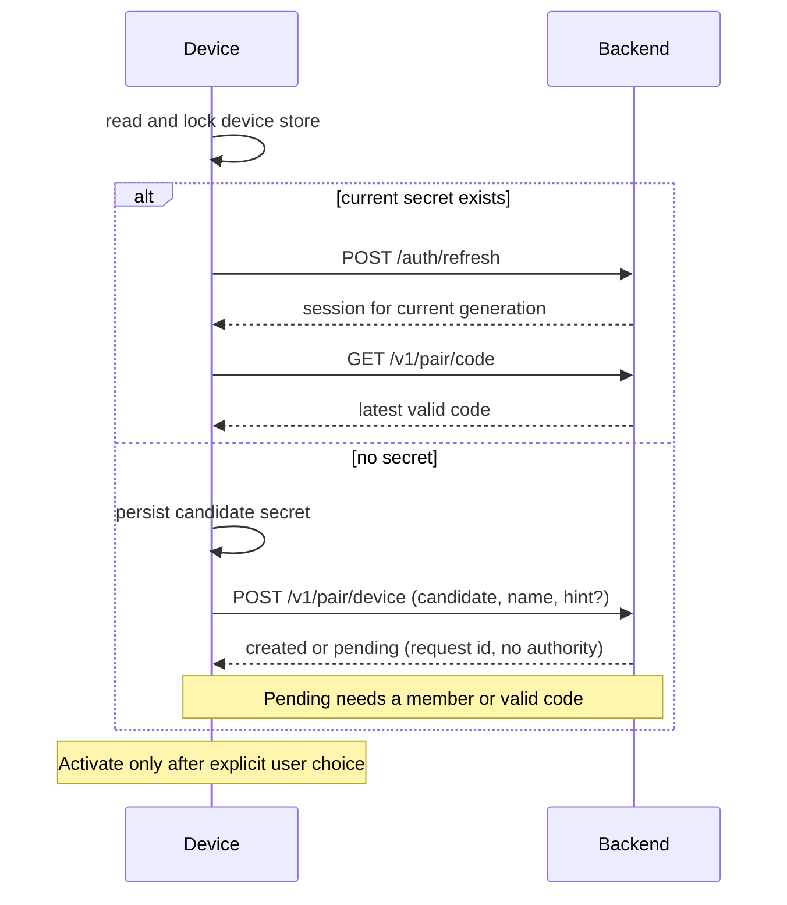

# Pairing-code login

**Status: planned, nothing here is implemented yet.** This page specifies the
design for [issue #174](https://github.com/acking-you/POCOX/issues/174). Once a stage
ships, its section becomes the rules a change must keep.

Pairing makes a device usable without GitHub or another third-party account.
The backend gives each device its own code, and devices linked by those codes
count as one user. GitHub sign-in and self-hosted relays keep their existing flows.

## Decisions

| Question | Decision |
| --- | --- |
| Who issues a code? | The backend, one long-lived code per device; not a one-time invitation. |
| How does a device find its code? | Opening sign-in prepares its latest code without changing the active account or hosting. |
| What does linking do? | B enters A's code, previews A's device names, confirms that group and moves into it. Either device can invite another. |
| What is a user? | The set of linked devices. No profile, email or password. |
| Rotation | At least 24 hours after issue. The old code dies at once; existing membership is unchanged. |
| A leaked code during the wait | Pause that code immediately. Removing an intruder alone does not prevent re-entry with a still-valid leaked code. |
| Reinstalling | Keeps the code if the device secret survives, or after authorized recovery. A hardware identifier alone never authorizes recovery. |
| Replacing a device secret | Old JWTs and old relay credentials have a fixed **10-minute** overlap, restricted as described under [Sessions](#sessions). |
| Removal or leaving | No overlap for new authorization. Revoke every relay key of the departing device and change its membership; peers retain their keys. |
| Existing connections | May continue until their endpoints close them. Revocation prevents new setups; it is not a promise to terminate an established P2P session. |
| Already linked to others | Moving only this device requires explicit confirmation. Two groups never merge. |
| Everything lost | A remembered valid, unpaused code can join its surviving group. Without a secret, a valid code or an authorized member, recovery is impossible. |

## Terms

```text
user          device_users row      linked set; owns relay namespace and pcxu:<id>
└ device      devices row           one OS-account identity and one pairing code
  ├ session generation             secret + JWT generation + relay credential
  └ installation (existing hostId)  hosting identity, unchanged
```

One device may contain the desktop app and several CLI hosting installations.
They retain their own service keys but share a pairing identity within the same
OS account, environment, backend and explicit device scope. Moving that identity
therefore affects all those installations; confirmation must say so. Hosting
state and `owner.lock` remain installation-owned.

## Device identity

The **device secret** proves authority. The optional **hardware hint** only finds
a candidate row when the secret is lost. Neither a hostname, a hardware hash nor
a client-supplied platform/scope is proof that the caller owns that device.

### The device secret and store

Use a cryptographically random 256-bit `pcxd1_…` value; store only its SHA-256 on
the backend. It does not rotate on ordinary refresh.

The client creates and durably saves a candidate secret **before** its first
create/recovery request. A retry presents that same candidate. Creation is
idempotent by its hash; after approved recovery it becomes the new device secret.
Thus a lost response, including after recovery on Linux or iOS, cannot leave a
server-generated secret that the client never received. Pending candidates have
no session or relay authority until approved.

The device store lives outside application uninstall directories where the
platform permits. It is keyed by canonical backend origin/base path, OS
environment and `POCOX_DEVICE_SCOPE`; the OS account supplies the private parent
directory. Scope must affect both the store and hardware derivation, so test
devices do not share a secret. Canonicalization must not equate different backend
paths or send credentials across redirects to another origin.

| Platform | Device store | App reinstall |
| --- | --- | --- |
| iOS | Keychain, `kSecAttrAccessibleAfterFirstUnlockThisDeviceOnly`, synchronization disabled | Usually retained; [Apple does not guarantee this](https://developer.apple.com/forums/thread/36442?page=2) |
| Android | App-private, non-backed-up storage | Wiped with the app; recovery requires confirmation or a valid code |
| macOS, Linux, WSL | Private user data directory outside the app's folder; directory `0700`, files `0600` | Retained if that directory survives |
| Windows | User profile data directory outside the app's folder; owner-restricted ACL | Retained if that directory survives |

Reuse the locking and atomic-write approach in
`crates/pocox-core/src/device/identity.rs`, with Windows replacement semantics
handled explicitly. Serialize create, recovery and replacement across processes,
and re-read under the lock. An unreadable store is an error, never a new device.
Sharing a home directory or copying a VM can copy this bearer identity; a
hardware hint cannot detect or revoke such a clone.

After the user activates pairing, copy the current secret to
`[account].refresh_token` for the existing transport code. The store is
authoritative: on `device_superseded`, re-read it and retry once with a newer
secret. Otherwise show recovery; never automatically reclaim a device in a loop.
The store retains pending and completed operation identity until local
configuration catches up with a successful server transition.

**Every copy is sensitive.** Exclude the store, pending secrets, `config.toml`
credential copies and cached JWT/relay credentials from backup and device
transfer. On Android this needs both `fullBackupContent` (Android 11 and earlier)
and `dataExtractionRules` for cloud backup and device transfer on Android 12+;
see [Android's backup rules](https://developer.android.com/identity/data/autobackup).
Excluding only the new store still clones the identity through the refresh-token
copy. A transferred device starts unauthenticated and pairs explicitly.

### The hardware hint

```text
hardware_key = HMAC-SHA256(
    key = raw_id,
    msg = encode("pocox.device.v1", source, os_account, environment,
                 canonical_backend, POCOX_DEVICE_SCOPE))
```

`encode` is an unambiguous length-prefixed UTF-8 tuple. The raw identifier never
leaves the device; the backend stores a separately domain-separated
`HMAC(pairing_secret, encode("hardware", hardware_key))`. Application-specific
derivation limits raw-identifier exposure; it does not add secrecy to a public
identifier. Backend binding prevents the same hint becoming a cross-backend
tracking identifier.

| Platform | Optional source | Limit |
| --- | --- | --- |
| Android 8+ | [`ANDROID_ID`](https://developer.android.com/reference/android/provider/Settings.Secure#ANDROID_ID) | Scoped to signing key, user and device; reset/signing changes and the documented Android 8 OTA case can change it. Not remote attestation. |
| macOS | `IOPlatformUUID` | Machine-wide, readable by other local accounts, may survive resale; not an authorization secret. |
| Windows | SMBIOS UUID, with `MachineGuid` fallback | Firmware duplicates/placeholders exist; fallback and OS-account identity may change on reinstall. |
| iOS, Android 7 and older | None | Recover with a retained secret, member confirmation or a code. |
| Linux, WSL, containers | None | The store preserves identity across binary reinstalls; losing it requires recovery. |

Reject empty, all-zero, all-`F` values and known firmware placeholders such as
`03000200-0400-0500-0006-000700080009`. Do not promise recovery across an OS
reinstall: `os_account` can change even when a machine UUID survives. Renaming
the host only changes its display name.

Read the hint only when recovering without a secret. Do not use it for locality,
routing or automatic takeover. The stored source/scope is informational;
claiming `app` scope in a request must never bypass recovery authorization.
Linux's machine-id provides little recovery benefit and is often copied in VM
images, so this design omits it.

### Restore rules

`POST /v1/pair/device` receives the persisted candidate secret and optional hint.

| Case | Result |
| --- | --- |
| Candidate already created or completed this operation | Return its existing status; only a still-current candidate can refresh. Never recreate a retired identity or restart a grace deadline. |
| No hint or unknown hint | Create a single-device user and device; bind an unknown hint. |
| Known hint, any platform, with or without peers | Create a pending recovery request. Do not replace the old secret, reveal the code or expose device names/count. |
| Pending request confirmed by a current authorized member or valid code | Replace the secret on the same device; preserve its code; apply the 10-minute overlap. |
| Explicit compromised-device recovery (`intent: retake`) | Require the same authorization, then revoke old authorization immediately and rotate the code without the 24-hour wait. |
| `intent: fresh` | Persist a new candidate and create a new device without taking the old hint binding. Cancel the prior request only with its own candidate secret. |

A pending request is authorized by the target device's current, unpaused code,
another current code in its group, or a current-generation member's approval.
Knowing the hint, an obsolete secret or a previous JWT is insufficient.
If there is no peer and no retained code/secret, offer an explicit new device,
not automatic ownership of the old device or group. Recovery that cannot locate
a row can instead create a fresh device and join using a remembered group code.

Requests have independent random ids and candidate-secret hashes. Approval/denial
names the **request id**, not just the device id, and binds the target's session
generation, group and membership revision. A replacement request cannot inherit
an earlier approval. Show a request-specific matching identifier on both devices;
names and platform labels cannot distinguish a legitimate request from an impostor.
Keep a small bounded set per target; a new unauthenticated
request cannot overwrite a legitimate pending request or revoke current access.
On completion, invalidate competing requests; on denial or expiry, polling the
same candidate returns a terminal status. Requests expire after seven days.

A device removed from a group keeps its own row/hint in a new single-device
user. Cancel its old pending requests in the same membership transition: an old
group's approval or code must not restore it into that group later.

Normal recovery is continuity, not theft remediation: anyone who already copied
the still-valid pairing code can join again. Use explicit retake/code rotation
for a suspected leak. Current installations display the replacement and the
fixed grace deadline; at expiry they stop retrying their old authorization.

## Flows



```mermaid
sequenceDiagram
    participant D as Device B
    participant S as Backend
    participant R as Relay
    D->>S: POST /v1/pair/preview (A's code)
    S-->>D: device names and short-lived preview ticket
    D->>S: POST /v1/pair/link (ticket, operation id, leave_current?)
    S->>S: validate confirmation; persist transition; block issuance
    S->>R: revoke all B's old-generation keys
    R-->>S: revoked; new setups refused
    S->>S: commit membership and new generation
    S-->>D: completed session, or pending operation to poll
    D->>D: persist; stop old owned tunnels; restart under new user
    D->>S: GET /v1/relay
    S-->>D: B's key in A's namespace
```

### Confirmation and retry boundaries

Preview returns a five-minute signed ticket bound to the caller device/session
generation and source membership revision, plus the target device, code
generation, user and membership revision. Link revalidates all of these and the
code's active/unpaused state in the committing transaction. If A moves to another
group after B previews it, return `preview_stale` and show a new preview; do not
silently follow A's code into a group B never confirmed.

Every membership mutation uses an idempotency operation id bound to its actor,
target, expected generations and confirmed destination. A duplicate reads its
result; it does not apply the mutation again. Authorize result lookup to the
actor's current secret, or the recovery candidate for that recovery. No bearer
material is returned merely for knowing an operation id. Historical results
contain status, not reusable JWTs or relay credentials; issuing a session always
rechecks that the candidate/secret is still current. Reusing an operation id with
different input fails instead of applying the new input.

A link to a different device already in the same current user is a no-op success,
including opposite-direction A/B links that race. Other stale previews fail.
Do not treat a retry of leave/remove as a request to create another new group.
Recheck actor membership when approving a restore or removing another device,
so a concurrent removal cannot authorize a later action on its former peers.

## Backend

### Persisted model

Migration `0004_pairing.sql` adds separate tables: `users.github_id` remains
`NOT NULL UNIQUE`, and existing GitHub rows/tokens are not migrated. The
implementation must persist the following ownership and state boundaries:

| Table | Required state and constraints |
| --- | --- |
| `device_users` | Unique id, fixed relay namespace, membership revision and creation time. Namespace is allocated once even under concurrent first-key requests. |
| `devices` | Id; user FK/index; label/platform; unique nullable hardware lookup; current session generation; code generation/unique lookup/issue time; pause flag; joined time; activation and last-active day; nullable pending transition id. |
| `device_sessions` | Device FK + generation as primary key; indexed secret hash; original user; state (`current`, `grace`, `revoked`); fixed nullable grace deadline. Partial unique indexes permit one current session per device and one current owner per secret hash. Membership moves preserve the hash in historical generations; replacement uses a new hash. Keep old hashes briefly to answer `device_superseded`. |
| `pair_restore_requests` | Request id; unique candidate hash; target device/group/session generation/membership revision; state; expiry. Multiple requests never overwrite each other. |
| `pair_operations` | Operation id; actor and subject; expected revisions; confirmed destination; kind; prepared/relay-applied/committed state; result and retry metadata. Never store plaintext secrets or codes. |
| `device_relay_keys` | Device/session generation, relay instance, unique full key id, namespace, grant operation id, expiry and hard cutoff/revocation state. Include every key that may still authenticate. |
| `retired_codes` | Unique code lookup and retirement time; retain seven days for `code_retired`. |
| `pairing_metadata` | Non-secret key verification value/version, to detect an accidental pairing-secret change at startup. |

Use STRICT tables, foreign keys, indexes on ownership/lookups and transactional
compare-and-set updates. Relay key ids/namespaces are `u64`: store canonical
decimal TEXT (or fixed eight-byte BLOB), not a signed SQLite INTEGER. A namespace
must not be reused for another user after all its keys expire. Device-user ids
must also be disjoint from GitHub ids used in `sub`/cache ownership.

### Codes

12 Crockford Base32 characters (60 bits), displayed as `K7M2-F9QX-3RTB`.
Ignore case and dashes; fold `I`/`L` to `1` and `O` to `0`; reject other
characters and lengths before lookup. The QR contains
`pocox://pair?c=K7M2F9QX3RTB`.

```text
code        = crockford(HMAC(pairing_secret, encode("code", device_id, generation)))[..12]
code_lookup =           HMAC(pairing_secret, encode("lookup", normalized_code))
```

Derivation lets a device retrieve its code without plaintext storage. A lookup
collision with an active or retained retired code advances the generation in the
same transaction. Rotation retires the old lookup, increments the generation and
records server time atomically. Pause and rotation also invalidate preview tickets
for that code. Server time determines the 24-hour wait.

`POCOX_PAIRING_SECRET` follows the entropy/configuration checks on `jwt_secret`.
It is independent of the JWT key. With it unset, pairing routes are disabled and
device refresh fails closed; GitHub remains available. On a populated pairing
database, changing it is **not** a harmless environment update: derived codes
would disagree with stored lookups, and hardware indexes use the old key too.
Reject a mismatched key verification value at startup. A later documented rekey
migration must handle both indexes and active/retired codes before changing it.

### API

The JWT form below distinguishes a current device session from a grace session.
All pairing mutations require a **current** device session. A GitHub JWT is never
implicitly converted to a device principal.

| Route | Auth | Behaviour |
| --- | --- | --- |
| `POST /v1/pair/device` | Candidate secret, creation limits | Idempotent creation or pending recovery; no hardware-only authorization. |
| `POST /auth/refresh` | Current device secret, or existing GitHub refresh token | Issue the appropriate session. Superseded secrets cannot mint new JWTs. |
| `GET /v1/pair/restore/{request_id}` | That request's candidate secret | Pending/denied/expired/stale/completed result; completed candidate can refresh. |
| `POST /v1/pair/activate` | Current device JWT | Explicit Get started/Continue; marks activation idempotently. |
| `GET /v1/pair/code` | Current device JWT | Own current code, next rotation time and pause state. |
| `POST /v1/pair/code/rotate` | Current device JWT, operation id | Enforce 24 hours; 429 and `retry_after` before then. |
| `PATCH /v1/pair/code` | Current device JWT | Set pause state explicitly, not a retry-sensitive toggle. |
| `POST /v1/pair/preview` | Current device JWT, code limits | Names plus preview ticket; `code_unknown`, `code_retired`, `linking_paused`, `own_code`. |
| `POST /v1/pair/link` | Current device JWT, preview ticket, operation id | Move this device; 409 `already_linked` unless the preview's source group is explicitly left. |
| `POST /v1/pair/leave` | Current device JWT, operation id | Revoke old authorization and move this device into a single-device user. |
| `POST /v1/pair/restore` | Candidate secret, request id, code limits | Confirm recovery with a current unpaused code from the bound group. |
| `GET /v1/devices` | Current device JWT | Own group's devices, last-active day, joined time and bounded pending request summaries. Never another device's code/secret. |
| `PATCH /v1/devices/{id}` | Current device JWT | Rename only a device in the caller's current user. |
| `DELETE /v1/devices/{id}` | Current device JWT, operation id | Remove only from the caller's current user; revoke every old key before completing the move. |
| `POST /v1/devices/{id}/restore` | Current device JWT, request id, operation id | Allow/deny that exact pending request in the caller's current user. |
| `GET /v1/pair/operations/{id}` | Actor's current secret or bound recovery candidate | Read that operation's pending/completed result after a lost response or stale JWT. |
| `GET /v1/relay` | Current or eligible grace device JWT | Issue only for its validated session generation; grace never obtains the current generation's key. |

Return 202 with an operation id while relay work is incomplete. Do not show
"removed" or "restored" until it completes. Foreground controllers poll devices
every 60 seconds; pending operation screens can poll their own operation with
bounded backoff. Background/headless correctness must not depend on those UI polls.

### Sessions

Add optional `did` and `dgen` claims and make `gh_id` optional, but validate
a closed set of principal forms: GitHub has `gh_id` without device claims;
pairing has both `did` and `dgen` without `gh_id`. Reject mixed or incomplete
forms. Legacy GitHub tokens keep their existing validation.

Each device-authenticated route checks the database row, user, generation,
session state and any pending transition. `sub`/`ns` refer to the device's
current user; `account_id` is that user's opaque id; `login` is display only.
Apply this to existing `/v1/me`, service listing and service deregistration as
well as the new routes. Checking only `/v1/relay` leaves other old-user access.
Authenticate a refresh against the current session first; a matching historical
hash cannot override the current row after a membership move. A pending recovery
candidate never falls through into ordinary device creation or GitHub refresh.

**Normal secret replacement allows a fixed 600-second overlap.** At preparation
time `t`, persist the retiring generation's deadline `t + 600` and cap all its
relay keys at the relay before activating the replacement. If activation takes
longer, the remaining overlap is shorter; retries never restart the clock.

During that overlap:

- An already-issued old JWT is accepted only before both its own expiry and that
  generation's deadline. Its old secret cannot refresh, and it cannot read codes,
  preview/link, approve recovery, rename/remove devices or deregister services.
- Allow `/v1/me`, `/v1/services` and access to the **same retiring generation's**
  relay key, if it still exists. Never mint another old-generation key or hand
  out a current-generation key. The backend's credential cache includes backend,
  user, device and generation; an account-only cache would leak the new key.
- The relay enforces an absolute, persistent upper bound on the old key's expiry
  and refuses new setups at that deadline. Renewals, concurrent requests, backend
  restarts and repeated restores cannot extend it. Each retiring generation
  retains its own earlier deadline.
- Existing data connections follow [the connection boundary](#connection-boundary).
  This design adds no forced teardown beyond the SDK's existing lease handling.

Leave, removal and explicit compromised-device retake have **no grace** for new
authorization: revoke all current and grace generations, invalidate old JWTs and
cancel pending requests. A moved device's current secret may obtain a new-user
JWT after completion; a superseded secret never revives. Returning later to the
same user must not make any old JWT valid again.

### Relay credentials and durable transitions

Today one GitHub account shares a key whose id is its namespace
(`crates/pocox-backend/src/credentials.rs`). Pairing needs per-device-generation
keys in one stable user namespace. GitHub retains its current shared model.

**Required pb-mapper changes, on `master`, before enabling pairing:**

- Persist a namespace on each key; default legacy keys to their existing key id.
  Only the administrator may allocate namespaces or issue keys into them.
- Add namespace-scoped issuance, stable grant-operation lookup/idempotency and
  an absolute expiry-cap operation. The cap can only shorten authority and must
  survive renewal, restart, snapshot/WAL replay and clock handling.
- Expose a capability check for these operations and namespace persistence.
  Pairing returns 503 `relay_too_old` before side effects on an older relay.
- Preserve generation-tagged key ids (already present in the pinned SDK);
  namespace allocation must not collide with legacy key-id namespaces.
- Keep per-key revocation enforced at new register/subscribe/direct-setup
  authorization boundaries over both TCP and QUIC. Existing data paths have the
  documented boundary below.

Issuance is serialized against session/membership transitions. Persist the grant
operation before calling the relay, label it with device/generation/operation,
and reconcile a lost issue response instead of blindly minting another key.
Persist every returned key id before exposing it to a client. Recover or revoke
orphan grants after a crash, including ones the relay applied before a response
or database write. Do not adopt the longest-lived old key across generations.

A link, leave, removal or restore is a durable operation, not a database
transaction pretending to include a network call:

1. Under transactional generation/revision checks, persist the operation and mark
   the subject transitioning. Block competing changes and new key issue/renewal.
2. Apply its relay action: cap retiring keys for normal recovery; revoke **all**
   previous-generation keys for leave, removal or retake. Treat an authoritative
   already-expired/revoked response as success, not a transport timeout.
3. Once confirmed, commit the destination membership/new session generation and
   result, clear the transition and allow destination issuance. Preserve the
   secret on a move; replace it only on recovery. Cancel stale recovery requests
   and bump both affected users' membership revisions.

If the relay is unavailable, retain the operation and report pending. A worker
reconciles it on restart. No destination credential is exposed while old
authorization is uncertain. Revalidate the confirmed destination before commit;
if it changed, require a new preview and leave the source membership intact
(after an already-applied revocation it can receive a fresh generation there).
Keep empty source users until no operation or potentially live old key refers
to them. Client cache clearing is not server-side revocation.

Normal key expiry remains 24 hours. Grace keys and revoked/expired tombstones
also consume capacity until the relay reclaims them; 65,536 slots is not a promise
of 65,536 simultaneous devices. Bound grant concurrency and handle capacity
errors without changing a device's namespace or falling back to an administrator
credential.

### Connection boundary

The pinned SDK explicitly lets established P2P data connections survive relay
loss and credential revocation; see
[direct connections](relay-worker-recovery.md#direct-connections).
This design accepts that behavior. The 10-minute overlap bounds **old JWT use
and new connection authorization**, not the lifetime of an established stream.

Removal prevents new relay/direct setups once its relay action completes.
A setup that raced revocation must have a defined authorization/commit boundary;
an uncommitted direct ticket must not authorize a later new session after that
boundary. Previously committed connections may remain, and a session inside one
can still send commands, read files or open application-level channels.
Relayed connections may close with the SDK key lease; uninterrupted survival is
not promised either.

UI says access for new connections was removed, rather than claiming every
session has been disconnected. To cut an established connection, stop its owning
subscription or host/service at an endpoint. Local account changes still stop
all tunnels owned by that installation, including direct ones; remote correctness
must not rely on the removed device voluntarily doing this. No new P2P restriction
or reconnection of unaffected peers is required.

### Limits and transport

| Limit | Initial value |
| --- | --- |
| Code checks per IP (`preview`, `link`, `restore`) | 5 per 10 minutes, with growing backoff |
| Code checks across the backend | 100 per second, charged before lookup |
| `POST /v1/pair/device` per IP | 20 new operations per hour; idempotent retries do not create rows |
| Pending recovery requests | At most 3 per target, plus backend-wide admission limits |
| Rotation | Once per 24 hours per device, except authorized compromised-device retake |

Also bound request bytes, label lengths, group size, preview responses, concurrent
requests, new-device admission and in-memory limiter entries. Failed-only counters
updated after lookup allow concurrent guesses to outrun the limit. Charge an
attempt atomically before expensive work; do not put raw codes into limiter keys.
Return `Retry-After` and paginate device lists. The backend-wide budget must be
shared or partitioned across replicas, not multiplied per process.

Use HTTPS for all remote pairing requests and redact request/response bodies.
Carry the socket peer address through `serve.rs` in both direct-TLS and plain
modes: the current accept loop discards it. Trust forwarding headers only from
an explicitly configured trusted proxy whose ingress is restricted and which
overwrites them. A global "trust any X-Forwarded-For" switch is insufficient.
Use keyed IP hashes in bounded counters and expire them within 24 hours.

QR scanning only parses an invitation for the configured backend; it never
executes a link. Reject unexpected schemes, hosts, extra redirect/backend
parameters and oversized input. Route `pocox://pair` separately from
`pocox://auth` so it cannot consume an OAuth callback, and always show preview
before linking. The existing Android callback activity catches the entire
`pocox` scheme and therefore needs explicit dispatch. Never log a full URI
containing a code; use no-store responses and keep codes out of status/errors.

### Retention and recovery limits

| Data | Kept until |
| --- | --- |
| Activated device, code and hardware index | 180 days without successful authenticated use/credential renewal |
| Unactivated first-screen device | 30 days after creation; merely opening/polling the code does not activate it |
| Current session hash | Device deletion or authorized replacement |
| Superseded/revoked session hashes | At least their authorization cutoff; seven-day diagnostic retention |
| Pending requests and terminal results | Seven-day expiry/diagnostic window; never delete an unresolved relay transition |
| Completed operation retry results and retired-code indexes | Seven days |
| Relay grant/revocation records | Reconciled inactive at the relay and no longer needed by a transition |
| User id and namespace | Last device and outstanding operation/grant gone; allocator never reassigns its namespace |
| Failure counters | 24 hours or process restart |

Purge follows the same revocation/transition boundary, not a blind cascade that
forgets still-valid keys. A host's successful credential renewal counts as
activity even with no foreground UI. Pausing the last available code prevents
code-based recovery; retiring it invalidates remembered copies. Once retention
deletes the last device, its code cannot recover that group. Unknown/expired
identity is shown explicitly with a choice to start anew; never silently create
a replacement group on refresh failure.

The backend keeps no conversations, model keys, agent credentials, email, phone
number, raw hardware identifiers or plaintext codes/device secrets.

## Client

| Area | Change |
| --- | --- |
| `pocox-core` | Device store/hardware-hint modules; provider-aware session persistence; redact `pcxd1_`, codes and pairing URIs; keep installation hosting identity separate. |
| `pocox-account-proto` | Pairing requests/results, principal/provider and operation states; preserve GitHub wire compatibility. |
| `pocox-store`, `pocox-auth` | Additive schema, transactional operations, code derivation and generation-aware device sessions; refresh dispatch must reject incomplete/mixed principals. |
| `pocox-backend` | Pair/device routes, common auth checks, per-generation grants, reconciliation, bounded admission, peer address propagation and pairing-key startup validation. |
| `pocox-pb` | SDK wrappers for namespace issuance, grant recovery, expiry caps and revocation capability checks. |
| `pocox_bridge` | Pairing engine/API, foreground progress and lifecycle integration; persist result, invalidate caches and stop old owned tunnels before restarting under the current generation/user. |
| `pocox-cli` | Pairing commands and shared-store coordination with the app; existing login/logout meanings preserved. |
| Native platforms | Hardware hint adapters and private storage; iOS Keychain; complete Android backup exclusions and pairing/OAuth URI dispatch. |
| Flutter | Pairing pages, onboarding and Account settings, explicit confirmations and deadline/pending states; l10n; QR display/scan dependencies in both pubspecs. |

A backend commit is authoritative even if the local response/write is lost.
Reconcile using the saved candidate or operation id on next start; do not switch
back to old hosting or replay a mutation against a different active account.
Shared-store changes are observed before issuing new authenticated work and by
long-running hosting owners, not only when a foreground page happens to poll.
Only the hosting-state lock owner may restart hosts.

```bash
pocox pair                  # show this device's code, wait for a device to link
pocox pair join             # read code interactively or from stdin, never argv
pocox pair rotate           # error while the 24-hour wait runs
pocox pair pause            # resume explicitly with: pocox pair resume
pocox pair leave            # confirm; move this device out of its group
pocox devices               # list; devices remove <id>
pocox devices allow <id> --request <request-id>
pocox devices deny <id> --request <request-id>
```

`pocox login` stays the GitHub flow. `pocox logout` clears that installation's
active account and owned connections, just as before; it does not silently leave
a group or delete the persistent device store. Resuming pairing from the retained
store is an explicit choice. Server-side device removal/retake is the action for
revoking authorization, rather than assuming local logout erased every copy.

## UI and compatibility

The original PR's widget-rendered mockups are design references, not evidence of
implemented recovery or revocation. Revise recovery, pending-operation and
expiry wording to match this document before implementation acceptance.

| Screen | Behaviour |
| --- | --- |
| First open, computer | Logo/greeting, prepared code with QR/copy, Get started, Enter another device's code, then GitHub sign-ins and Advanced. |
| First open, phone | Code entry/scan first; This is my first device remains available. |
| Retained-secret reinstall | Same code and explicit Continue. |
| Lost-secret reinstall | Pending confirmation or code entry; offer fresh identity when recovery is unavailable. No hardware-only "Restored" state. |
| Confirm link | Target group's names and explicit notice of leaving current peers/all local installations sharing this identity. Re-preview if membership changes. |
| Pending operation | Show pending relay confirmation; survive restart and allow status retry without repeating the action. |
| Superseded | Explain the fixed overlap deadline; re-read shared store, or offer authorized recovery/fresh identity. |
| Settings › Account | My devices; Add device shows the own code; pause/change code; explicit leave/switch actions. |
| Peer view | Joined/recovery notice; approve/deny the exact request. Removal explains the existing-connection boundary. |

The existing `accountUseDeviceCode` label becomes "GitHub device code / GitHub
设备码" to distinguish GitHub's flow from pairing.

Preparing a code on first open creates only an inactive candidate. It must not
call active-account setters, reset self-host settings, restart services or discard
an in-progress GitHub login. Cancel/Advanced/offline/backend errors leave those
choices usable. Use backend/account ownership checks before applying async results.

A device on GitHub/self-host enters pairing through a staged device principal,
then explicitly confirms activation. A GitHub JWT cannot call pairing mutations
as if it already had a device id. Switching to GitHub/self-host does not merge
users or revoke a GitHub account's shared relay key. Retain enough inactive
configuration to resume explicitly, and isolate it by backend.

Do not claim old clients transparently support pairing: current
`set_account_session` hard-codes `github`, refresh does not handle superseded
stores, and old clients lack generation-aware lifecycle rules. New clients keep
GitHub response compatibility; pairing requires an explicit pairing protocol
version on device refresh and pairing requests. Return 426
`pairing_client_upgrade_required` to an unsupported client presenting a pairing
secret, before side effects. Keep new pairing lifecycle state in its own store
rather than adding unknown fields to old `deny_unknown_fields` config schemas.

## Security boundaries

| Threat | Control and remaining limit |
| --- | --- |
| Guessing | 60-bit codes plus atomic admission limits. At one million active codes and 100 independent guesses/second, expected time to any hit is about 365 years; this is an estimate, not a guarantee against leaks or an excuse to omit creation limits. |
| Leaked code | Pause/rotate the invitation and remove unauthorized members. A joined member has full group authority and can remove peers; a toast is detection, not prevention. |
| Hardware leak/shared or resold computer | Hints only locate pending requests. A valid secret, code or authorized approval is required even for a single-device group. |
| Replaced secret | Old JWTs/new setups bounded by 600 seconds and original expiry; old credentials cannot obtain new-generation authority. Normal recovery preserves the code, so use retake for compromise. |
| Stolen/removed device | New authorizations revoked without grace. Established sessions and local cached data may remain; stopping the owning endpoint is needed for full disconnection. |
| Copied device store | A bearer-secret clone is indistinguishable until authorized replacement/revocation; backups must not clone credential copies. |
| Database disclosure | Hash device secrets and hardware indexes; derive codes with a separate server secret. Database plus pairing secret derives all codes. |
| Isolation | Relay namespace enforced independently of claimed service-key names; administrator credentials stay only in the backend. |

## Delivery and verification

Each stage is a separate PR. This documentation-only change does not ship the
feature, alter configuration, or warrant a release-note claim that pairing works.

| Stage | Scope | Acceptance |
| --- | --- | --- |
| 0 | Reviewed design and identity wording | Cross-check with current auth/relay/client code; document chosen 600-second overlap and surviving connections. |
| 1 | pb-mapper namespace/grant/expiry-cap support; then update the lockfile | Per-key isolation, stable namespace, expiry cap cannot be extended, crash/restart recovery, old keys unchanged; TCP and QUIC plus direct-setup boundaries. |
| 2 | Backend model, auth, routes and reconciliation | Real relay: multi-device groups, invalid principals, concurrent confirmed links, idempotent retries, lost responses and every recovery rule. |
| 3 | Core, bridge and CLI | App/CLI shared-store races, two explicit device scopes, account switches and hosting owner rules; copied/expired/superseded credentials cannot revive authority. |
| 4 | Flutter and native platforms | Real-app state/theme media, large text and phone/desktop layouts; real reinstall/backup/transfer checks and OAuth/pair URI routing. |
| 5 | Usage, CLI, deployment docs and changelog | Upgrade order, supported client versions, recovery/retention limits and existing-connection behavior documented. |

The central acceptance scenarios are:

- A retired JWT works only on grace-eligible routes just before its deadline and
  fails at/after it; its relay key cannot start a new setup then. The replacement
  stays usable. Refresh, retry, restart and successive replacements do not extend
  any earlier deadline or leak a current-generation key.
- Leave/remove/retake racing renewal or lost issue responses revokes every old
  generation before reporting completion. A backend/relay outage reports pending
  and recovers without cross-group authority or namespace changes to peers.
- An already-established P2P session may survive removal; a fresh direct setup
  cannot. Show this distinction in the UI acceptance, not a misleading
  "all connections terminated" assertion.
- A forged hint/platform/scope never grants authority; two pending requests cannot
  approve each other, and an old-group approval fails after removal. Lost create
  or restore responses are recoverable with the saved candidate.
- Preview A, move A elsewhere, then confirm: require a new preview. Repeated leave
  is a no-op result; opposite-direction singleton links converge without merging
  existing multi-device groups.
- Android backup/transfer cannot restore credentials through either the store or
  config/cache copies. Missing retained secrets require authorization. No retained
  secret/code after the retention window means explicit new identity, not a
  promise of universal reinstall recovery.
