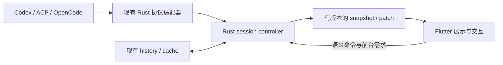

# POCOX Rust offload review — 2026-10-21

> 这是迁移前 `b2e056be` 的评审快照，下文行号、复现和验证结果属于该基线。
> 随后的执行边界、日志、会话准入与投影、附件和 Diff 实现见
> [Rust offload 落地说明](rust-offload.md)，文本与 Galaxy 的实测及迁移见
> [性能报告](rust-text-performance.md)；本文保留原始发现和分批顺序。

建议继续把协议解释、会话状态、任务调度、附件处理和诊断收拢到 Rust。收益最大的边界是“Rust 持有数据和任务，Flutter 订阅可显示的结果”，而不是把 Dart 函数逐个翻译成 Rust。

当前最值得先做的是：消除阻塞桥接与同步文件 I/O、收敛重复事件流、让 Rust 统一维护会话投影，再迁移附件流水线。Galaxy 已经下沉，仍有可消除的分配，但本次小场景计算只有约 20 µs/帧，不应抢占会话链路的优先级。

## 核对范围与证据强度

- POCOX：`b2e056be25a50cfc8854835a997a72b6b3ae00a2`，核对时与 `origin HEAD` 一致。现有未跟踪文件未改动。
- proxy-everything：本地 `19f0e18` 落后于远端；另外读取了远端 `8a0d529aeb77cf9442c5b713477718df02009d7d` 的 Git 对象，未切换分支或修改其已有工作区。对照包括 `a44d17f` 的共享原生服务、`6e099e1` 的重复序列化修正，以及最新应用代理迁移。
- 覆盖 Flutter/FRB、Codex/ACP/OpenCode 会话入口、历史与缓存、发现与恢复、附件/文件、日志、文本处理、Galaxy、更新和语音的主要职责边界。源码清点为 275 个手写 Dart 文件、约 8.4 万行；其中 `screens/app_session/` 约 2.4 万行，包含大量应该保留的 UI 代码。这不是可迁移行数，也不是逐行安全审计。
- 下文明确区分：**已复现的错误**、**源码确认的执行/数据路径**、**尚待端到端测量的收益**。没有测量手机帧率、整机 RSS 或续航，不承诺全应用加速比例。
- 本次仅新增此评审文档，未实施生产代码迁移。

proxy-everything 的直接参考：[职责审计](https://github.com/acking-you/proxy-everything/blob/8a0d529aeb77cf9442c5b713477718df02009d7d/docs/rust-ui-runtime.md)、[共享控制任务](https://github.com/acking-you/proxy-everything/blob/8a0d529aeb77cf9442c5b713477718df02009d7d/crates/proxy-ffi/src/operations.rs)、[有界日志写入](https://github.com/acking-you/proxy-everything/blob/8a0d529aeb77cf9442c5b713477718df02009d7d/crates/proxy-ffi/src/disk_log.rs)。其中布局计算的 20.4× 是特定 Windows 工作负载的局部测量，不能外推给 POCOX。

## 发现与迁移建议

以下“优先”表示工程顺序；只有明确描述错误的条目才是功能缺陷。

### 1. 优先：普通 FRB 调用仍会被慢 I/O 占住

`app_probe`、`api_probe`、历史读取、发送/停止、上传和更新下载等仍通过普通 Rust `pub fn` 进入 FRB 工作池。引擎再以 `runtime().block_on(...)` 等待网络。Dart 返回 `Future`，只说明 Dart 调用方异步，并不表示原生工作线程没有被占用。

证据：

- `crates/pocket-codex-bridge/src/api/bridge/connection.rs:61`、`:84`：探测入口。
- `crates/pocket-codex-bridge/src/engine/app_session_connection.rs:209`、`:250`：临时隧道与同步等待握手。
- `crates/pocket-codex-bridge/src/api/bridge/threads.rs:435`、`:625`：读取和停止也走普通桥接调用。
- `crates/pocket-codex-bridge/src/engine/meta_files.rs:62`：上传同步等待 HTTP，超时预算为 180 秒。
- `crates/pocket-codex-bridge/src/api/bridge/threads.rs:561`：摘要请求已经专门移出 FRB 工作池，注释明确说明避免占用 CPU 数量规模的交互工作池。这种处理尚未覆盖其他慢请求。

多个不可达服务的探测、慢上传与用户操作并发时，存在工作池排队风险；已确认共享执行路径，尚未测量现行构建中实际的 Stop 延迟。可见服务按行触发探测的入口在 `apps/flutter/lib/src/screens/services/device_browser.dart:317`。

**建议：**先把发现/探测、HTTP/WS 等待改成 Rust async 路径，在现有 runtime 上统一限流、合并同目标请求，并取消已失去需求的只读任务。保留会话写操作的串行顺序；不能为了取消 UI 请求而重发结果未知的 turn。同步文件/CPU 操作进入有并发上限的阻塞工作队列。临时使用 `spawn_blocking` 可以隔离 FRB 池，但不等于消除阻塞，也不能靠 `abort` 停止已开始的任务。参见 [FRB 并发语义](https://cjycode.com/flutter_rust_bridge/guides/concurrency) 和 [Tokio 的限制](https://docs.rs/tokio/latest/tokio/task/fn.spawn_blocking.html)。

这部分与 proxy-everything 的批量探测、共享 worker 优化最直接对应。POCOX 已使用 FRB，不需要另造一套通用 JSON/C 指针请求分发器。

### 2. 优先：有些“已在 Rust”的文件操作仍直接运行于 UI 调用线程

`meta_upload_context` 标记了 `#[frb(sync)]`，但它会锁配置、读取 `config.toml`、解析 TOML、序列化并计算摘要。附件选取随后直接同步调用它。更新的 `update_announce` 也标记为同步，内部读取和写入状态文件；`update_state` 的首次快照还可能触发磁盘恢复与签名验证。

证据：

- `crates/pocket-codex-bridge/src/api/bridge/host_sessions.rs:373` → `engine/meta_files.rs:22` → `engine/config.rs:65`。
- `apps/flutter/lib/src/screens/app_session/session_attachments.dart:411`：读取文件前同步取得上下文。
- `crates/pocket-codex-bridge/src/api/bridge/updates.rs:128` → `engine/updates/mod.rs:731`。
- `crates/pocket-codex-bridge/src/engine/updates/mod.rs:349`、`:448`：首次快照的恢复路径。

**建议：**同步接口只返回已经初始化的内存快照。附件上下文使用可验证的账户/relay/config revision；磁盘确认仍在异步上传准入阶段完成，保留现有“配置变化后不得把附件发往另一端”的约束。更新初始化和状态落盘放到 worker。不能通过删除配置复核来换取同步调用变快。

### 3. 优先：事件重复跨桥，Dart 收到完整载荷后才过滤

每次 `RustBridgeApi.appEvents(serviceKey)` 都创建新的 FRB 订阅。会话页、运行列表、语音和听写分别调用它；同一服务的正文和工具输出因而可能通过多个 sink 传给 Dart，运行列表实际上只需要少数状态事件。

Rust 已把 `Inbound.params` 解析成对象，随后又生成 `AppEvent.raw = params.to_string()`。Dart 继续从 `raw` 解析 turn id、状态、模型、问题、用量等字段。文本 delta 同时存在于 `text` 和 `raw`。原生图片结果已有专门去重，不应误称所有图片都在 raw 中重复。

证据：

- `crates/pocket-codex-bridge/src/engine/app_session_items.rs:153`、`:247`。
- `crates/pocket-codex-bridge/src/api/bridge/events.rs:125`：每个订阅独立转发。
- `apps/flutter/lib/src/bridge_api_rust.dart:268`。
- 消费者：`screens/app_session/session_recovery.dart:14`、`providers.dart:493`、`voice/voice_controller.dart:229`、`voice/dictation.dart:447`。

Rust 的 512 项 broadcast 能发现 Rust 接收端滞后，但不能把它当成 Dart 已消费消息的确认机制。当前 sink 逐条发送，没有应用级消费确认或字节预算；UI 暂停时的跨桥在途消息规模需要另测。

**建议：**Rust 一次归一化，提供类型化状态流和按 thread/topic 过滤的内容流；同一消费者只拿所需字段。文本更新按短时间窗和字节阈值合并，并保留 request/completion/reset 的顺序。先设计有界缓冲与缺口恢复，再决定批大小。旧 raw API 可暂时兼容，新 UI 不再依赖它解析正常协议字段。

只做 Dart broadcast 可以减少部分重复订阅，但会话权威状态和背压仍应在 Rust。

### 4. 优先但分阶段：会话投影由 Rust 与 Dart 双重维护

Rust 已有活动 turn、审批请求、有效配置、`LiveTranscript`、分页和磁盘缓存；Dart 又维护 `_items`、索引、实时覆盖层、历史窗口、turn 状态、恢复 epoch 和队列准入。打开历史时，需要再处理实时到达事件、补页、乐观消息与外部 writer 的竞态。

证据：

- `crates/pocket-codex-bridge/src/engine/app_session_connection.rs:61`：Rust 状态集中入口。
- `crates/pocket-codex-bridge/src/engine/app_session_live.rs:22`：有界实时正文。
- `apps/flutter/lib/src/screens/app_session/session_events.dart:686`、`:794`：再次归并事件和拼接 Dart 字符串。
- `apps/flutter/lib/src/screens/app_session/session_history.dart:85`、`:175`，`history_merge.dart:7`：行索引、实时/历史合并。
- `apps/flutter/lib/src/screens/app_session/session_recovery.dart:50`、`:520`，`session_external_writer.dart:150`：恢复和监控调度。
- `apps/flutter/lib/src/providers.dart:363`、`:451`：运行列表轮询与事件对账。

Dart 的行模型已有缓存，历史列表也已惰性渲染；不能把它描述为“每个 delta 重建全部消息”。仍存在不可变正文追加、缓存命中时遍历行来源、多个数据层保存相同正文，以及跨层状态规则重复。

**建议：**在现有 bridge engine 内增加会话 controller，复用 `SessionEngine` 的 Codex/ACP/OpenCode 适配器以及现有缓存。它拥有会话领域状态、历史/实时对账、请求准入和连接恢复；对 Flutter 输出有版本的 snapshot/patch。先迁只读投影和运行状态，再迁发送队列、未知结果与恢复规则。

对象身份至少包括账户/relay 命名空间、service、thread、connection generation 和 history generation。初始 snapshot 与后续事件必须有连续序号或明确的重置边界，避免“快照取得后、订阅前”丢事件。队列只在用户允许且原有前台/会话条件满足时推进，不能因移入长期存活的 Rust controller 就在后台自动发送。

Flutter 保留草稿编辑器、IME、选区、滚动锚点、展开状态、布局与显示时钟。可以把已提交的队列记录移入 Rust，但不能双向实时同步整个 `TextEditingController`。

### 5. 优先：附件应是一条有界 Rust 流水线

图片目前在 Dart `compute` isolate 解码、EXIF 修正、缩放、JPEG 编码，因此不是在 UI isolate 做全部解码。不过选中多图后会并发启动多条处理链，没有统一像素/解码内存预算；输出边长限制发生在完整解码之后。发送时 `ProcessedImage.dataUrl` 又在调用方同步执行 Base64。

文档附件最多 4 个、单个 32 MiB，先由 Dart `readAsBytes()` 全量读取，再跨 FRB 交给 Rust HTTP body。上传不用 Dart 才能做，但当前 Dart 仍持有并搬运整个文件。文件下载已经在 Rust 流式处理，可以沿用相同的所有权方向。

证据：

- `apps/flutter/lib/src/image_attachments.dart:49`、`:61`、`:130`。
- `apps/flutter/lib/src/screens/app_session/session_attachments.dart:60`、`:76`、`:403`。
- `apps/flutter/lib/src/attachment_refs.dart:37`：文件数与大小预算。
- `crates/pocket-codex-bridge/src/engine/meta_files.rs:40`、`:62`、`:246`。

**建议：**系统选择器仍在 Flutter；可读本地文件交 Rust 处理并上传，剪贴板或平台只提供字节的场景只跨桥一次。Rust 持有原图、处理后内容、上传任务和发送所需的编码，Flutter 仅持有附件 ID、元信息及有界预览。对本地路径、远端路径和生成图片授权保持区分，移动端 URI/沙盒授权由平台层先取得可读句柄或暂存文件。

图片可优先评估维护中的 `image` crate，使用其 [解码 limits](https://docs.rs/image/latest/image/struct.ImageReader.html#method.limits)，并额外施加格式、输入字节、像素和批量并发预算；不能仅替换库名就宣称内存有界。保持小 PNG 原样、EXIF 方向、透明底白色合成、动画首帧/原样规则及失败重试。迁移后删除对应 Dart CPU 实现，不长期维护两套生产流水线。

### 6. 优先：日志虽然在 Rust 落盘，却仍阻塞产生日志的线程

`CaptureLayer::on_event` 同步进入 `emit`，取得文件 mutex 后直接维护目录、打开文件并写入。慢盘或日志突发会把这些成本施加到网络、事件处理等日志调用线程。当前磁盘保留按小时/时间清理，没有对应的总字节预算；Rust 和 Dart 的内存缓冲各按 2,000 行限制，也没有字节上限。

同时，Dart `LogManager.record` 只写 Dart 内存，恢复过程等 controller 诊断不会经过 Rust 的磁盘 sink。UI 每 100 ms 合并刷新已经存在，但日志仍逐条跨桥，而且应用启动就订阅。

证据：`crates/pocket-codex-bridge/src/engine/logging.rs:90`、`:260`、`:297`；`apps/flutter/lib/src/log_manager.dart:55`、`:72`、`:100`。

**建议：**借鉴 proxy-everything 的有界 writer：按条数和字节预算非阻塞入队，专用写线程批量写入、轮转与 flush；溢出明确计数，写失败不能递归进入同一日志管线。Dart controller 诊断经一个小入口进入同一个源。日志页按需订阅、批量取增量，Rust 提供有界历史和导出。保持现有六小时保留语义，增加尺寸上限时明确记录新策略。

这是收益清晰、边界较小、适合作为第一批落地的改动。

### 7. 已复现的功能错误：Diff 解析不区分文件头与 hunk 正文

`DiffModel.parse` 在进入 hunk 后仍优先匹配 `--- ` 和 `+++ `。因此，删除文本 `-- old`、添加文本 `++ new` 形成的合法 diff 会被误判为新的文件标记，实际增删行和统计丢失。

复现输入：

```diff
diff --git a/file.txt b/file.txt
--- a/file.txt
+++ b/file.txt
@@ -1 +1 @@
--- old
+++ new
```

当前输出为 `paths=[file.txt], added=0, removed=0`，正确结果应为 `added=1, removed=1`。另外，`"b/a b.txt"` 这类带引号的合法路径会保留 `b/` 前缀，因为 `_strip` 在去引号之前去前缀；当前输出 `b/a b.txt`，预期 `a b.txt`。

证据：`apps/flutter/lib/src/git_diff.dart:85`、`:111`、`:115`、`:170`。现有 `git_diff_test.dart` 全通过，未覆盖这两个输入。

**建议：**把统一 diff 的结构化解析、文件路径、hunk、行号和增删统计下沉 Rust，按 diff revision 缓存；Flutter 只取概览和可见范围。迁移时修正文件头/hunk 状态与 Git 路径转义，保留已有 header-less patch 输入。选择第三方 parser 前验证这组真实格式与移动包体成本，不为解析字符串直接引入整个 libgit2 栈。

`SessionChanges.of(_items)` 还在每次 review panel 构建时重聚合；即使原始 diff 已有 LRU，文件索引和统计仍应按内容 revision 更新。见 `apps/flutter/lib/src/screens/app_session/session_review.dart:150`、`apps/flutter/lib/src/review/session_changes.dart:61`。

### 8. 第二批：Markdown、代码着色和结构化消息解析

Markdown AST 与代码 token 化仍在 Dart。已有 Markdown parse cache、highlight cache 和 20,000 字符着色上限；不应忽略这些现有优化。变化中的长回复仍会重新解析变化后的文本，结构化工具结果、问题、计划、Guardian、文件引用、IDE 上下文也有多处 Dart JSON/正则逻辑。

证据：`apps/flutter/lib/src/widgets/markdown_view.dart:125`、`:181`；`apps/flutter/lib/src/code_highlight.dart:139`、`:194`；`screens/app_session/async_questions.dart:14`；`attachment_refs.dart:59`；`ide_context.dart:159`。

**建议：**先把协议含义和结构化结果变成类型化 DTO；后续按 profile 结果迁移 Markdown block/token 化与语法 token 化。Rust 输出源文本范围和 token 类型，Flutter 继续创建 `TextSpan`、布局、选择与链接控件。不要每帧全量传输树形 AST，主题也不进入 Rust 解析缓存键。保留现有 CJK、文件链接、Markdown 扩展与不完整流式代码块行为。

需要明确 Rust UTF-8 字节偏移到 Dart UTF-16 code unit 的映射；直接把 Rust 字节偏移当作 Flutter 选区偏移会破坏中文和 emoji。

### 9. 第二批：Galaxy 已迁移，继续优化所有权和分配

场景上传只在变化时发生，输出 buffer 也复用；但每次 native frame 仍 `Scene::decode` 创建多个 `Vec`，轨道、深度排序、label placement 又产生临时向量。

证据：`crates/pocket-codex-bridge/src/engine/galaxy/ffi.rs:46`；`engine/galaxy/mod.rs:249`、`:471`、`:565`、`:822`；`apps/flutter/lib/src/tools/galaxy/galaxy_frame.dart:255`。

用现有 Rust 测试场景（3 个 system、3 个 planet、1 条 link）预分配输入/输出、预热一次后，对实际 FFI 入口执行 1,000 帧并计数：

```text
alloc/realloc: 66 次/帧
请求分配字节: 18,296 字节/帧
平均计算时间: 19.70 µs/帧
```

这是 `rustc -O` 的单机原生计算测量，带分配计数器；不包括 Dart、FFI 调用方、GPU、场景上传或真实帧时间，也不是峰值内存。

**建议：**先复用 scratch、消除轨道中间容器；如实测值得，再引入按 scene revision 更新的 native scene 生命周期。保持短而有界的 leaf 调用、输入校验和现有 parity 测试。图集、GPU 绘制、字体测量仍留 Flutter。两个项目几何布局和输出语义不同，适合复用方法，尚无依据直接共用整个 crate。

### 10. 后续收拢：低频领域规则与持久化

- 服务 key 和协议类别应由现有 Rust `ServiceId` / `NamespacedServiceId` 解析后随服务 DTO 返回，减少 Dart 同步维护种类列表。见 `apps/flutter/lib/src/service_key.dart:18`、`crates/pocket-codex-bridge/src/engine/session_engine.rs:62`。
- 项目/worktree 归并、父子会话拓扑和搜索索引可以跟随 Rust inventory revision 生成。Flutter 保留展开、用户排序与即时小列表筛选，不为每次按键把整个对象图回传。见 `apps/flutter/lib/src/project_index.dart:14`、`session_tree.dart:2`。
- 业务偏好和跨端配置的落盘可进入 Rust；主题、窗口几何等小型 UI 偏好可继续由 Flutter 持有。当前 `ui_state.json` 采用直接 `writeAsString`，若接管应保持字段格式，改为原子替换并保留已存在的写入串行/加载前修改重放语义。见 `apps/flutter/lib/src/ui_prefs.dart:395`、`:466`。

这些属于减少重复规则与改进所有权，不是已经证明的性能瓶颈。

## 建议的最终职责边界

| 领域 | Rust 持有 | Flutter / 平台层持有 |
| --- | --- | --- |
| 连接与发现 | 隧道、协议、探测批次、超时、重试、能力与连接 generation | 前后台/页面需求、错误展示、用户选择 |
| 会话 | 类型化协议事件、权威投影、历史窗口/缓存、审批与发送准入 | 展示窗口、滚动锚点、选择、展开与本地化 |
| 输入与附件 | 已提交发送记录、附件处理/暂存/上传、结果未知状态 | IME、编辑草稿、光标、系统选择器、剪贴板 |
| 内容处理 | diff、结构化消息、按需文本解析/token | `TextSpan`、字体、排版、语义和绘制 |
| 日志 | 单一源、有界队列、落盘/轮转、查询与导出 | 筛选条件、日志页与系统分享 |
| 语音 | 协议信令和服务状态可统一类型化 | `flutter_webrtc` 连接/track、平台音频焦点、权限、生命周期 |
| 更新/宿主服务/账户 | 继续使用现有 Rust 实现 | 安装器 channel、正常退出、授权 UI |
| Galaxy | 几何、排序与复用计算缓冲 | 图集、Canvas/GPU、字体测量、交互动画 |

现有 Rust 资产应继续复用：`engine/session_engine.rs`、`session_sync.rs`、`session_cache.rs`、`meta_files.rs`、`network.rs`、`updates/`，以及 host-svc 的 native history/协议适配器。宿主进程、relay、账户、工具服务、代理与更新并非等待迁移的 Dart 服务。

会话迁移的建议形态如下；图中的 controller 与 patch 是目标设计，不是当前实现：



全部放入现有 crate 的内聚模块即可起步。不要引入第二套模型运行时，也不要因减少 Dart 解析而链接 Codex runtime；继续使用本地 wire types 和外部可执行文件。

## 可直接执行的分批计划

| 批次 | 具体范围 | 核心验收 |
| --- | --- | --- |
| A：执行边界与诊断 | `api/bridge/{connection,threads,updates,host_sessions}.rs` 的慢调用；`engine/logging.rs`；`log_manager.dart` | 不可达服务批量探测期间，交互调用不等待同一批慢探测释放 FRB worker；同步 UI 桥接不做文件 I/O；日志突发不阻塞生产者，队列/字节有界且 flush 可验证 |
| B：事件与只读会话投影 | `app_session_items.rs`、`api/bridge/events.rs`、`providers.dart`、`session_events.dart`、`session_history.dart`、`history_merge.dart` | 相同事件序列在实时、缓存恢复、补页后得到相同内容；审批无丢失；旧 epoch 不覆盖新会话；闲置消费者不接收正文载荷 |
| C：附件和 diff | `image_attachments.dart`、`session_attachments.dart`、`meta_files.rs`、`git_diff.dart`、`review/session_changes.dart` | 大图/多文件峰值内存有预算；慢上传不持有整份 Dart 文件；跨账号/主机切换不误传；两例 diff 错误修复，路径和行号正确 |
| D：可写会话 controller | `session_queue.dart`、`session_send.dart`、`session_recovery.dart`、`session_external_writer.dart` | 结果未知不自动重发；重复 terminal event 不误放队列；切会话/前后台行为不变；只读视图不发起写操作 |
| E：按 profile 决定 | Markdown/highlight、项目索引、Galaxy scratch、业务偏好 | 比较完整路径 p50/p95、分配/GC 与包体；保留视觉/文本语义，不只比较 Rust 算术微基准 |

每批同时删掉被替代的 Dart 生产逻辑，保留核心边界测试；避免长期双写状态。接口变化重新生成 FRB。兼容现有持久化、主机协议和旧 API 的工作应写在对应批次，不把整体迁移压成一个大 PR。

端到端基准至少包含：长会话持续输出及跳转历史、多服务离线探测时发送/停止、批量照片与 32 MiB 文件上传、日志突发、Galaxy 典型/繁忙场景。记录 UI/raster p95、跨桥消息数和字节、Dart GC/RSS、操作等待时间与后台网络量；同时保留输入结果的 parity 校验。

## 本次验证与限制

已执行：

```sh
cd apps/flutter
fvm flutter test --no-pub test/git_diff_test.dart test/image_attachments_test.dart \
  test/history_merge_test.dart test/running_sessions_test.dart --reporter expanded
# 27 passed
fvm flutter test --no-pub test/composer_recovery_test.dart \
  test/history_monitoring_test.dart test/history_rows_test.dart --reporter expanded
# 50 passed
```

另以 `rustc --edition=2021 --test -O` 独立运行无第三方依赖的 `engine/galaxy/mod.rs` 测试：3 passed。临时 Dart 程序直接导入当前 `DiffModel` 复现上述两个错误；临时 Rust 计数程序直接调用当前 Galaxy FFI。临时探针位于 `/tmp/pocox-rust-review-20261021/`，不进入产品。

没有修改生产代码，未执行全量 workspace clippy/test、Flutter analyze、桌面构建或移动真机性能测试。77 个 Flutter 测试与 3 个纯计算测试是当前行为的局部基线，不证明迁移已经完成，也不覆盖全部平台。落地每批代码时仍需执行项目规定的检查与相应用户级验收。
